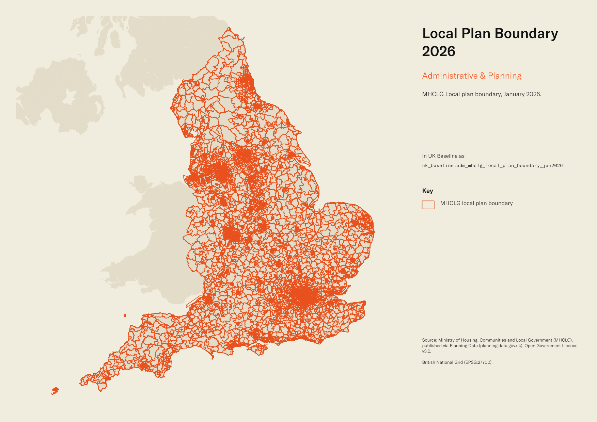
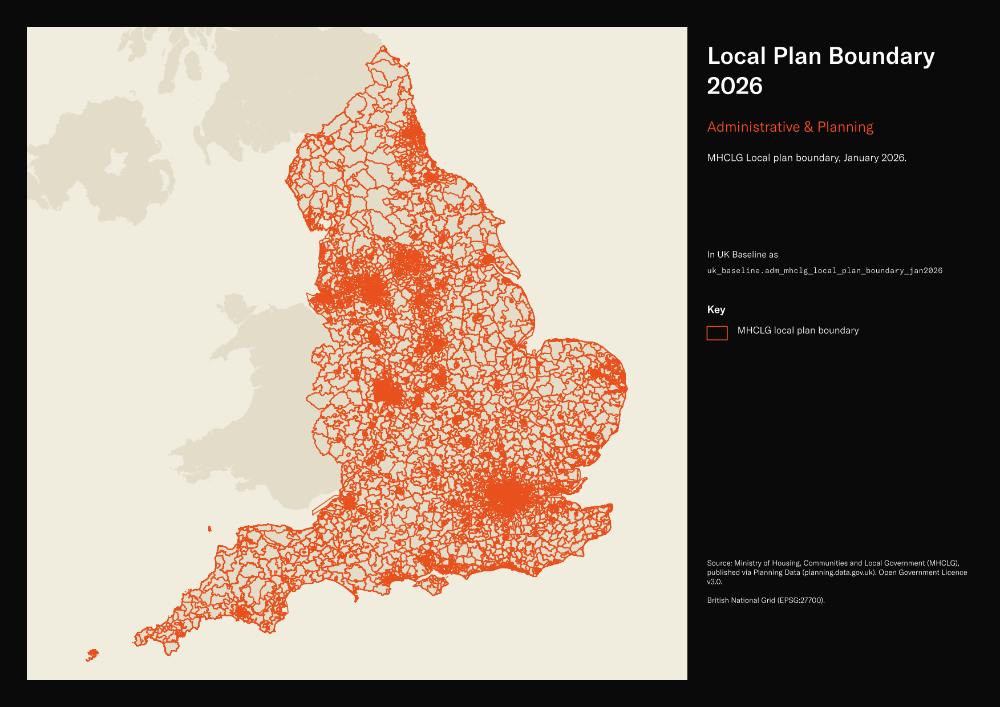

# MHCLG Local plan boundary, January 2026

Local Plan Boundary 2026

`adm_mhclg_local_plan_boundary_jan2026`<button class="md-clipboard md-icon" data-clipboard-text="adm_mhclg_local_plan_boundary_jan2026" title="Copy table name" aria-label="Copy table name" data-search-exclude></button>
{: .layer-table }

**SOURCE**
{: .sec-label }

- Ministry of Housing, Communities and Local Government (MHCLG), published via Planning Data (planning.data.gov.uk).

**DOCUMENTATION**
{: .sec-label }

- Dataset page : https://www.planning.data.gov.uk/dataset/local-plan-boundary
- Field specification : https://digital-land.github.io/specification/dataset/local-plan-boundary

**DEFINITIONS**
{: .sec-label }

- Local plan boundary is the development plan area prepared by a local planning authority.

**SCOPE**
{: .sec-label }

- England only.
- 575 polygon rows representing 364 distinct upstream entity IDs across 363 local planning authorities.

**CRS**
{: .sec-label }

- EPSG:27700 (British National Grid / BNG).

**LICENCE**
{: .sec-label }

- Open Government Licence v3.0.

**DATA QUALITY CAVEATS**
{: .sec-label }

- The row count counts split pieces, not source features: this layer was split by Middle Layer Super Output Area, so it holds one row per feature per MSOA piece, plus whole and remainder rows to keep 100% of the source geometry. 15,358 rows represent 575 source features, measured 25 August 2026. `source_fid` identifies the originating feature.
- Geography keys are NULL on 307 of 15,358 rows, measured 25 August 2026: 282 fall inside an England or Wales district and could carry one, so their keys are a gap rather than an absence; 19 are residual fragments left by the MSOA split, each under 100 sqm or 10 m; 1 are in Scotland or Northern Ireland, outside the England and Wales lookup; 5 fall outside every district — offshore, inter-tidal, or beyond Great Britain.
- County and Spatial Development Strategy columns are England and Wales only; rows elsewhere carry no county or SDS. Wales and the Isles of Scilly carry a county but no SDS. Rows with no Local Authority District code are NULL in all four columns.
- The upstream geometry is multipolygon; the loader exploded each multipolygon into single-part Polygon rows. One entity can occupy many rows (entity 4211319 has 53 parts).

**ENRICHMENT**
{: .sec-label }

- `sds_name` / `sds_group` — Spatial Development Strategy area and devolution status, a Prior + Partners categorisation over Ministry of Housing, Communities and Local Government (MHCLG) English devolution policy, joined at load on the row's Local Authority District 2025 code via uk.ref_lad25_ctyua25_sds_lu_jul2026.

**UPDATE REQUIRED**
{: .sec-label }

- New data found from data source on 18 March 2026. Current data is 9 January 2026. An update is scheduled in the next turn.

**LOADED INTO uk_baseline**
{: .sec-label }

- Loaded by PNC, January 2026.

MSOA SPLIT (added 30 June 2026)

- Geometry split to one row per (source feature x MSOA 2021). Each row carries that MSOA's msoa21cd / msoa21nm / msoa21hclnm and best-fit lad22 / lad25. The source feature's original primary key is preserved as `source_fid`; `gid` is a fresh surrogate primary key.
- Keep-everything (3 July 2026): geometry outside every MSOA — offshore, estuarine, or beyond the generalised coastline — is retained as rows with NULL geography columns (source_fid links the parts), so the layer holds the complete source geometry.

## Columns

| Column | Type | Description / unit |
|---|---|---|
| `fid` | `bigint` |  |
| `dataset` | `character varying` | Source field "dataset"; constant value "local-plan-boundary". |
| `end_date` | `character varying` | Source field "end-date"; date the boundary was retired upstream (blank if still active). All rows currently active in this load. |
| `entity` | `character varying` | Source field "entity"; numeric ID assigned by Planning Data; 364 distinct entities in this load. |
| `entry_date` | `date` | Source field "entry-date"; date this row was first published in the upstream Planning Data dataset. |
| `name` | `character varying` | Source field "name"; human-readable name of the local-plan area (e.g. "London Borough of Camden"). |
| `organisation_entity` | `character varying` | Source field "organisation-entity"; numeric ID of the publishing organisation. |
| `prefix` | `character varying` | Source field "prefix"; constant value "local-plan-boundary" (mirrors dataset). |
| `quality` | `character varying` | Source field "quality"; upstream data-quality tag (e.g. "authoritative"). |
| `reference` | `character varying` | Source field "reference"; alphanumeric identifier (often matches the LPA GSS code, e.g. "E60000188"). |
| `start_date` | `character varying` | Source field "start-date"; date the boundary became effective upstream (often blank). |
| `typology` | `character varying` | Source field "typology"; upstream taxonomy class. Constant "geography" for this dataset. |
| `organisations` | `character varying` | Source field "organisations"; ":"-delimited list of upstream organisation slugs (e.g. "local-authority:CMD"). |
| `local_planning_authorities` | `character varying` | Source field "local-planning-authorities"; LPA reference(s). |
| `msoa21cd` | `character varying` | Middle Layer Super Output Area (MSOA) 2021 code of this piece. Open Government Licence v3.0. |
| `msoa21nm` | `character varying` | Official ONS MSOA 2021 name of this piece. Open Government Licence v3.0. |
| `msoa21hclnm` | `text` | House of Commons Library readable MSOA name of this piece. Open Parliament Licence. |
| `lad22cd` | `text` | Local Authority District 2022 code (2021 LAD geography, anchored to the MSOA 2021 name scoping), best-fit from this piece's msoa21cd. Open Government Licence v3.0. |
| `lad22nm` | `text` | Local Authority District 2022 name (2021 LAD geography), best-fit from this piece's msoa21cd. Open Government Licence v3.0. |
| `lad25cd` | `text` | Local Authority District 2025 code (current administering authority), best-fit from this piece's msoa21cd. Open Government Licence v3.0. |
| `lad25nm` | `text` | Local Authority District 2025 name (current administering authority), best-fit from this piece's msoa21cd. Open Government Licence v3.0. |
| `geom` | `geometry(MultiPolygon,27700)` | Source field "geometry" (multipolygon per upstream spec; exploded to Polygon at load); EPSG:27700. |
| `source_fid` | `integer` | Primary key of the source feature in the pre-split layer uk.adm_mhclg_local_plan_boundary_jan2026__preswap_jun30 (non-unique here: a feature spanning N MSOAs has N rows). |
| `gid` | `bigint` |  |
| `ctyua25cd` | `text` | County or unitary authority code at 1 April 2025. Joined at load via uk.ref_lad25_ctyua25_sds_lu_jul2026 on the row's Local Authority District 2025 code. Open Government Licence v3.0. |
| `ctyua25nm` | `text` | County or unitary authority name at 1 April 2025. Joined at load via uk.ref_lad25_ctyua25_sds_lu_jul2026 on the row's Local Authority District 2025 code. Open Government Licence v3.0. |
| `sds_name` | `text` | Spatial Development Strategy (SDS) area, a Prior + Partners categorisation over Ministry of Housing, Communities and Local Government (MHCLG) English devolution policy. Joined at load via uk.ref_lad25_ctyua25_sds_lu_jul2026 on the row's Local Authority District 2025 code. Open Government Licence v3.0. |
| `sds_group` | `text` | Devolution status of the Spatial Development Strategy area: Existing Devolution Footprints, Devolution Priority Programme, Other Proposed Geographies or Remaining Areas. Joined at load via uk.ref_lad25_ctyua25_sds_lu_jul2026 on the row's Local Authority District 2025 code. Open Government Licence v3.0. |
| `area_ha` | `double precision` | Area in hectares of this row's own geometry, computed at load from the EPSG:27700 geometry. On layers split by Middle Layer Super Output Area this is the area of the piece inside its MSOA, not the area of the whole source feature. |
| `msoa_area_ha` | `double precision` | Area in hectares of the Middle Layer Super Output Area this row falls in, computed from uk_baseline.adm_ons_msoa_boundary_2021 — the same boundary the layer was split against. Provided as the denominator for MSOA coverage shares. NULL wherever msoa21cd is NULL. Open Government Licence v3.0. |
