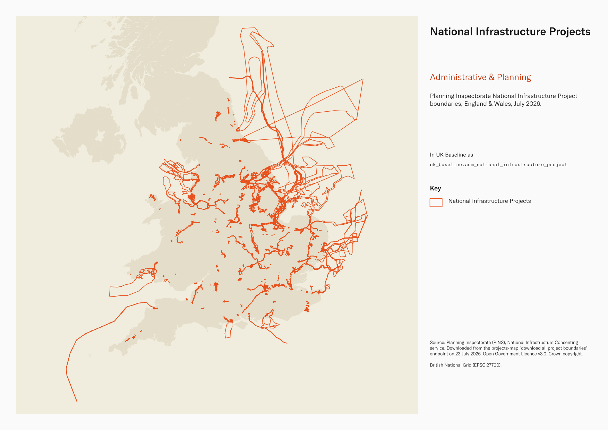

# Planning Inspectorate National Infrastructure Project boundaries, England & Wales, July 2026

National Infrastructure Projects

`adm_national_infrastructure_project`<button class="md-clipboard md-icon" data-clipboard-text="adm_national_infrastructure_project" title="Copy table name" aria-label="Copy table name" data-search-exclude></button>
{: .layer-table }

**SOURCE**
{: .sec-label }

- Planning Inspectorate (PINS), National Infrastructure Consenting service. Downloaded from the projects-map "download all project boundaries" endpoint on 23 July 2026.

**DOCUMENTATION**
{: .sec-label }

- Projects map      : https://national-infrastructure-consenting.planninginspectorate.gov.uk/projects-map
- Service home      : https://national-infrastructure-consenting.planninginspectorate.gov.uk/
- Boundary download : https://national-infrastructure-consenting.planninginspectorate.gov.uk/projects-map/download-boundaries

**DEFINITIONS**
{: .sec-label }

- Nationally Significant Infrastructure Projects (NSIP): "These are large scale projects like power stations, highways and power lines." (Planning Inspectorate, National Infrastructure Consenting service)

**SCOPE**
{: .sec-label }

- England & Wales, including offshore project envelopes. 351 boundary features across 268 distinct case references. Boundaries received between 6 September 2017 and 20 July 2026. Held here as 2,273 rows after the split by Middle Layer Super Output Area (MSOA) 2021 (see DATA QUALITY CAVEATS).

**CRS**
{: .sec-label }

- EPSG:27700 (British National Grid). Reprojected at load from EPSG:4326 (WGS 84), the source GeoJSON coordinate reference system.

**LICENCE**
{: .sec-label }

- Open Government Licence v3.0. Crown copyright.

**DATA QUALITY CAVEATS**
{: .sec-label }

- "Project boundaries and markers are approximate" (National Infrastructure Consenting projects map); not a substitute for the definitive Development Consent Order application plans.
- One source feature is one boundary submission, not one project: 351 features across 268 case references, so some projects carry more than one boundary submission.
- 13 source features (case references EN0110020, EN0110033, EN0110036, EN0110037, EN010055, EN010141, EN020009, EN0210004, EN070001, EN0710009, TR010027, TR0310002) had invalid geometry as received, mostly ring self-intersections; all 2,273 rows in this table are valid (measured 15 October 2026).
- area_ha includes large offshore envelopes (for example Dogger Bank at roughly 1.7 million hectares) and is indicative; for the 13 invalid features it is unreliable.
- No field-level data dictionary is published for this download; the four source fields are carried by their source names.
- Project boundaries overlap one another, so summing area_ha across the rows in an MSOA counts shared land more than once and can exceed the MSOA's own area. Dissolve the geometry before computing a coverage share.
- County and Spatial Development Strategy columns are England and Wales only; rows elsewhere carry no county or SDS. Wales and the Isles of Scilly carry a county but no SDS. Rows with no Local Authority District code are NULL in all four columns.
- Geometry split to one row per source feature and MSOA 2021 piece on 5 August 2026. The source feature's primary key is preserved as `source_fid` and is non-unique here: a project spanning N MSOAs has N rows. `gid` is a fresh surrogate primary key. Row count 351 before the split, 2,273 after.
- `area_ha` is the whole project's area, carried unchanged onto every piece. It is NOT the area of the piece, and summing it across rows does not give a meaningful total. It was deliberately not recomputed, because that would change a published numeric value.
- 121 rows carry no MSOA or district geography. These hold the parts of a project lying outside every MSOA, which for this layer is predominantly marine: MSOA and district boundaries stop at the coast, while offshore energy projects extend well beyond it. They account for 6,109,662 ha of the 6,745,096 ha total, so most of this layer's area sits offshore and carries no geography key by construction. 116 of the 121 touch the coastline; 5 lie wholly offshore.
- Geometry is conserved at 100.000% against the pre-split layer: the split neither gained nor lost measurable area.

**ENRICHMENT**
{: .sec-label }

- area_ha: hectares computed at load from the British National Grid geometry.
- msoa21cd, msoa21nm, msoa21hclnm, lad22cd, lad22nm, lad25cd, lad25nm from the MSOA 2021 boundary each piece falls in; ctyua25cd, ctyua25nm, sds_name, sds_group joined from the LAD 2025 lookup.
- `sds_name` / `sds_group` — Spatial Development Strategy area and devolution status, a Prior + Partners categorisation over Ministry of Housing, Communities and Local Government (MHCLG) English devolution policy, joined at load on the row's Local Authority District 2025 code via uk.ref_lad25_ctyua25_sds_lu_jul2026.

**NOT IN THIS DATASET**
{: .sec-label }

- Project stage, sector or type, applicant, key dates and documents are not in the boundary download. They are on each project page, keyed by case_reference, at the National Infrastructure Consenting service, and in the planning.data.gov.uk Nationally Significant Infrastructure Project datasets.

**LOADED INTO uk_baseline**
{: .sec-label }

- Loaded by PNC, 23 July 2026.

## Columns

| Column | Type | Description / unit |
|---|---|---|
| `source_fid` | `bigint` | Primary key of the source feature in uk_baseline.adm_national_infrastructure_project (non-unique here: a feature spanning N MSOAs has N rows). |
| `case_reference` | `text` | Source field `caseReference`. No publisher field definition; carried by source name. |
| `project_name` | `text` | Source field `projectName`. No publisher field definition; carried by source name. |
| `file_name` | `text` | Source field `fileName`. No publisher field definition; carried by source name. |
| `received_date` | `timestamp with time zone` | Source field `receivedDate`. No publisher field definition; carried by source name. Bare source dates stored at 00:00:00 UTC. |
| `area_ha` | `double precision` | Area in hectares of this row's own geometry, computed at load from the EPSG:27700 geometry. On layers split by Middle Layer Super Output Area this is the area of the piece inside its MSOA, not the area of the whole source feature. |
| `msoa21cd` | `character varying` | Middle Layer Super Output Area (MSOA) 2021 code of this piece. Open Government Licence v3.0. |
| `msoa21nm` | `character varying` | Official ONS MSOA 2021 name of this piece. Open Government Licence v3.0. |
| `msoa21hclnm` | `text` | House of Commons Library readable MSOA name of this piece. Open Parliament Licence. |
| `lad22cd` | `text` | Local Authority District 2022 code (2021 LAD geography, anchored to the MSOA 2021 name scoping), best-fit from this piece's msoa21cd. Open Government Licence v3.0. |
| `lad22nm` | `text` | Local Authority District 2022 name (2021 LAD geography), best-fit from this piece's msoa21cd. Open Government Licence v3.0. |
| `lad25cd` | `text` | Local Authority District 2025 code (current administering authority), best-fit from this piece's msoa21cd. Open Government Licence v3.0. |
| `lad25nm` | `text` | Local Authority District 2025 name (current administering authority), best-fit from this piece's msoa21cd. Open Government Licence v3.0. |
| `geom` | `geometry(MultiPolygon,27700)` | Boundary geometry, EPSG:27700 (British National Grid), MultiPolygon, reprojected at load from EPSG:4326. Source boundaries are approximate; 13 features have invalid geometry. |
| `gid` | `bigint` |  |
| `ctyua25cd` | `text` | County or unitary authority code at 1 April 2025. Joined at load via uk.ref_lad25_ctyua25_sds_lu_jul2026 on the row's Local Authority District 2025 code. Open Government Licence v3.0. |
| `ctyua25nm` | `text` | County or unitary authority name at 1 April 2025. Joined at load via uk.ref_lad25_ctyua25_sds_lu_jul2026 on the row's Local Authority District 2025 code. Open Government Licence v3.0. |
| `sds_name` | `text` | Spatial Development Strategy (SDS) area, a Prior + Partners categorisation over Ministry of Housing, Communities and Local Government (MHCLG) English devolution policy. Joined at load via uk.ref_lad25_ctyua25_sds_lu_jul2026 on the row's Local Authority District 2025 code. Open Government Licence v3.0. |
| `sds_group` | `text` | Devolution status of the Spatial Development Strategy area: Existing Devolution Footprints, Devolution Priority Programme, Other Proposed Geographies or Remaining Areas. Joined at load via uk.ref_lad25_ctyua25_sds_lu_jul2026 on the row's Local Authority District 2025 code. Open Government Licence v3.0. |
| `msoa_area_ha` | `double precision` | Area in hectares of the Middle Layer Super Output Area this row falls in, computed from uk_baseline.adm_ons_msoa_boundary_2021 — the same boundary the layer was split against. Provided as the denominator for MSOA coverage shares. NULL wherever msoa21cd is NULL. Open Government Licence v3.0. |
