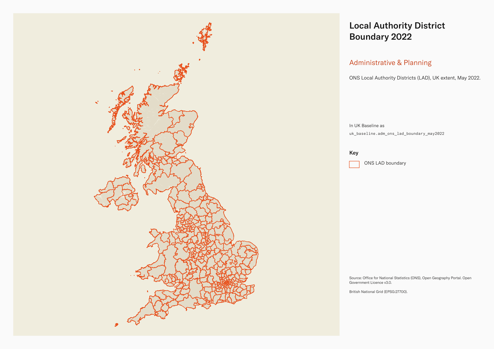
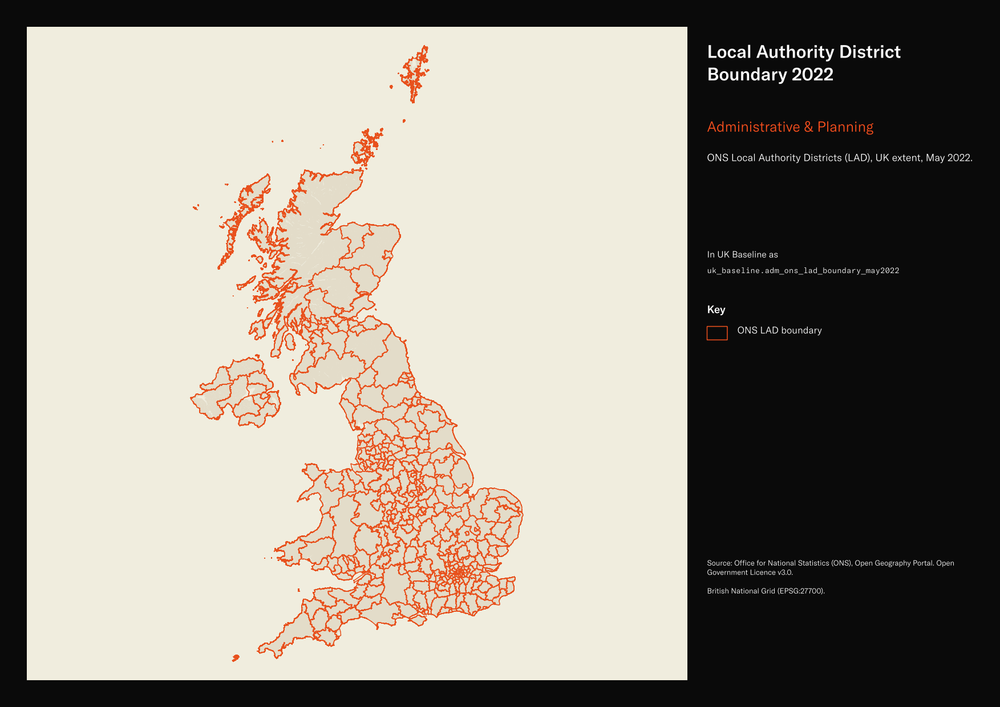

# ONS Local Authority Districts (LAD), UK extent, May 2022

Local Authority District Boundary 2022

`adm_ons_lad_boundary_may2022`<button class="md-clipboard md-icon" data-clipboard-text="adm_ons_lad_boundary_may2022" title="Copy table name" aria-label="Copy table name" data-search-exclude></button>
{: .layer-table }

**SOURCE**
{: .sec-label }

- Office for National Statistics (ONS), Open Geography Portal.

**DOCUMENTATION**
{: .sec-label }

- Dataset page : https://geoportal.statistics.gov.uk/datasets/local-authority-districts-may-2022-boundaries-uk-bfe-v3-2
- Digital boundaries methods : https://www.ons.gov.uk/methodology/geography/geographicalproducts/digitalboundaries

**DEFINITIONS**
{: .sec-label }

- Local Authority (LA) boundaries define the exact geographic limits of a council's jurisdiction.

**SCOPE**
{: .sec-label }

- United Kingdom (England, Wales, Scotland, Northern Ireland).
- 374 LADs.

**CRS**
{: .sec-label }

- EPSG:27700 (British National Grid / BNG).

**LICENCE**
{: .sec-label }

- Open Government Licence v3.0.

**DATA QUALITY CAVEATS**
{: .sec-label }

- Geography keys are NULL on 43 of 374 rows, measured 25 August 2026: 43 are in Scotland or Northern Ireland, outside the England and Wales lookup.
- County and Spatial Development Strategy columns are England and Wales only; rows elsewhere carry no county or SDS. Wales and the Isles of Scilly carry a county but no SDS. Rows with no Local Authority District code are NULL in all four columns.
- `lad25cd` and `lad25nm` cover England and Wales only; Scottish and Northern Irish rows carry no 2025 district code.

**ENRICHMENT**
{: .sec-label }

- `sds_name` / `sds_group` — Spatial Development Strategy area and devolution status, a Prior + Partners categorisation over Ministry of Housing, Communities and Local Government (MHCLG) English devolution policy, joined at load on the row's Local Authority District 2025 code via uk.ref_lad25_ctyua25_sds_lu_jul2026.

## Columns

| Column | Type | Description / unit |
|---|---|---|
| `id_original` | `integer` | ArcGIS source identifier preserved at load; not stable across ONS re-publications. |
| `lad22cd` | `character varying(9)` | Source field "LAD22CD"; ONS GSS 9-character LAD code (e.g. "E06000001" for Hartlepool). |
| `lad22nm` | `character varying(36)` | Source field "LAD22NM"; human-readable LAD name. |
| `bng_e` | `integer` | Source field "BNG_E"; British National Grid easting of LAD centroid. Unit: "metres". |
| `bng_n` | `integer` | Source field "BNG_N"; British National Grid northing of LAD centroid. Unit: "metres". |
| `long` | `double precision` | Source field "LONG"; longitude of LAD centroid. Unit: "degrees". |
| `lat` | `double precision` | Source field "LAT"; latitude of LAD centroid. Unit: "degrees". |
| `globalid` | `character varying(38)` | Source field "GlobalID"; ArcGIS GUID-format unique identifier. |
| `geom` | `geometry(MultiPolygon,27700)` | Source field "geometry"; MultiPolygon in EPSG:27700 (British National Grid). BFE = full resolution, extent of the realm — see table comment. |
| `fid` | `bigint` |  |
| `area_ha` | `double precision` | Area in hectares, computed at load from the geometry. Unit: hectares. Stale if geometry is later edited. |
| `lad25cd` | `text` | Local Authority District 2025 code (current administering authority). Traced via uk.ref_lad25_ctyua25_sds_lu_jul2026 from the row's Local Authority District 2022 code. Open Government Licence v3.0. |
| `lad25nm` | `text` | Local Authority District 2025 name (current administering authority). Traced via uk.ref_lad25_ctyua25_sds_lu_jul2026 from the row's Local Authority District 2022 code. Open Government Licence v3.0. |
| `ctyua25cd` | `text` | County or unitary authority code at 1 April 2025. Joined at load via uk.ref_lad25_ctyua25_sds_lu_jul2026 on the row's Local Authority District 2025 code. Open Government Licence v3.0. |
| `ctyua25nm` | `text` | County or unitary authority name at 1 April 2025. Joined at load via uk.ref_lad25_ctyua25_sds_lu_jul2026 on the row's Local Authority District 2025 code. Open Government Licence v3.0. |
| `sds_name` | `text` | Spatial Development Strategy (SDS) area, a Prior + Partners categorisation over Ministry of Housing, Communities and Local Government (MHCLG) English devolution policy. Joined at load via uk.ref_lad25_ctyua25_sds_lu_jul2026 on the row's Local Authority District 2025 code. Open Government Licence v3.0. |
| `sds_group` | `text` | Devolution status of the Spatial Development Strategy area: Existing Devolution Footprints, Devolution Priority Programme, Other Proposed Geographies or Remaining Areas. Joined at load via uk.ref_lad25_ctyua25_sds_lu_jul2026 on the row's Local Authority District 2025 code. Open Government Licence v3.0. |
