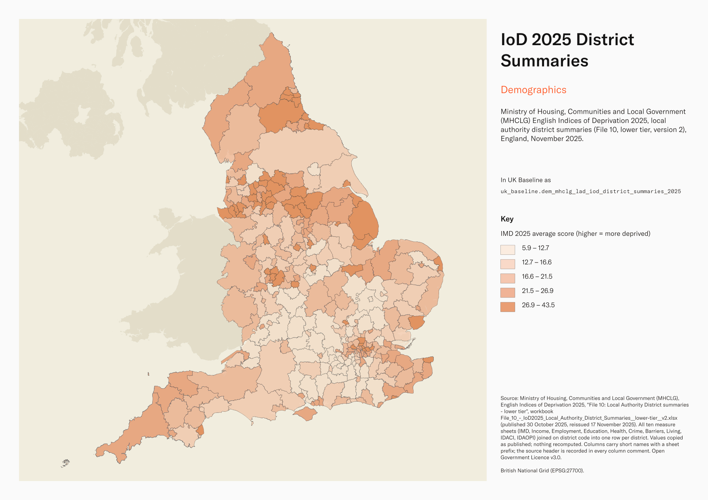
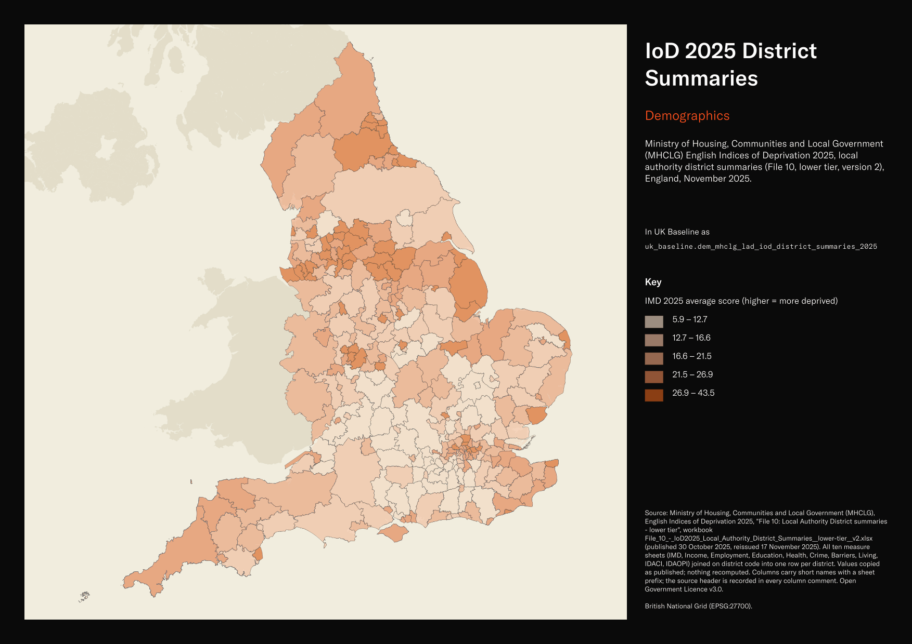

# Ministry of Housing, Communities and Local Government (MHCLG) English Indices of Deprivation 2025, local authority district summaries (File 10, lower tier, version 2), England, November 2025

IoD 2025 District Summaries

`dem_mhclg_lad_iod_district_summaries_2025`<button class="md-clipboard md-icon" data-clipboard-text="dem_mhclg_lad_iod_district_summaries_2025" title="Copy table name" aria-label="Copy table name" data-search-exclude></button>
{: .layer-table }

**SOURCE**
{: .sec-label }

- Ministry of Housing, Communities and Local Government (MHCLG), English Indices of Deprivation 2025, "File 10: Local Authority District summaries - lower tier", workbook File_10_-_IoD2025_Local_Authority_District_Summaries__lower-tier__v2.xlsx (published 30 October 2025, reissued 17 November 2025). All ten measure sheets (IMD, Income, Employment, Education, Health, Crime, Barriers, Living, IDACI, IDAOPI) joined on district code into one row per district. Values copied as published; nothing recomputed. Columns carry short names with a sheet prefix; the source header is recorded in every column comment.

**DOCUMENTATION**
{: .sec-label }

- Statistics page : https://www.gov.uk/government/statistics/english-indices-of-deprivation-2025
- Technical report : https://assets.publishing.service.gov.uk/media/68ff59c80f801e57b5bef907/ID_2025_Technical_Report.pdf

**DEFINITIONS**
{: .sec-label }

- Average score: "Population weighted average of the combined scores for the LSOAs in a larger area." (File 10 notes)
- Proportion of LSOAs in most deprived 10%: "Proportion of a larger area's LSOAs that fall in the most deprived 10% of LSOAs nationally." (File 10 notes)
- Extent: "Proportion of a larger area's population living in the most deprived LSOAs in the country." (File 10 notes) Calculation note: populations in the most deprived 10% of LSOAs receive weight 1; weights decline from 0.95 in the eleventh percentile to 0.05 in the thirtieth percentile (IoD 2025 research report, 3.3.16).
- The average rank and local concentration measures "use a reversed ranking - where 33,755 rather than 1 corresponds to the most deprived area" (IoD 2025 research report), so higher values mean greater deprivation.
- Local concentration: "Population weighted average of the ranks of a larger area's most deprived LSOAs that contain exactly 10% of the larger area's population." (File 10 notes)
- Scale: "Income Scale is the number of people who are income deprived; Employment Scale is the number of people who are employment deprived." (File 10 notes)
- Ranks: "the local authority district with a rank of 1 is the most deprived, and the area ranked 296 is the least deprived." (File 10 notes)

**SCOPE**
{: .sec-label }

- England. 296 rows, one per Local Authority District on 2024 codes ("At the time of publication, there were 296 Local Authority Districts in England"); every English district in uk_baseline.adm_ons_lad_boundary_may2024.
- Indices of Deprivation 2025; underlying indicator reference periods vary. The reference periods and sources for individual indicators are documented in Chapter 4 and Appendix A of the technical report.

**CRS**
{: .sec-label }

- EPSG:27700 (British National Grid). The source has no geometry; geometry is copied from uk_baseline.adm_ons_lad_boundary_may2024 by matching the source district code to lad24cd. No reprojection.

**LICENCE**
{: .sec-label }

- Open Government Licence v3.0.

**DATA QUALITY CAVEATS**
{: .sec-label }

- County and Spatial Development Strategy columns are England and Wales only; rows elsewhere carry no county or SDS. Wales and the Isles of Scilly carry a county but no SDS. Rows with no Local Authority District code are NULL in all four columns.
- Version 2 replaces the first release: ONS corrected an LSOA to district lookup and LSOA E01027305 (West Northamptonshire 048E) moved from Cherwell to West Northamptonshire (MHCLG page, 17 November 2025).
- District summaries are derived by MHCLG from the LSOA indices (uk_baseline.dem_mhclg_lsoa_imd_2025); they describe the pattern inside each district, not an index of the district itself. Ranks are relative: a change in rank is not a change in absolute deprivation.
- Barnsley (E08000016) and Sheffield (E08000019) carry their 2024 codes, as published.

**ENRICHMENT**
{: .sec-label }

- `sds_name` / `sds_group` — Spatial Development Strategy area and devolution status, a Prior + Partners categorisation over Ministry of Housing, Communities and Local Government (MHCLG) English devolution policy, joined at load on the row's Local Authority District 2025 code via uk.ref_lad25_ctyua25_sds_lu_jul2026.

**LOADED INTO uk_baseline**
{: .sec-label }

- Loaded by PNC, 2 November 2026.

## Columns

| Column | Type | Description / unit |
|---|---|---|
| `gid` | `bigint` |  |
| `lad24cd` | `text` | Source field `Local Authority District code (2024)`; ONS GSS district code (2024 codes, as MHCLG's header states). Matched to the boundary at load. |
| `lad24nm` | `text` | Source field `Local Authority District name (2024)`; district name as published. |
| `imd_avg_rank` | `double precision` | Source field `IMD - Average rank` on sheet IMD. Unit: population-weighted mean of reversed LSOA ranks; higher values indicate greater deprivation. |
| `imd_rank_avg_rank` | `integer` | Source field `IMD - Rank of average rank` on sheet IMD. Unit: rank, 1 = most deprived of 296. |
| `imd_avg_score` | `double precision` | Source field `IMD - Average score` on sheet IMD. Unit: dimensionless index score, calculated by MHCLG as a population-weighted mean of LSOA scores; higher values indicate greater deprivation. |
| `imd_rank_avg_score` | `integer` | Source field `IMD - Rank of average score` on sheet IMD. Unit: rank, 1 = most deprived of 296. |
| `imd_prop_lsoas_10pc` | `double precision` | Source field `IMD - Proportion of LSOAs in most deprived 10% nationally` on sheet IMD. Unit: proportion, 0 to 1. |
| `imd_rank_prop_lsoas_10pc` | `integer` | Source field `IMD - Rank of proportion of LSOAs in most deprived 10% nationally` on sheet IMD. Unit: rank, 1 = most deprived of 296. |
| `imd_extent` | `double precision` | Source field `IMD25 - Extent` on sheet IMD. Unit: weighted population proportion, 0 to 1; MHCLG's extent measure covers LSOAs in the most deprived 30% nationally. |
| `imd_rank_extent` | `integer` | Source field `IMD25 - Rank of extent` on sheet IMD. Unit: rank, 1 = most deprived of 296. |
| `imd_local_conc` | `double precision` | Source field `IMD25 - Local concentration` on sheet IMD. Unit: population-weighted mean of reversed LSOA ranks for the most deprived LSOAs containing exactly 10% of the district population; higher values indicate greater deprivation. |
| `imd_rank_local_conc` | `integer` | Source field `IMD25 - Rank of local concentration` on sheet IMD. Unit: rank, 1 = most deprived of 296. |
| `inc_avg_rank` | `double precision` | Source field `Income - Average rank` on sheet Income. Unit: population-weighted mean of reversed LSOA ranks; higher values indicate greater deprivation. |
| `inc_rank_avg_rank` | `integer` | Source field `Income - Rank of average rank` on sheet Income. Unit: rank, 1 = most deprived of 296. |
| `inc_avg_score` | `double precision` | Source field `Income - Average score` on sheet Income. Unit: proportion (0 to 1), the population-weighted mean of LSOA income-deprivation scores. |
| `inc_rank_avg_score` | `integer` | Source field `Income - Rank of average score` on sheet Income. Unit: rank, 1 = most deprived of 296. |
| `inc_prop_lsoas_10pc` | `double precision` | Source field `Income - Proportion of LSOAs in most deprived 10% nationally` on sheet Income. Unit: proportion, 0 to 1. |
| `inc_rank_prop_lsoas_10pc` | `integer` | Source field `Income - Rank of proportion of LSOAs in most deprived 10% nationally` on sheet Income. Unit: rank, 1 = most deprived of 296. |
| `inc_scale` | `double precision` | Source field `Income scale` on sheet Income. Unit: number of people experiencing income deprivation. |
| `inc_rank_scale` | `integer` | Source field `Rank of Income Scale` on sheet Income. Unit: district rank among 296 districts; 1 indicates the largest income-deprived population. |
| `emp_avg_rank` | `double precision` | Source field `Employment - Average rank` on sheet Employment. Unit: population-weighted mean of reversed LSOA ranks; higher values indicate greater deprivation. |
| `emp_rank_avg_rank` | `integer` | Source field `Employment - Rank of average rank` on sheet Employment. Unit: rank, 1 = most deprived of 296. |
| `emp_avg_score` | `double precision` | Source field `Employment - Average score` on sheet Employment. Unit: proportion (0 to 1), the population-weighted mean of LSOA employment-deprivation scores. |
| `emp_rank_avg_score` | `integer` | Source field `Employment - Rank of average score` on sheet Employment. Unit: rank, 1 = most deprived of 296. |
| `emp_prop_lsoas_10pc` | `double precision` | Source field `Employment - Proportion of LSOAs in most deprived 10% nationally` on sheet Employment. Unit: proportion, 0 to 1. |
| `emp_rank_prop_lsoas_10pc` | `integer` | Source field `Employment - Rank of proportion of LSOAs in most deprived 10% nationally` on sheet Employment. Unit: rank, 1 = most deprived of 296. |
| `emp_scale` | `double precision` | Source field `Employment scale` on sheet Employment. Unit: number of people experiencing employment deprivation. |
| `emp_rank_scale` | `integer` | Source field `Rank of Employment Scale` on sheet Employment. Unit: district rank among 296 districts; 1 indicates the largest employment-deprived population. |
| `edu_avg_rank` | `double precision` | Source field `Education, Skills and Training - Average rank` on sheet Education. Unit: population-weighted mean of reversed LSOA ranks; higher values indicate greater deprivation. |
| `edu_rank_avg_rank` | `integer` | Source field `Education, Skills and Training - Rank of average rank` on sheet Education. Unit: rank, 1 = most deprived of 296. |
| `edu_avg_score` | `double precision` | Source field `Education, Skills and Training - Average score` on sheet Education. Unit: dimensionless index score, calculated by MHCLG as a population-weighted mean of LSOA scores; higher values indicate greater deprivation. |
| `edu_rank_avg_score` | `integer` | Source field `Education, Skills and Training - Rank of average score` on sheet Education. Unit: rank, 1 = most deprived of 296. |
| `edu_prop_lsoas_10pc` | `double precision` | Source field `Education, Skills and Training - Proportion of LSOAs in most deprived 10% nationally` on sheet Education. Unit: proportion, 0 to 1. |
| `edu_rank_prop_lsoas_10pc` | `integer` | Source field `Education, Skills and Training - Rank of proportion of LSOAs in most deprived 10% nationally` on sheet Education. Unit: rank, 1 = most deprived of 296. |
| `hlth_avg_rank` | `double precision` | Source field `Health Deprivation and Disability - Average rank` on sheet Health. Unit: population-weighted mean of reversed LSOA ranks; higher values indicate greater deprivation. |
| `hlth_rank_avg_rank` | `integer` | Source field `Health Deprivation and Disability - Rank of average rank` on sheet Health. Unit: rank, 1 = most deprived of 296. |
| `hlth_avg_score` | `double precision` | Source field `Health Deprivation and Disability - Average score` on sheet Health. Unit: dimensionless index score, calculated by MHCLG as a population-weighted mean of LSOA scores; higher values indicate greater deprivation. |
| `hlth_rank_avg_score` | `integer` | Source field `Health Deprivation and Disability - Rank of average score` on sheet Health. Unit: rank, 1 = most deprived of 296. |
| `hlth_prop_lsoas_10pc` | `double precision` | Source field `Health Deprivation and Disability - Proportion of LSOAs in most deprived 10% nationally` on sheet Health. Unit: proportion, 0 to 1. |
| `hlth_rank_prop_lsoas_10pc` | `integer` | Source field `Health Deprivation and Disability - Rank of proportion of LSOAs in most deprived 10% nationally` on sheet Health. Unit: rank, 1 = most deprived of 296. |
| `crime_avg_rank` | `double precision` | Source field `Crime - Average rank` on sheet Crime. Unit: population-weighted mean of reversed LSOA ranks; higher values indicate greater deprivation. |
| `crime_rank_avg_rank` | `integer` | Source field `Crime - Rank of average rank` on sheet Crime. Unit: rank, 1 = most deprived of 296. |
| `crime_avg_score` | `double precision` | Source field `Crime - Average score` on sheet Crime. Unit: dimensionless index score, calculated by MHCLG as a population-weighted mean of LSOA scores; higher values indicate greater deprivation. |
| `crime_rank_avg_score` | `integer` | Source field `Crime - Rank of average score` on sheet Crime. Unit: rank, 1 = most deprived of 296. |
| `crime_prop_lsoas_10pc` | `double precision` | Source field `Crime - Proportion of LSOAs in most deprived 10% nationally` on sheet Crime. Unit: proportion, 0 to 1. |
| `crime_rank_prop_lsoas_10pc` | `integer` | Source field `Crime - Rank of proportion of LSOAs in most deprived 10% nationally` on sheet Crime. Unit: rank, 1 = most deprived of 296. |
| `barr_avg_rank` | `double precision` | Source field `Barriers to Housing and Services - Average rank` on sheet Barriers. Unit: population-weighted mean of reversed LSOA ranks; higher values indicate greater deprivation. |
| `barr_rank_avg_rank` | `integer` | Source field `Barriers to Housing and Services - Rank of average rank` on sheet Barriers. Unit: rank, 1 = most deprived of 296. |
| `barr_avg_score` | `double precision` | Source field `Barriers to Housing and Services - Average score` on sheet Barriers. Unit: dimensionless index score, calculated by MHCLG as a population-weighted mean of LSOA scores; higher values indicate greater deprivation. |
| `barr_rank_avg_score` | `integer` | Source field `Barriers to Housing and Services - Rank of average score` on sheet Barriers. Unit: rank, 1 = most deprived of 296. |
| `barr_prop_lsoas_10pc` | `double precision` | Source field `Barriers to Housing and Services - Proportion of LSOAs in most deprived 10% nationally` on sheet Barriers. Unit: proportion, 0 to 1. |
| `barr_rank_prop_lsoas_10pc` | `integer` | Source field `Barriers to Housing and Services - Rank of proportion of LSOAs in most deprived 10% nationally` on sheet Barriers. Unit: rank, 1 = most deprived of 296. |
| `liv_avg_rank` | `double precision` | Source field `Living Environment - Average rank` on sheet Living. Unit: population-weighted mean of reversed LSOA ranks; higher values indicate greater deprivation. |
| `liv_rank_avg_rank` | `integer` | Source field `Living Environment - Rank of average rank` on sheet Living. Unit: rank, 1 = most deprived of 296. |
| `liv_avg_score` | `double precision` | Source field `Living Environment - Average score` on sheet Living. Unit: dimensionless index score, calculated by MHCLG as a population-weighted mean of LSOA scores; higher values indicate greater deprivation. |
| `liv_rank_avg_score` | `integer` | Source field `Living Environment - Rank of average score` on sheet Living. Unit: rank, 1 = most deprived of 296. |
| `liv_prop_lsoas_10pc` | `double precision` | Source field `Living Environment - Proportion of LSOAs in most deprived 10% nationally` on sheet Living. Unit: proportion, 0 to 1. |
| `liv_rank_prop_lsoas_10pc` | `integer` | Source field `Living Environment - Rank of proportion of LSOAs in most deprived 10% nationally` on sheet Living. Unit: rank, 1 = most deprived of 296. |
| `idaci_avg_rank` | `double precision` | Source field `IDACI - Average rank` on sheet IDACI. Unit: population-weighted mean of reversed LSOA ranks; higher values indicate greater deprivation. |
| `idaci_rank_avg_rank` | `integer` | Source field `IDACI - Rank of average rank` on sheet IDACI. Unit: rank, 1 = most deprived of 296. |
| `idaci_avg_score` | `double precision` | Source field `IDACI - Average score` on sheet IDACI. Unit: proportion (0 to 1), the population-weighted mean of LSOA Income Deprivation Affecting Children Index scores. |
| `idaci_rank_avg_score` | `integer` | Source field `IDACI - Rank of average score` on sheet IDACI. Unit: rank, 1 = most deprived of 296. |
| `idaci_prop_lsoas_10pc` | `double precision` | Source field `IDACI - Proportion of LSOAs in most deprived 10% nationally` on sheet IDACI. Unit: proportion, 0 to 1. |
| `idaci_rank_prop_lsoas_10pc` | `integer` | Source field `IDACI - Rank of proportion of LSOAs in most deprived 10% nationally` on sheet IDACI. Unit: rank, 1 = most deprived of 296. |
| `idaopi_avg_rank` | `double precision` | Source field `IDAOPI - Average rank` on sheet IDAOPI. Unit: population-weighted mean of reversed LSOA ranks; higher values indicate greater deprivation. |
| `idaopi_rank_avg_rank` | `integer` | Source field `IDAOPI - Rank of average rank` on sheet IDAOPI. Unit: rank, 1 = most deprived of 296. |
| `idaopi_avg_score` | `double precision` | Source field `IDAOPI - Average score` on sheet IDAOPI. Unit: proportion (0 to 1), the population-weighted mean of LSOA Income Deprivation Affecting Older People Index scores. |
| `idaopi_rank_avg_score` | `integer` | Source field `IDAOPI - Rank of average score` on sheet IDAOPI. Unit: rank, 1 = most deprived of 296. |
| `idaopi_prop_lsoas_10pc` | `double precision` | Source field `IDAOPI - Proportion of LSOAs in most deprived 10% nationally` on sheet IDAOPI. Unit: proportion, 0 to 1. |
| `idaopi_rank_prop_lsoas_10pc` | `integer` | Source field `IDAOPI - Rank of proportion of LSOAs in most deprived 10% nationally` on sheet IDAOPI. Unit: rank, 1 = most deprived of 296. |
| `geom` | `geometry(MultiPolygon,27700)` | MultiPolygon in EPSG:27700, copied at load from the boundary named in the table comment's CRS section. |
| `lad25cd` | `text` | Local Authority District 2025 code (current administering authority). Traced via uk.ref_lad25_ctyua25_sds_lu_jul2026 from the row's Local Authority District 2024 code, with Barnsley and Sheffield recoded to their 1 April 2025 codes. Open Government Licence v3.0. |
| `lad25nm` | `text` | Local Authority District 2025 name (current administering authority). Traced via uk.ref_lad25_ctyua25_sds_lu_jul2026 from the row's Local Authority District 2024 code, with Barnsley and Sheffield recoded to their 1 April 2025 codes. Open Government Licence v3.0. |
| `ctyua25cd` | `text` | County or unitary authority code at 1 April 2025. Joined at load via uk.ref_lad25_ctyua25_sds_lu_jul2026 on the row's Local Authority District 2025 code. Open Government Licence v3.0. |
| `ctyua25nm` | `text` | County or unitary authority name at 1 April 2025. Joined at load via uk.ref_lad25_ctyua25_sds_lu_jul2026 on the row's Local Authority District 2025 code. Open Government Licence v3.0. |
| `sds_name` | `text` | Spatial Development Strategy (SDS) area, a Prior + Partners categorisation over Ministry of Housing, Communities and Local Government (MHCLG) English devolution policy. Joined at load via uk.ref_lad25_ctyua25_sds_lu_jul2026 on the row's Local Authority District 2025 code. Open Government Licence v3.0. |
| `sds_group` | `text` | Devolution status of the Spatial Development Strategy area: Existing Devolution Footprints, Devolution Priority Programme, Other Proposed Geographies or Remaining Areas. Joined at load via uk.ref_lad25_ctyua25_sds_lu_jul2026 on the row's Local Authority District 2025 code. Open Government Licence v3.0. |
| `census_2021_population` | `integer` | Census 2021 usual residents of this area: ONS Census 2021 TS001 "Number of usual residents in households and communal establishments", Census Day 21 March 2021, joined on lad24cd from uk_new.ref_census21_ts001_usual_residents. Unit: "Person". The four unitary authorities formed in April 2023 carry the sum of their former districts' figures. |
