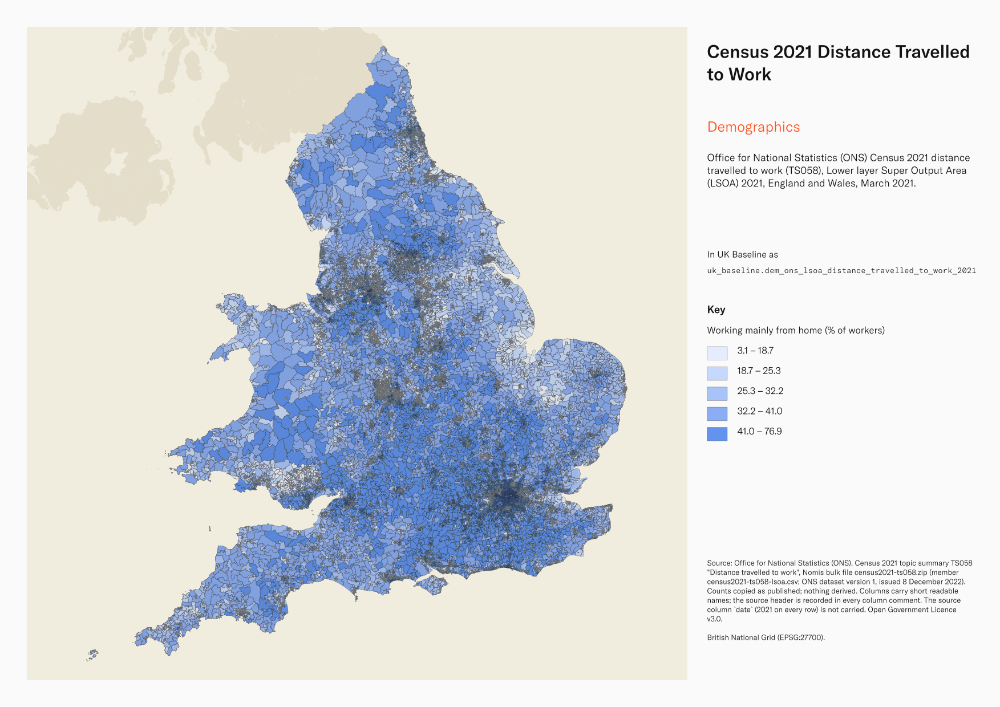
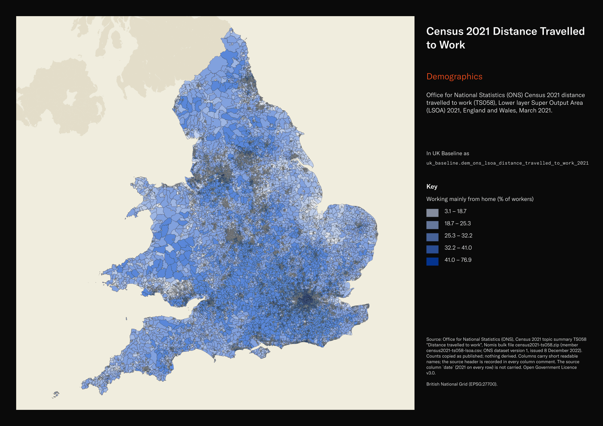

# Office for National Statistics (ONS) Census 2021 distance travelled to work (TS058), Lower layer Super Output Area (LSOA) 2021, England and Wales, March 2021

Census 2021 Distance Travelled to Work

`dem_ons_lsoa_distance_travelled_to_work_2021`<button class="md-clipboard md-icon" data-clipboard-text="dem_ons_lsoa_distance_travelled_to_work_2021" title="Copy table name" aria-label="Copy table name" data-search-exclude></button>
{: .layer-table }

**SOURCE**
{: .sec-label }

- Office for National Statistics (ONS), Census 2021 topic summary TS058 "Distance travelled to work", Nomis bulk file census2021-ts058.zip (member census2021-ts058-lsoa.csv; ONS dataset version 1, issued 8 December 2022). Counts copied as published; nothing derived. Columns carry short readable names; the source header is recorded in every column comment. The source column `date` (2021 on every row) is not carried.

**DOCUMENTATION**
{: .sec-label }

- ONS dataset (TS058) : https://www.ons.gov.uk/datasets/TS058/editions/2021/versions/1
- Nomis bulk download : https://www.nomisweb.co.uk/sources/census_2021_bulk
- Travel to work quality information for Census 2021 : https://www.ons.gov.uk/employmentandlabourmarket/peopleinwork/employmentandemployeetypes/methodologies/traveltoworkqualityinformationforcensus2021

**DEFINITIONS**
{: .sec-label }

- "The distance, in kilometres, between a person's residential postcode and their workplace postcode measured in a straight line." (Nomis metadata, TS058)
- "Distance is calculated as the straight line distance between the enumeration postcode and the workplace postcode." (Nomis metadata, TS058)
- Works mainly from home is "made up of those that ticked either the 'Mainly work at or from home' box for the address of workplace question, or the 'Work mainly at or from home' box for the method of travel to work question." (Nomis metadata, TS058)

**SCOPE**
{: .sec-label }

- England and Wales. 35,672 rows, one per Lower layer Super Output Area (LSOA) 2021 (England 33,755; Wales 1,917): every LSOA in uk_baseline.adm_ons_lsoa_boundary_2021.
- Base population: usual residents aged 16 years and over in employment the week before the census. Census Day 21 March 2021.

**CRS**
{: .sec-label }

- EPSG:27700 (British National Grid). The source has no geometry; geometry is copied from uk_baseline.adm_ons_lsoa_boundary_2021 by matching the source code to lsoa21cd. No reprojection.

**LICENCE**
{: .sec-label }

- Open Government Licence v3.0.

**DATA QUALITY CAVEATS**
{: .sec-label }

- County and Spatial Development Strategy columns are England and Wales only; rows elsewhere carry no county or SDS. Wales and the Isles of Scilly carry a county but no SDS. Rows with no Local Authority District code are NULL in all four columns.
- ONS applied statistical disclosure control: targeted record swapping and cell key perturbation, so small counts may differ slightly between tables and between levels (Nomis metadata). Counts are not rounded.
- "As Census 2021 was during a unique period of rapid change, take care when using this data for planning purposes." (Nomis metadata, TS058 quality statement) Census Day fell during a national lockdown, so working from home is higher than usual.
- Distances are straight lines between postcodes, not route distances. "Distances over 1200km are treated as invalid, and an imputed or estimated value is added." (Nomis metadata, TS058)
- The ten categories sum exactly to total_in_employment on every row (checked at load).

**ENRICHMENT**
{: .sec-label }

- `sds_name` / `sds_group` — Spatial Development Strategy area and devolution status, a Prior + Partners categorisation over Ministry of Housing, Communities and Local Government (MHCLG) English devolution policy, joined at load on the row's Local Authority District 2025 code via uk.ref_lad25_ctyua25_sds_lu_jul2026.
- `msoa21hclnm` — House of Commons Library readable MSOA name, joined at load on lsoa21cd via the ONS 2021 output-area hierarchy (uk_baseline.adm_ons_msoa_boundary_2021). Open Parliament Licence.

**LOADED INTO uk_baseline**
{: .sec-label }

- Loaded by PNC, 2 November 2026.

## Columns

| Column | Type | Description / unit |
|---|---|---|
| `gid` | `bigint` |  |
| `lsoa21nm` | `text` | Source field `geography`; LSOA 2021 name as published. |
| `lsoa21cd` | `text` | Source field `geography code`; ONS GSS code of the LSOA 2021. Matched to the boundary at load. |
| `total_in_employment` | `integer` | Source field `Distance travelled to work: Total: All usual residents aged 16 years and over in employment the week before the census`; count of all usual residents aged 16 years and over in employment the week before the census. Unit: "Person" (Nomis metadata). |
| `dist_less_than_2km` | `integer` | Source field `Distance travelled to work: Less than 2km`; count of usual residents aged 16 and over in employment in this category. Unit: "Person" (Nomis metadata). |
| `dist_2km_to_less_than_5km` | `integer` | Source field `Distance travelled to work: 2km to less than 5km`; count of usual residents aged 16 and over in employment in this category. Unit: "Person" (Nomis metadata). |
| `dist_5km_to_less_than_10km` | `integer` | Source field `Distance travelled to work: 5km to less than 10km`; count of usual residents aged 16 and over in employment in this category. Unit: "Person" (Nomis metadata). |
| `dist_10km_to_less_than_20km` | `integer` | Source field `Distance travelled to work: 10km to less than 20km`; count of usual residents aged 16 and over in employment in this category. Unit: "Person" (Nomis metadata). |
| `dist_20km_to_less_than_30km` | `integer` | Source field `Distance travelled to work: 20km to less than 30km`; count of usual residents aged 16 and over in employment in this category. Unit: "Person" (Nomis metadata). |
| `dist_30km_to_less_than_40km` | `integer` | Source field `Distance travelled to work: 30km to less than 40km`; count of usual residents aged 16 and over in employment in this category. Unit: "Person" (Nomis metadata). |
| `dist_40km_to_less_than_60km` | `integer` | Source field `Distance travelled to work: 40km to less than 60km`; count of usual residents aged 16 and over in employment in this category. Unit: "Person" (Nomis metadata). |
| `dist_60km_and_over` | `integer` | Source field `Distance travelled to work: 60km and over`; count of usual residents aged 16 and over in employment in this category. Unit: "Person" (Nomis metadata). |
| `works_mainly_from_home` | `integer` | Source field `Distance travelled to work: Works mainly from home`; count of usual residents aged 16 and over in employment in this category. Unit: "Person" (Nomis metadata). |
| `works_offshore_no_fixed_place` | `integer` | Source field `Distance travelled to work: Works mainly at an offshore installation, in no fixed place, or outside the UK`; count of usual residents aged 16 and over in employment in this category. Unit: "Person" (Nomis metadata). |
| `geom` | `geometry(MultiPolygon,27700)` | MultiPolygon in EPSG:27700, copied at load from the boundary named in the table comment's CRS section. |
| `msoa21cd` | `text` | Middle Layer Super Output Area (MSOA) 2021 code of the row's Lower Layer Super Output Area (LSOA); LSOAs nest wholly within MSOAs. Joined at load on lsoa21cd via uk_baseline.adm_ons_lsoa_boundary_2021, then uk_baseline.adm_ons_msoa_boundary_2021. Open Government Licence v3.0. |
| `msoa21nm` | `text` | Official Office for National Statistics MSOA 2021 name of the row's Lower Layer Super Output Area (LSOA); LSOAs nest wholly within MSOAs. Joined at load on lsoa21cd via uk_baseline.adm_ons_lsoa_boundary_2021, then uk_baseline.adm_ons_msoa_boundary_2021. Open Government Licence v3.0. |
| `msoa21hclnm` | `text` | House of Commons Library readable MSOA name of the row's Lower Layer Super Output Area (LSOA); LSOAs nest wholly within MSOAs. Joined at load on lsoa21cd via uk_baseline.adm_ons_lsoa_boundary_2021, then uk_baseline.adm_ons_msoa_boundary_2021, which carries the House of Commons Library name. Open Parliament Licence. |
| `lad22cd` | `text` | Local Authority District 2022 code (2021 LAD geography, anchored to the MSOA 2021 name scoping), best-fit assigned from the row's Lower Layer Super Output Area (LSOA); LSOAs nest wholly within MSOAs. Joined at load on lsoa21cd via uk_baseline.adm_ons_lsoa_boundary_2021, then uk_baseline.adm_ons_msoa_boundary_2021. Open Government Licence v3.0. |
| `lad22nm` | `text` | Local Authority District 2022 name (2021 LAD geography), best-fit assigned from the row's Lower Layer Super Output Area (LSOA); LSOAs nest wholly within MSOAs. Joined at load on lsoa21cd via uk_baseline.adm_ons_lsoa_boundary_2021, then uk_baseline.adm_ons_msoa_boundary_2021. Open Government Licence v3.0. |
| `lad25cd` | `text` | Local Authority District 2025 code (current administering authority), best-fit assigned from the row's Lower Layer Super Output Area (LSOA); LSOAs nest wholly within MSOAs. Joined at load on lsoa21cd via uk_baseline.adm_ons_lsoa_boundary_2021, then uk_baseline.adm_ons_msoa_boundary_2021. Open Government Licence v3.0. |
| `lad25nm` | `text` | Local Authority District 2025 name (current administering authority), best-fit assigned from the row's Lower Layer Super Output Area (LSOA); LSOAs nest wholly within MSOAs. Joined at load on lsoa21cd via uk_baseline.adm_ons_lsoa_boundary_2021, then uk_baseline.adm_ons_msoa_boundary_2021. Open Government Licence v3.0. |
| `ctyua25cd` | `text` | County or unitary authority code at 1 April 2025. Joined at load via uk.ref_lad25_ctyua25_sds_lu_jul2026 on the row's Local Authority District 2025 code. Open Government Licence v3.0. |
| `ctyua25nm` | `text` | County or unitary authority name at 1 April 2025. Joined at load via uk.ref_lad25_ctyua25_sds_lu_jul2026 on the row's Local Authority District 2025 code. Open Government Licence v3.0. |
| `sds_name` | `text` | Spatial Development Strategy (SDS) area, a Prior + Partners categorisation over Ministry of Housing, Communities and Local Government (MHCLG) English devolution policy. Joined at load via uk.ref_lad25_ctyua25_sds_lu_jul2026 on the row's Local Authority District 2025 code. Open Government Licence v3.0. |
| `sds_group` | `text` | Devolution status of the Spatial Development Strategy area: Existing Devolution Footprints, Devolution Priority Programme, Other Proposed Geographies or Remaining Areas. Joined at load via uk.ref_lad25_ctyua25_sds_lu_jul2026 on the row's Local Authority District 2025 code. Open Government Licence v3.0. |
| `census_2021_population` | `integer` | Census 2021 usual residents of this area: ONS Census 2021 TS001 "Number of usual residents in households and communal establishments", Census Day 21 March 2021, joined on lsoa21cd from uk_new.ref_census21_ts001_usual_residents. Unit: "Person". |
