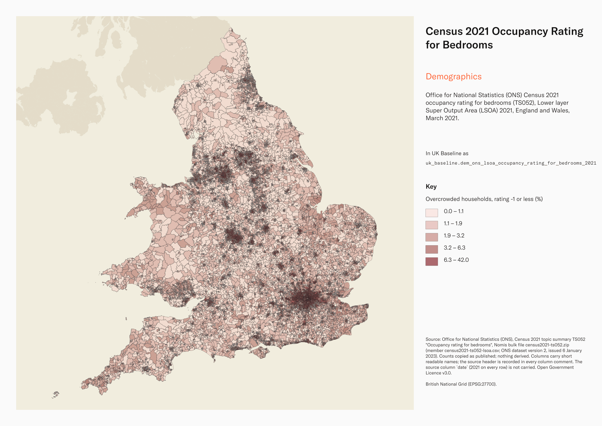
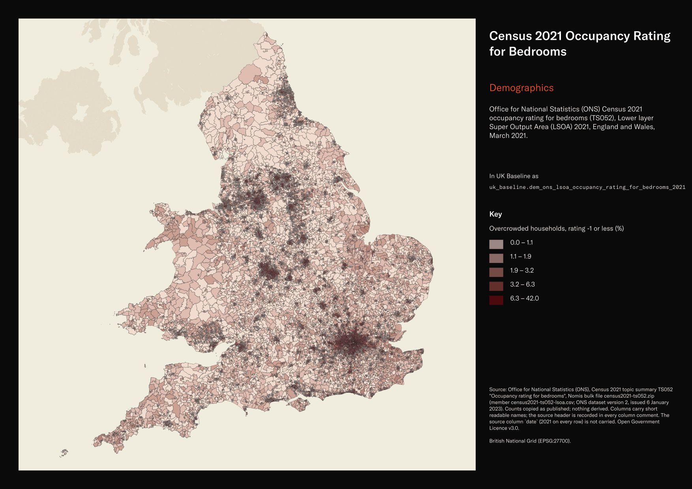

# Office for National Statistics (ONS) Census 2021 occupancy rating for bedrooms (TS052), Lower layer Super Output Area (LSOA) 2021, England and Wales, March 2021

Census 2021 Occupancy Rating for Bedrooms

`dem_ons_lsoa_occupancy_rating_for_bedrooms_2021`<button class="md-clipboard md-icon" data-clipboard-text="dem_ons_lsoa_occupancy_rating_for_bedrooms_2021" title="Copy table name" aria-label="Copy table name" data-search-exclude></button>
{: .layer-table }

**SOURCE**
{: .sec-label }

- Office for National Statistics (ONS), Census 2021 topic summary TS052 "Occupancy rating for bedrooms", Nomis bulk file census2021-ts052.zip (member census2021-ts052-lsoa.csv; ONS dataset version 2, issued 6 January 2023). Counts copied as published; nothing derived. Columns carry short readable names; the source header is recorded in every column comment. The source column `date` (2021 on every row) is not carried.

**DOCUMENTATION**
{: .sec-label }

- ONS dataset (TS052) : https://www.ons.gov.uk/datasets/TS052/editions/2021/versions/2
- Nomis bulk download : https://www.nomisweb.co.uk/sources/census_2021_bulk
- Housing quality information for Census 2021 : https://www.ons.gov.uk/peoplepopulationandcommunity/housing/methodologies/housingqualityinformationforcensus2021

**DEFINITIONS**
{: .sec-label }

- "Whether a household's accommodation is overcrowded, ideally occupied or under-occupied. This is calculated by comparing the number of bedrooms the household requires to the number of available bedrooms." (Nomis metadata, TS052)
- The number of bedrooms required follows the Bedroom Standard (Nomis metadata, TS052).
- "-1 or less implies that a household's accommodation has fewer bedrooms than required (overcrowded)"; "+1 or more implies that a household's accommodation has more bedrooms than required (under-occupied)"; "0 suggests that a household's accommodation has an ideal number of bedrooms" (Nomis metadata, TS052).

**SCOPE**
{: .sec-label }

- England and Wales. 35,672 rows, one per Lower layer Super Output Area (LSOA) 2021 (England 33,755; Wales 1,917): every LSOA in uk_baseline.adm_ons_lsoa_boundary_2021.
- Base population: all households. Census Day 21 March 2021.

**CRS**
{: .sec-label }

- EPSG:27700 (British National Grid). The source has no geometry; geometry is copied from uk_baseline.adm_ons_lsoa_boundary_2021 by matching the source code to lsoa21cd. No reprojection.

**LICENCE**
{: .sec-label }

- Open Government Licence v3.0.

**DATA QUALITY CAVEATS**
{: .sec-label }

- County and Spatial Development Strategy columns are England and Wales only; rows elsewhere carry no county or SDS. Wales and the Isles of Scilly carry a county but no SDS. Rows with no Local Authority District code are NULL in all four columns.
- ONS applied statistical disclosure control: targeted record swapping and cell key perturbation, so small counts may differ slightly between tables and between levels (Nomis metadata). Counts are not rounded.
- The five ratings sum exactly to total_households on every row (checked at load).

**ENRICHMENT**
{: .sec-label }

- `sds_name` / `sds_group` — Spatial Development Strategy area and devolution status, a Prior + Partners categorisation over Ministry of Housing, Communities and Local Government (MHCLG) English devolution policy, joined at load on the row's Local Authority District 2025 code via uk.ref_lad25_ctyua25_sds_lu_jul2026.
- `msoa21hclnm` — House of Commons Library readable MSOA name, joined at load on lsoa21cd via the ONS 2021 output-area hierarchy (uk_baseline.adm_ons_msoa_boundary_2021). Open Parliament Licence.

**LOADED INTO uk_baseline**
{: .sec-label }

- Loaded by PNC, 2 November 2026.

## Columns

| Column | Type | Description / unit |
|---|---|---|
| `gid` | `bigint` |  |
| `lsoa21nm` | `text` | Source field `geography`; LSOA 2021 name as published. |
| `lsoa21cd` | `text` | Source field `geography code`; ONS GSS code of the LSOA 2021. Matched to the boundary at load. |
| `total_households` | `integer` | Source field `Occupancy rating for bedrooms: Total: All households`; count of all households. Unit: "Household" (Nomis metadata). |
| `rating_plus_2_or_more` | `integer` | Source field `Occupancy rating for bedrooms: Occupancy rating of bedrooms: +2 or more`; count of households with an occupancy rating of +2 or more (under-occupied). Unit: "Household" (Nomis metadata). |
| `rating_plus_1` | `integer` | Source field `Occupancy rating for bedrooms: Occupancy rating of bedrooms: +1`; count of households with an occupancy rating of +1 (under-occupied). Unit: "Household" (Nomis metadata). |
| `rating_0` | `integer` | Source field `Occupancy rating for bedrooms: Occupancy rating of bedrooms: 0`; count of households with an occupancy rating of 0 (ideal number of bedrooms). Unit: "Household" (Nomis metadata). |
| `rating_minus_1` | `integer` | Source field `Occupancy rating for bedrooms: Occupancy rating of bedrooms: -1`; count of households with an occupancy rating of -1 (overcrowded). Unit: "Household" (Nomis metadata). |
| `rating_minus_2_or_less` | `integer` | Source field `Occupancy rating for bedrooms: Occupancy rating of bedrooms: -2 or less`; count of households with an occupancy rating of -2 or less (overcrowded). Unit: "Household" (Nomis metadata). |
| `geom` | `geometry(MultiPolygon,27700)` | MultiPolygon in EPSG:27700, copied at load from the boundary named in the table comment's CRS section. |
| `msoa21cd` | `text` | Middle Layer Super Output Area (MSOA) 2021 code of the row's Lower Layer Super Output Area (LSOA); LSOAs nest wholly within MSOAs. Joined at load on lsoa21cd via uk_baseline.adm_ons_lsoa_boundary_2021, then uk_baseline.adm_ons_msoa_boundary_2021. Open Government Licence v3.0. |
| `msoa21nm` | `text` | Official Office for National Statistics MSOA 2021 name of the row's Lower Layer Super Output Area (LSOA); LSOAs nest wholly within MSOAs. Joined at load on lsoa21cd via uk_baseline.adm_ons_lsoa_boundary_2021, then uk_baseline.adm_ons_msoa_boundary_2021. Open Government Licence v3.0. |
| `msoa21hclnm` | `text` | House of Commons Library readable MSOA name of the row's Lower Layer Super Output Area (LSOA); LSOAs nest wholly within MSOAs. Joined at load on lsoa21cd via uk_baseline.adm_ons_lsoa_boundary_2021, then uk_baseline.adm_ons_msoa_boundary_2021, which carries the House of Commons Library name. Open Parliament Licence. |
| `lad22cd` | `text` | Local Authority District 2022 code (2021 LAD geography, anchored to the MSOA 2021 name scoping), best-fit assigned from the row's Lower Layer Super Output Area (LSOA); LSOAs nest wholly within MSOAs. Joined at load on lsoa21cd via uk_baseline.adm_ons_lsoa_boundary_2021, then uk_baseline.adm_ons_msoa_boundary_2021. Open Government Licence v3.0. |
| `lad22nm` | `text` | Local Authority District 2022 name (2021 LAD geography), best-fit assigned from the row's Lower Layer Super Output Area (LSOA); LSOAs nest wholly within MSOAs. Joined at load on lsoa21cd via uk_baseline.adm_ons_lsoa_boundary_2021, then uk_baseline.adm_ons_msoa_boundary_2021. Open Government Licence v3.0. |
| `lad25cd` | `text` | Local Authority District 2025 code (current administering authority), best-fit assigned from the row's Lower Layer Super Output Area (LSOA); LSOAs nest wholly within MSOAs. Joined at load on lsoa21cd via uk_baseline.adm_ons_lsoa_boundary_2021, then uk_baseline.adm_ons_msoa_boundary_2021. Open Government Licence v3.0. |
| `lad25nm` | `text` | Local Authority District 2025 name (current administering authority), best-fit assigned from the row's Lower Layer Super Output Area (LSOA); LSOAs nest wholly within MSOAs. Joined at load on lsoa21cd via uk_baseline.adm_ons_lsoa_boundary_2021, then uk_baseline.adm_ons_msoa_boundary_2021. Open Government Licence v3.0. |
| `ctyua25cd` | `text` | County or unitary authority code at 1 April 2025. Joined at load via uk.ref_lad25_ctyua25_sds_lu_jul2026 on the row's Local Authority District 2025 code. Open Government Licence v3.0. |
| `ctyua25nm` | `text` | County or unitary authority name at 1 April 2025. Joined at load via uk.ref_lad25_ctyua25_sds_lu_jul2026 on the row's Local Authority District 2025 code. Open Government Licence v3.0. |
| `sds_name` | `text` | Spatial Development Strategy (SDS) area, a Prior + Partners categorisation over Ministry of Housing, Communities and Local Government (MHCLG) English devolution policy. Joined at load via uk.ref_lad25_ctyua25_sds_lu_jul2026 on the row's Local Authority District 2025 code. Open Government Licence v3.0. |
| `sds_group` | `text` | Devolution status of the Spatial Development Strategy area: Existing Devolution Footprints, Devolution Priority Programme, Other Proposed Geographies or Remaining Areas. Joined at load via uk.ref_lad25_ctyua25_sds_lu_jul2026 on the row's Local Authority District 2025 code. Open Government Licence v3.0. |
| `census_2021_population` | `integer` | Census 2021 usual residents of this area: ONS Census 2021 TS001 "Number of usual residents in households and communal establishments", Census Day 21 March 2021, joined on lsoa21cd from uk_new.ref_census21_ts001_usual_residents. Unit: "Person". |
