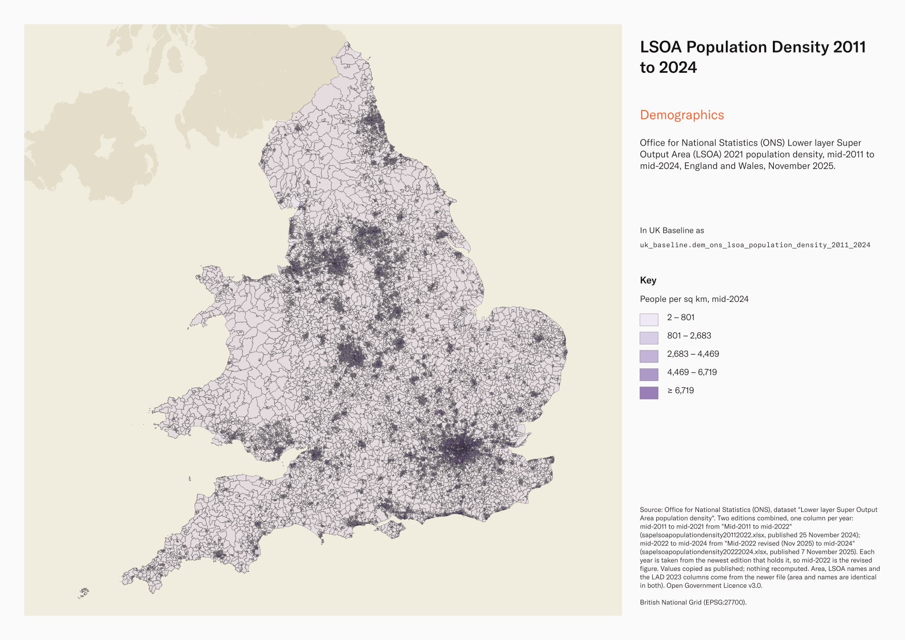
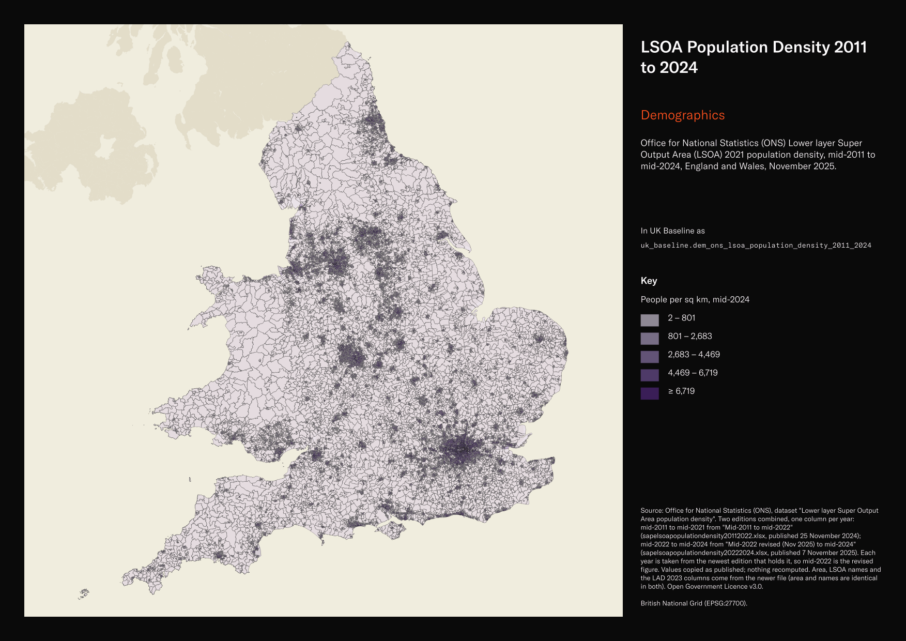

# Office for National Statistics (ONS) Lower layer Super Output Area (LSOA) 2021 population density, mid-2011 to mid-2024, England and Wales, November 2025

LSOA Population Density 2011 to 2024

`dem_ons_lsoa_population_density_2011_2024`<button class="md-clipboard md-icon" data-clipboard-text="dem_ons_lsoa_population_density_2011_2024" title="Copy table name" aria-label="Copy table name" data-search-exclude></button>
{: .layer-table }

**SOURCE**
{: .sec-label }

- Office for National Statistics (ONS), dataset "Lower layer Super Output Area population density". Two editions combined, one column per year: mid-2011 to mid-2021 from "Mid-2011 to mid-2022" (sapelsoapopulationdensity20112022.xlsx, published 25 November 2024); mid-2022 to mid-2024 from "Mid-2022 revised (Nov 2025) to mid-2024" (sapelsoapopulationdensity20222024.xlsx, published 7 November 2025). Each year is taken from the newest edition that holds it, so mid-2022 is the revised figure. Values copied as published; nothing recomputed. Area, LSOA names and the LAD 2023 columns come from the newer file (area and names are identical in both).

**DOCUMENTATION**
{: .sec-label }

- ONS dataset page : https://www.ons.gov.uk/peoplepopulationandcommunity/populationandmigration/populationestimates/datasets/lowersuperoutputareapopulationdensity

**DEFINITIONS**
{: .sec-label }

- "Mid-year (30 June) population density of Lower layer Super Output Areas (LSOAs) in England and Wales based on estimates of the usual resident population." (ONS dataset page)
- "the estimated resident population of an area includes all those people who usually live there, regardless of nationality." Students are taken to be usually resident at their term time address. (ONS workbook Notes sheet)

**SCOPE**
{: .sec-label }

- England and Wales. 35,672 rows, one per Lower layer Super Output Area (LSOA) 2021 (England 33,755; Wales 1,917): every LSOA in uk_baseline.adm_ons_lsoa_boundary_2021.
- Reference date 30 June of each year, mid-2011 to mid-2024 (14 years).

**CRS**
{: .sec-label }

- EPSG:27700 (British National Grid). The source has no geometry; geometry is copied from uk_baseline.adm_ons_lsoa_boundary_2021 by matching the source code to lsoa21cd. No reprojection.

**LICENCE**
{: .sec-label }

- Open Government Licence v3.0.

**DATA QUALITY CAVEATS**
{: .sec-label }

- County and Spatial Development Strategy columns are England and Wales only; rows elsewhere carry no county or SDS. Wales and the Isles of Scilly carry a county but no SDS. Rows with no Local Authority District code are NULL in all four columns.
- Two ONS editions are combined in one table: mid-2011 to mid-2021 are the November 2024 figures and mid-2022 to mid-2024 the November 2025 figures, which revised mid-2022 on 34,543 of 35,672 LSOAs. Year-to-year change across 2021 to 2022 mixes the two editions.
- "the estimates should not be taken to be accurate to the level of detail provided"; ONS asks that figures are "rounded to the nearest 100 if quoted in any publication" (ONS workbook Notes sheet).
- Area is in square kilometres as published (ONS); density is people per square kilometre, not per hectare.
- The newer file's worksheet title says "2025 Lower layer Super Output Areas" while its contents page and column header say LSOA 2021; all 35,672 codes match the LSOA 2021 boundary.

**ENRICHMENT**
{: .sec-label }

- `sds_name` / `sds_group` — Spatial Development Strategy area and devolution status, a Prior + Partners categorisation over Ministry of Housing, Communities and Local Government (MHCLG) English devolution policy, joined at load on the row's Local Authority District 2025 code via uk.ref_lad25_ctyua25_sds_lu_jul2026.
- `msoa21hclnm` — House of Commons Library readable MSOA name, joined at load on lsoa21cd via the ONS 2021 output-area hierarchy (uk_baseline.adm_ons_msoa_boundary_2021). Open Parliament Licence.

**LOADED INTO uk_baseline**
{: .sec-label }

- Loaded by PNC, 2 November 2026.

## Columns

| Column | Type | Description / unit |
|---|---|---|
| `gid` | `bigint` |  |
| `lsoa21cd` | `text` | Source field `LSOA 2021 Code`; ONS GSS code of the LSOA 2021. Matched to the boundary at load. |
| `lsoa21nm` | `text` | Source field `LSOA 2021 Name`; LSOA 2021 name as published. |
| `lad23cd` | `text` | Source field `LAD 2023 Code`; Local Authority District 2023 code as published in the newer ONS file. |
| `lad23nm` | `text` | Source field `LAD 2023 Name`; Local Authority District 2023 name as published in the newer ONS file. |
| `area_sq_km` | `double precision` | Source field `Area Sq Km`; area of the LSOA. Unit: "Sq Km" (square kilometres, as published). |
| `population_mid2011` | `integer` | Source field `Mid-2011: Population` from the Mid-2011 to mid-2022 edition (November 2024); usual resident population at 30 June 2011, unrounded. Unit: persons. |
| `population_mid2012` | `integer` | Source field `Mid-2012: Population` from the Mid-2011 to mid-2022 edition (November 2024); usual resident population at 30 June 2012, unrounded. Unit: persons. |
| `population_mid2013` | `integer` | Source field `Mid-2013: Population` from the Mid-2011 to mid-2022 edition (November 2024); usual resident population at 30 June 2013, unrounded. Unit: persons. |
| `population_mid2014` | `integer` | Source field `Mid-2014: Population` from the Mid-2011 to mid-2022 edition (November 2024); usual resident population at 30 June 2014, unrounded. Unit: persons. |
| `population_mid2015` | `integer` | Source field `Mid-2015: Population` from the Mid-2011 to mid-2022 edition (November 2024); usual resident population at 30 June 2015, unrounded. Unit: persons. |
| `population_mid2016` | `integer` | Source field `Mid-2016: Population` from the Mid-2011 to mid-2022 edition (November 2024); usual resident population at 30 June 2016, unrounded. Unit: persons. |
| `population_mid2017` | `integer` | Source field `Mid-2017: Population` from the Mid-2011 to mid-2022 edition (November 2024); usual resident population at 30 June 2017, unrounded. Unit: persons. |
| `population_mid2018` | `integer` | Source field `Mid-2018: Population` from the Mid-2011 to mid-2022 edition (November 2024); usual resident population at 30 June 2018, unrounded. Unit: persons. |
| `population_mid2019` | `integer` | Source field `Mid-2019: Population` from the Mid-2011 to mid-2022 edition (November 2024); usual resident population at 30 June 2019, unrounded. Unit: persons. |
| `population_mid2020` | `integer` | Source field `Mid-2020: Population` from the Mid-2011 to mid-2022 edition (November 2024); usual resident population at 30 June 2020, unrounded. Unit: persons. |
| `population_mid2021` | `integer` | Source field `Mid-2021: Population` from the Mid-2011 to mid-2022 edition (November 2024); usual resident population at 30 June 2021, unrounded. Unit: persons. |
| `population_mid2022` | `integer` | Source field `Mid-2022: Population` from the Mid-2022 revised (Nov 2025) to mid-2024 edition; usual resident population at 30 June 2022, unrounded. Unit: persons. |
| `population_mid2023` | `integer` | Source field `Mid-2023: Population` from the Mid-2022 revised (Nov 2025) to mid-2024 edition; usual resident population at 30 June 2023, unrounded. Unit: persons. |
| `population_mid2024` | `integer` | Source field `Mid-2024: Population` from the Mid-2022 revised (Nov 2025) to mid-2024 edition; usual resident population at 30 June 2024, unrounded. Unit: persons. |
| `people_per_sq_km_mid2011` | `double precision` | Source field `Mid-2011: People per Sq Km` from the Mid-2011 to mid-2022 edition (November 2024); population at 30 June 2011 divided by area. Unit: "People per Sq Km". |
| `people_per_sq_km_mid2012` | `double precision` | Source field `Mid-2012: People per Sq Km` from the Mid-2011 to mid-2022 edition (November 2024); population at 30 June 2012 divided by area. Unit: "People per Sq Km". |
| `people_per_sq_km_mid2013` | `double precision` | Source field `Mid-2013: People per Sq Km` from the Mid-2011 to mid-2022 edition (November 2024); population at 30 June 2013 divided by area. Unit: "People per Sq Km". |
| `people_per_sq_km_mid2014` | `double precision` | Source field `Mid-2014: People per Sq Km` from the Mid-2011 to mid-2022 edition (November 2024); population at 30 June 2014 divided by area. Unit: "People per Sq Km". |
| `people_per_sq_km_mid2015` | `double precision` | Source field `Mid-2015: People per Sq Km` from the Mid-2011 to mid-2022 edition (November 2024); population at 30 June 2015 divided by area. Unit: "People per Sq Km". |
| `people_per_sq_km_mid2016` | `double precision` | Source field `Mid-2016: People per Sq Km` from the Mid-2011 to mid-2022 edition (November 2024); population at 30 June 2016 divided by area. Unit: "People per Sq Km". |
| `people_per_sq_km_mid2017` | `double precision` | Source field `Mid-2017: People per Sq Km` from the Mid-2011 to mid-2022 edition (November 2024); population at 30 June 2017 divided by area. Unit: "People per Sq Km". |
| `people_per_sq_km_mid2018` | `double precision` | Source field `Mid-2018: People per Sq Km` from the Mid-2011 to mid-2022 edition (November 2024); population at 30 June 2018 divided by area. Unit: "People per Sq Km". |
| `people_per_sq_km_mid2019` | `double precision` | Source field `Mid-2019: People per Sq Km` from the Mid-2011 to mid-2022 edition (November 2024); population at 30 June 2019 divided by area. Unit: "People per Sq Km". |
| `people_per_sq_km_mid2020` | `double precision` | Source field `Mid-2020: People per Sq Km` from the Mid-2011 to mid-2022 edition (November 2024); population at 30 June 2020 divided by area. Unit: "People per Sq Km". |
| `people_per_sq_km_mid2021` | `double precision` | Source field `Mid-2021: People per Sq Km` from the Mid-2011 to mid-2022 edition (November 2024); population at 30 June 2021 divided by area. Unit: "People per Sq Km". |
| `people_per_sq_km_mid2022` | `double precision` | Source field `Mid-2022: People per Sq Km` from the Mid-2022 revised (Nov 2025) to mid-2024 edition; population at 30 June 2022 divided by area. Unit: "People per Sq Km". |
| `people_per_sq_km_mid2023` | `double precision` | Source field `Mid-2023: People per Sq Km` from the Mid-2022 revised (Nov 2025) to mid-2024 edition; population at 30 June 2023 divided by area. Unit: "People per Sq Km". |
| `people_per_sq_km_mid2024` | `double precision` | Source field `Mid-2024: People per Sq Km` from the Mid-2022 revised (Nov 2025) to mid-2024 edition; population at 30 June 2024 divided by area. Unit: "People per Sq Km". |
| `geom` | `geometry(MultiPolygon,27700)` | MultiPolygon in EPSG:27700, copied at load from the boundary named in the table comment's CRS section. |
| `msoa21cd` | `text` | Middle Layer Super Output Area (MSOA) 2021 code of the row's Lower Layer Super Output Area (LSOA); LSOAs nest wholly within MSOAs. Joined at load on lsoa21cd via uk_baseline.adm_ons_lsoa_boundary_2021, then uk_baseline.adm_ons_msoa_boundary_2021. Open Government Licence v3.0. |
| `msoa21nm` | `text` | Official Office for National Statistics MSOA 2021 name of the row's Lower Layer Super Output Area (LSOA); LSOAs nest wholly within MSOAs. Joined at load on lsoa21cd via uk_baseline.adm_ons_lsoa_boundary_2021, then uk_baseline.adm_ons_msoa_boundary_2021. Open Government Licence v3.0. |
| `msoa21hclnm` | `text` | House of Commons Library readable MSOA name of the row's Lower Layer Super Output Area (LSOA); LSOAs nest wholly within MSOAs. Joined at load on lsoa21cd via uk_baseline.adm_ons_lsoa_boundary_2021, then uk_baseline.adm_ons_msoa_boundary_2021, which carries the House of Commons Library name. Open Parliament Licence. |
| `lad22cd` | `text` | Local Authority District 2022 code (2021 LAD geography, anchored to the MSOA 2021 name scoping), best-fit assigned from the row's Lower Layer Super Output Area (LSOA); LSOAs nest wholly within MSOAs. Joined at load on lsoa21cd via uk_baseline.adm_ons_lsoa_boundary_2021, then uk_baseline.adm_ons_msoa_boundary_2021. Open Government Licence v3.0. |
| `lad22nm` | `text` | Local Authority District 2022 name (2021 LAD geography), best-fit assigned from the row's Lower Layer Super Output Area (LSOA); LSOAs nest wholly within MSOAs. Joined at load on lsoa21cd via uk_baseline.adm_ons_lsoa_boundary_2021, then uk_baseline.adm_ons_msoa_boundary_2021. Open Government Licence v3.0. |
| `lad25cd` | `text` | Local Authority District 2025 code (current administering authority), best-fit assigned from the row's Lower Layer Super Output Area (LSOA); LSOAs nest wholly within MSOAs. Joined at load on lsoa21cd via uk_baseline.adm_ons_lsoa_boundary_2021, then uk_baseline.adm_ons_msoa_boundary_2021. Open Government Licence v3.0. |
| `lad25nm` | `text` | Local Authority District 2025 name (current administering authority), best-fit assigned from the row's Lower Layer Super Output Area (LSOA); LSOAs nest wholly within MSOAs. Joined at load on lsoa21cd via uk_baseline.adm_ons_lsoa_boundary_2021, then uk_baseline.adm_ons_msoa_boundary_2021. Open Government Licence v3.0. |
| `ctyua25cd` | `text` | County or unitary authority code at 1 April 2025. Joined at load via uk.ref_lad25_ctyua25_sds_lu_jul2026 on the row's Local Authority District 2025 code. Open Government Licence v3.0. |
| `ctyua25nm` | `text` | County or unitary authority name at 1 April 2025. Joined at load via uk.ref_lad25_ctyua25_sds_lu_jul2026 on the row's Local Authority District 2025 code. Open Government Licence v3.0. |
| `sds_name` | `text` | Spatial Development Strategy (SDS) area, a Prior + Partners categorisation over Ministry of Housing, Communities and Local Government (MHCLG) English devolution policy. Joined at load via uk.ref_lad25_ctyua25_sds_lu_jul2026 on the row's Local Authority District 2025 code. Open Government Licence v3.0. |
| `sds_group` | `text` | Devolution status of the Spatial Development Strategy area: Existing Devolution Footprints, Devolution Priority Programme, Other Proposed Geographies or Remaining Areas. Joined at load via uk.ref_lad25_ctyua25_sds_lu_jul2026 on the row's Local Authority District 2025 code. Open Government Licence v3.0. |
| `census_2021_population` | `integer` | Census 2021 usual residents of this area: ONS Census 2021 TS001 "Number of usual residents in households and communal establishments", Census Day 21 March 2021, joined on lsoa21cd from uk_new.ref_census21_ts001_usual_residents. Unit: "Person". |
