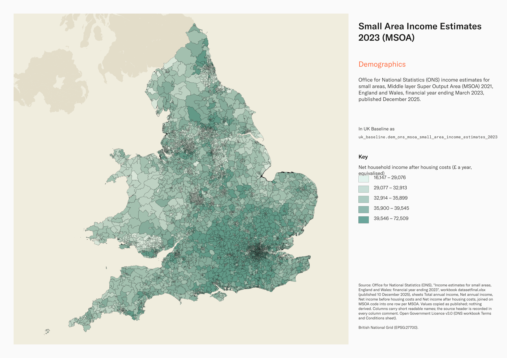
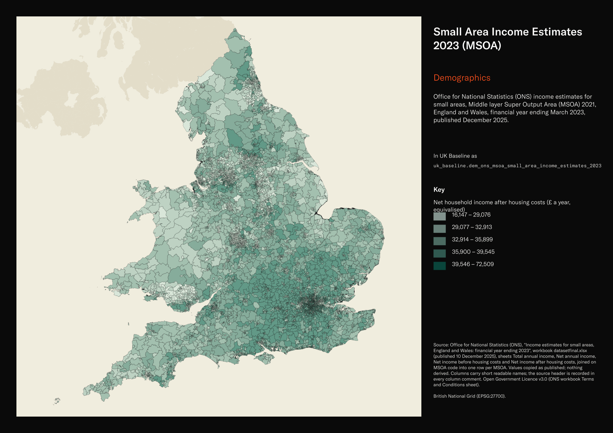

# Office for National Statistics (ONS) income estimates for small areas, Middle layer Super Output Area (MSOA) 2021, England and Wales, financial year ending March 2023, published December 2025

Small Area Income Estimates 2023 (MSOA)

`dem_ons_msoa_small_area_income_estimates_2023`<button class="md-clipboard md-icon" data-clipboard-text="dem_ons_msoa_small_area_income_estimates_2023" title="Copy table name" aria-label="Copy table name" data-search-exclude></button>
{: .layer-table }

**SOURCE**
{: .sec-label }

- Office for National Statistics (ONS), "Income estimates for small areas, England and Wales: financial year ending 2023", workbook datasetfinal.xlsx (published 10 December 2025), sheets Total annual income, Net annual income, Net income before housing costs and Net income after housing costs, joined on MSOA code into one row per MSOA. Values copied as published; nothing derived. Columns carry short readable names; the source header is recorded in every column comment.

**DOCUMENTATION**
{: .sec-label }

- ONS dataset page : https://www.ons.gov.uk/employmentandlabourmarket/peopleinwork/earningsandworkinghours/datasets/smallareaincomeestimatesformiddlelayersuperoutputareasenglandandwales
- Family Resources Survey (main data source) : https://www.gov.uk/government/collections/family-resources-survey--2

**DEFINITIONS**
{: .sec-label }

- "Estimates of annual household income for the four income types for Middle layer Super Output Areas, or local areas, in England and Wales." (ONS dataset page)
- The four income types: "1. Total annual household income", "2. Disposable (net) annual household income", "3. Disposable (net) annual household income before housing costs (equivalised)", "4. Disposable (net) annual household income after housing costs (equivalised)" (ONS workbook Metadata sheet).
- "Financial year ending (FYE) 2023 refers to the period between 1st April 2022 to 31st March 2023." (ONS workbook Notes sheet)

**SCOPE**
{: .sec-label }

- England and Wales. 7,264 rows, one per Middle layer Super Output Area (MSOA) 2021 (England 6,856; Wales 408): every MSOA in uk_baseline.adm_ons_msoa_boundary_2021.
- Financial year ending March 2023 (1 April 2022 to 31 March 2023).

**CRS**
{: .sec-label }

- EPSG:27700 (British National Grid). The source has no geometry; geometry is copied from uk_baseline.adm_ons_msoa_boundary_2021 by matching `MSOA code` to msoa21cd. No reprojection.

**LICENCE**
{: .sec-label }

- Open Government Licence v3.0 (ONS workbook Terms and Conditions sheet).

**DATA QUALITY CAVEATS**
{: .sec-label }

- County and Spatial Development Strategy columns are England and Wales only; rows elsewhere carry no county or SDS. Wales and the Isles of Scilly carry a county but no SDS. Rows with no Local Authority District code are NULL in all four columns.
- Model-based estimates with 95% confidence limits, not survey counts; estimates for small areas are pulled towards the average, so neighbouring MSOAs often overlap within their limits.
- "No estimates have been produced for financial year ending 2021 and financial year ending 2022 due to uncertainty with underlying data during the Coronavirus Pandemic." (ONS workbook Notes sheet) The previous edition is financial year ending 2020.
- Averages per household; never sum MSOAs, and weight by households when combining areas.
- The local authority and region columns are the publisher's own; the local authority edition is not stated in the workbook.

**ENRICHMENT**
{: .sec-label }

- `sds_name` / `sds_group` — Spatial Development Strategy area and devolution status, a Prior + Partners categorisation over Ministry of Housing, Communities and Local Government (MHCLG) English devolution policy, joined at load on the row's Local Authority District 2025 code via uk.ref_lad25_ctyua25_sds_lu_jul2026.
- `msoa21hclnm`, `lad22cd` / `lad22nm`, `lad25cd` / `lad25nm` — joined at load on the source msoa21cd from the MSOA 2021 backbone (uk_baseline.adm_ons_msoa_boundary_2021): House of Commons Library readable MSOA name (Open Parliament Licence) and the ONS MSOA-to-district best-fit assignments (Open Government Licence v3.0).

**LOADED INTO uk_baseline**
{: .sec-label }

- Loaded by PNC, 2 November 2026.

## Columns

| Column | Type | Description / unit |
|---|---|---|
| `gid` | `bigint` |  |
| `msoa21cd` | `text` | Source field `MSOA code`; ONS GSS code of the MSOA 2021. Matched to the boundary at load. |
| `msoa21nm` | `text` | Source field `MSOA name`; MSOA 2021 name as published. |
| `local_authority_code` | `text` | Source field `Local authority code`; ONS GSS code as published (edition not stated by ONS). |
| `local_authority_name` | `text` | Source field `Local authority name`; name as published. |
| `region_code` | `text` | Source field `Region code`; ONS GSS code as published (edition not stated by ONS). |
| `region_name` | `text` | Source field `Region name`; name as published. |
| `total_income` | `integer` | Source field `Total annual income \| Total annual income (£)`; average total annual household income per household, financial year ending March 2023. Unit: "£" per year. |
| `total_income_upper_cl` | `integer` | Source field `Total annual income \| Upper confidence limit (£)`; upper 95% confidence limit of the total annual household income per household, financial year ending March 2023. Unit: "£" per year. |
| `total_income_lower_cl` | `integer` | Source field `Total annual income \| Lower confidence limit (£)`; lower 95% confidence limit of the total annual household income per household, financial year ending March 2023. Unit: "£" per year. |
| `total_income_ci` | `integer` | Source field `Total annual income \| Confidence interval (£)`; width of the 95% confidence interval (upper minus lower) of the total annual household income per household, financial year ending March 2023. Unit: "£" per year. |
| `net_income` | `integer` | Source field `Net annual income \| Disposable (net) annual income (£)`; average disposable (net) annual household income per household, financial year ending March 2023. Unit: "£" per year. |
| `net_income_upper_cl` | `integer` | Source field `Net annual income \| Upper confidence limit (£)`; upper 95% confidence limit of the disposable (net) annual household income per household, financial year ending March 2023. Unit: "£" per year. |
| `net_income_lower_cl` | `integer` | Source field `Net annual income \| Lower confidence limit (£)`; lower 95% confidence limit of the disposable (net) annual household income per household, financial year ending March 2023. Unit: "£" per year. |
| `net_income_ci` | `integer` | Source field `Net annual income \| Confidence interval (£)`; width of the 95% confidence interval (upper minus lower) of the disposable (net) annual household income per household, financial year ending March 2023. Unit: "£" per year. |
| `net_income_bhc` | `integer` | Source field `Net income before housing costs \| Disposable (net) annual income before housing costs (£)`; average disposable (net) annual household income before housing costs (equivalised) per household, financial year ending March 2023. Unit: "£" per year. |
| `net_income_bhc_upper_cl` | `integer` | Source field `Net income before housing costs \| Upper confidence limit (£)`; upper 95% confidence limit of the disposable (net) annual household income before housing costs (equivalised) per household, financial year ending March 2023. Unit: "£" per year. |
| `net_income_bhc_lower_cl` | `integer` | Source field `Net income before housing costs \| Lower confidence limit (£)`; lower 95% confidence limit of the disposable (net) annual household income before housing costs (equivalised) per household, financial year ending March 2023. Unit: "£" per year. |
| `net_income_bhc_ci` | `integer` | Source field `Net income before housing costs \| Confidence interval (£)`; width of the 95% confidence interval (upper minus lower) of the disposable (net) annual household income before housing costs (equivalised) per household, financial year ending March 2023. Unit: "£" per year. |
| `net_income_ahc` | `integer` | Source field `Net income after housing costs \| Disposable (net) annual income after housing costs (£)`; average disposable (net) annual household income after housing costs (equivalised) per household, financial year ending March 2023. Unit: "£" per year. |
| `net_income_ahc_upper_cl` | `integer` | Source field `Net income after housing costs \| Upper confidence limit (£)`; upper 95% confidence limit of the disposable (net) annual household income after housing costs (equivalised) per household, financial year ending March 2023. Unit: "£" per year. |
| `net_income_ahc_lower_cl` | `integer` | Source field `Net income after housing costs \| Lower confidence limit (£)`; lower 95% confidence limit of the disposable (net) annual household income after housing costs (equivalised) per household, financial year ending March 2023. Unit: "£" per year. |
| `net_income_ahc_ci` | `integer` | Source field `Net income after housing costs \| Confidence interval (£)`; width of the 95% confidence interval (upper minus lower) of the disposable (net) annual household income after housing costs (equivalised) per household, financial year ending March 2023. Unit: "£" per year. |
| `geom` | `geometry(MultiPolygon,27700)` | MultiPolygon in EPSG:27700, copied at load from the boundary named in the table comment's CRS section. |
| `msoa21hclnm` | `text` | House of Commons Library readable MSOA name. Source field `msoa21hclnm` from House of Commons Library MSOA Names v2.3 (13 February 2026), joined at load on msoa21cd. Open Parliament Licence. |
| `lad22cd` | `text` | Local Authority District 2022 code, best-fit assigned from the feature's Middle Layer Super Output Area (MSOA) 2021 code. The 2022 reference is the 2021 LAD geography that the MSOA 2021 names are scoped to. Joined at load from the ONS MSOA (2021) to LAD (2022) best-fit lookup on msoa21cd. Open Government Licence v3.0. |
| `lad22nm` | `text` | Local Authority District 2022 name, best-fit assigned from the feature's MSOA 2021 code (the 2021 LAD geography matching the MSOA 2021 name scoping). Joined at load from the ONS MSOA (2021) to LAD (2022) best-fit lookup on msoa21cd. Open Government Licence v3.0. |
| `lad25cd` | `text` | Local Authority District 2025 code (current administering authority), best-fit assigned from the feature's MSOA 2021 code. Joined at load from the ONS MSOA (2021) to Ward (2025) to LAD (2025) best-fit lookup on msoa21cd. Open Government Licence v3.0. |
| `lad25nm` | `text` | Local Authority District 2025 name (current administering authority), best-fit assigned from the feature's MSOA 2021 code. Joined at load from the ONS MSOA (2021) to Ward (2025) to LAD (2025) best-fit lookup on msoa21cd. Open Government Licence v3.0. |
| `ctyua25cd` | `text` | County or unitary authority code at 1 April 2025. Joined at load via uk.ref_lad25_ctyua25_sds_lu_jul2026 on the row's Local Authority District 2025 code. Open Government Licence v3.0. |
| `ctyua25nm` | `text` | County or unitary authority name at 1 April 2025. Joined at load via uk.ref_lad25_ctyua25_sds_lu_jul2026 on the row's Local Authority District 2025 code. Open Government Licence v3.0. |
| `sds_name` | `text` | Spatial Development Strategy (SDS) area, a Prior + Partners categorisation over Ministry of Housing, Communities and Local Government (MHCLG) English devolution policy. Joined at load via uk.ref_lad25_ctyua25_sds_lu_jul2026 on the row's Local Authority District 2025 code. Open Government Licence v3.0. |
| `sds_group` | `text` | Devolution status of the Spatial Development Strategy area: Existing Devolution Footprints, Devolution Priority Programme, Other Proposed Geographies or Remaining Areas. Joined at load via uk.ref_lad25_ctyua25_sds_lu_jul2026 on the row's Local Authority District 2025 code. Open Government Licence v3.0. |
| `census_2021_population` | `integer` | Census 2021 usual residents of this area: ONS Census 2021 TS001 "Number of usual residents in households and communal establishments", Census Day 21 March 2021, joined on msoa21cd from uk_new.ref_census21_ts001_usual_residents. Unit: "Person". |
