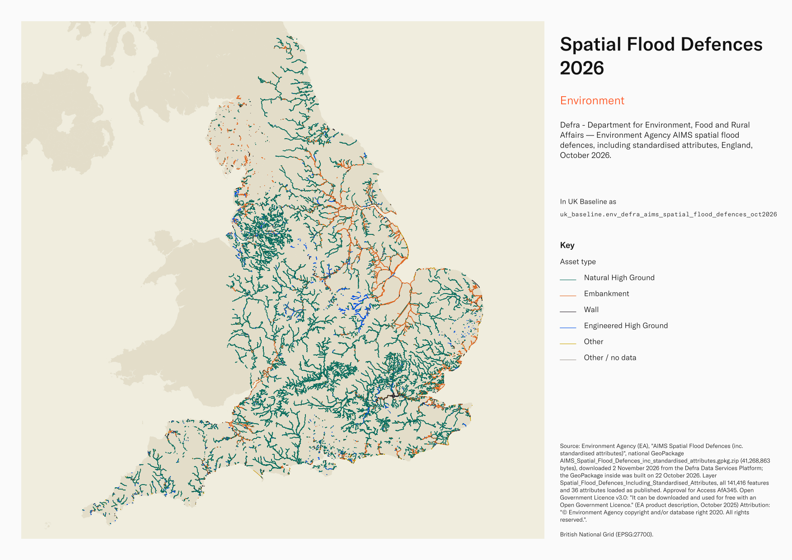
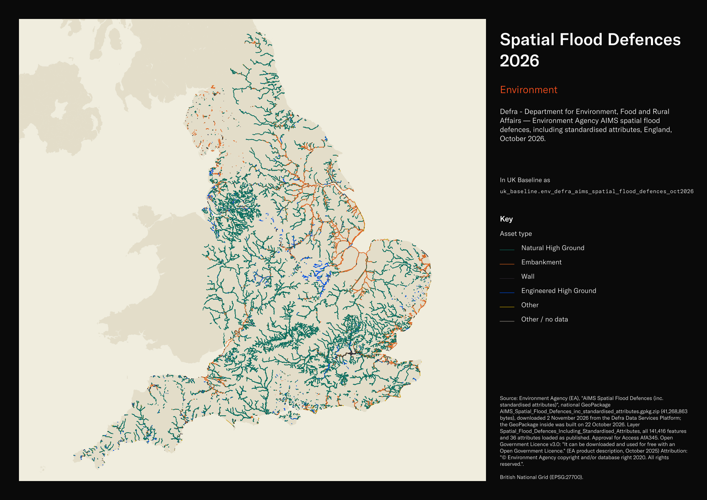

# Defra - Department for Environment, Food and Rural Affairs — Environment Agency AIMS spatial flood defences, including standardised attributes, England, October 2026

Spatial Flood Defences 2026

`env_defra_aims_spatial_flood_defences_oct2026`<button class="md-clipboard md-icon" data-clipboard-text="env_defra_aims_spatial_flood_defences_oct2026" title="Copy table name" aria-label="Copy table name" data-search-exclude></button>
{: .layer-table }

**SOURCE**
{: .sec-label }

- Environment Agency (EA), "AIMS Spatial Flood Defences (inc. standardised attributes)", national GeoPackage AIMS_Spatial_Flood_Defences_inc_standardised_attributes.gpkg.zip (41,268,863 bytes), downloaded 2 November 2026 from the Defra Data Services Platform; the GeoPackage inside was built on 22 October 2026. Layer Spatial_Flood_Defences_Including_Standardised_Attributes, all 141,416 features and 36 attributes loaded as published. Approval for Access AfA345.

**DOCUMENTATION**
{: .sec-label }

- data.gov.uk record : https://www.data.gov.uk/dataset/cc76738e-fc17-49f9-a216-977c61858dda/aims-spatial-flood-defences-inc-standardised-attributes
- Defra Data Services Platform : https://environment.data.gov.uk/dataset/8e5be50f-d465-11e4-ba9a-f0def148f590
- Product description (October 2025) : https://environment.data.gov.uk/api/file/download?fileDataSetId=3aa34e3d-1d6d-4345-a655-64a683e06b6b&fileName=AIMS%20Spatial%20Flood%20Defences%20Product%20Description.pdf
- Data schema : https://environment.data.gov.uk/asset-management/drl-app/revision/current/categories#Defence

**DEFINITIONS**
{: .sec-label }

- "A defence is any asset that provides flood defence or coastal protection functions. This includes both man-made and natural defences." (EA product description, October 2025)
- "Flood defences can be structures, buildings or parts of buildings. Typically, these are earth banks, stone and concrete walls, or sheet-piling that is used to prevent or control the extent of flooding." (EA product description, October 2025)
- Condition grades: "0 - Unchecked", "1 - Very Good", "2 - Good", "3 - Fair", "4 - Poor", "5 - Very Poor" (EA product description, October 2025).
- Standard of protection (1:n): "The Standard of Protection (1:n) that the asset currently provides, if known" (EA product description, October 2025).

**SCOPE**
{: .sec-label }

- England. 141,416 linear assets (natural high ground 94,136; embankment 17,134; wall 12,457; engineered high ground 11,761; bridge abutment 2,441; flood gate 1,957; and smaller types), about 57,900 km in all.
- "Only contains assets owned, managed or inspected by EA"; it "Does not contain all AIMS defences, such as: non-main river assets", coastal protection that another operating authority is responsible for, and assets with no flood and coastal risk management purpose (EA product description, October 2025).

**CRS**
{: .sec-label }

- EPSG:27700 (British National Grid), as declared in the GeoPackage. No reprojection. The source declares a generic geometry type; every feature is a multi-line, so the column is typed MultiLineString.

**LICENCE**
{: .sec-label }

- Open Government Licence v3.0: "It can be downloaded and used for free with an Open Government Licence." (EA product description, October 2025) Attribution: "© Environment Agency copyright and/or database right 2020. All rights reserved."

**DATA QUALITY CAVEATS**
{: .sec-label }

- Updated by the EA "daily (weekdays only)"; this table is the build of 22 October 2026 and will drift from the live product.
- Published attributes include blanks: current_condition is blank on 104,514 assets and design_sop_dqf on 139,037; the reasons are not established. Dates are text in DD/MM/YYYY form, as published.
- The product description omits measurement units; the EA Data Requirements Library specifies metres for calculated asset length and mAOD (metres above Ordnance Datum) for crest and toe levels.
- local_authority contains names rather than codes; 18 assets have no published value.

**LOADED INTO uk_baseline**
{: .sec-label }

- Loaded by PNC, 2 November 2026.

## Columns

| Column | Type | Description / unit |
|---|---|---|
| `gid` | `integer` | Source GeoPackage feature id (`fid`), carried as the primary key. |
| `asset_id` | `character varying` | Source field `asset_id`; "The Asset ID from the AIMS OM system" (EA product description, October 2025). |
| `asset_name` | `character varying` | Source field `asset_name`; "The name of the asset if it has one" (EA product description, October 2025). |
| `asset_sub_type` | `character varying` | Source field `asset_sub_type`; "The type of asset" (EA product description, October 2025). |
| `primary_purpose` | `character varying` | Source field `primary_purpose`; "The main purpose of the asset" (EA product description, October 2025). |
| `alternative_purpose_1` | `character varying` | Source field `alternative_purpose_1`; "An alternative purpose of the asset" (EA product description, October 2025). |
| `alternative_purpose_2` | `character varying` | Source field `alternative_purpose_2`; "An alternative purpose of the asset" (EA product description, October 2025). |
| `asset_length` | `double precision` | Source field `asset_length`; "The length of the asset (calculated from the digitised line feature)" (EA product description, October 2025). Unit: metres (EA Data Requirements Library). |
| `toe_level` | `double precision` | Source field `toe_level`; "The toe level at the exposed face" (EA product description, October 2025). Unit: metres above Ordnance Datum (mAOD), as specified in the EA Data Requirements Library. |
| `protection_type` | `character varying` | Source field `protection_type`; "The type of protection the asset gives" (EA product description, October 2025). |
| `asset_maintainer` | `character varying` | Source field `asset_maintainer`; "The organisation or private individual recognised to be the maintainer of the asset" (EA product description, October 2025). |
| `asset_operator` | `character varying` | Source field `asset_operator`; "The organisation or private individual recognised to be the operator of the asset" (EA product description, October 2025). |
| `asset_owner` | `character varying` | Source field `asset_owner`; "The organisation or private individual known to be the owner of the asset" (EA product description, October 2025). |
| `current_condition` | `character varying` | Source field `current_condition`; "The current condition of the asset" (EA product description, October 2025). Grades 0 Unchecked to 5 Very Poor; blank where no value is supplied in this extract. |
| `target_condition` | `character varying` | Source field `target_condition`; "The FCRM target condition of the Asset" (EA product description, October 2025). Grades 0 Unchecked to 5 Very Poor; blank where no value is supplied in this extract. |
| `current_sop` | `integer` | Source field `current_sop`; "The Standard of Protection (1:n) that the asset currently provides, if known" (EA product description, October 2025). Publisher unit: 1:n years (EA Data Requirements Library). |
| `current_sop_date` | `character varying` | Source field `current_sop_date`; "The date the Current Standard of Protection was appraised" (EA product description, October 2025). Text, DD/MM/YYYY, as published. |
| `design_sop` | `integer` | Source field `design_sop`; "The Standard of Protection (1:n) that the asset was designed to provide" (EA product description, October 2025). Publisher unit: 1:n years (EA Data Requirements Library). |
| `design_sop_dqf` | `character varying` | Source field `design_sop_dqf`; "The data quality flag for the Design Standard of Protection" (EA product description, October 2025). Quality codes, with no physical unit: 1 = Good; 2 = Adequate; 3 = Suspect; 4 = Poor; 5 = Missing; 6 = Unchecked (EA product description, October 2025). |
| `design_ucl` | `double precision` | Source field `design_ucl`; "The level of the crest as it was designed to be: at the upstream extent of fluvial or tidal assets, or the leftmost extent of coastal assets (when looking out to sea) (including any allowances for uncertainty or settlement)" (EA product description, October 2025). Unit: metres above Ordnance Datum (mAOD), as specified in the EA Data Requirements Library. |
| `year_last_refurbished` | `integer` | Source field `year_last_refurbished`; "The year the asset was last refurbished" (EA product description, October 2025). |
| `last_inspection_date` | `character varying` | Source field `last_inspection_date`; "The date that the inspection or assessment was completed" (EA product description, October 2025). Text, DD/MM/YYYY, as published. |
| `next_inspection_date` | `character varying` | Source field `next_inspection_date`; "The scheduled date of the inspection or assessment" (EA product description, October 2025). Text, DD/MM/YYYY, as published. |
| `asset_start_date` | `character varying` | Source field `asset_start_date`; "The date the asset becomes operational" (EA product description, October 2025). Text, DD/MM/YYYY, as published. |
| `actual_dcl` | `double precision` | Source field `actual_dcl`; "The real, measured crest level: at the downstream extent of a fluvial/tidal linear defence asset, or at the rightmost extent of a coastal linear defence asset when looking out to sea" (EA product description, October 2025). Unit: metres above Ordnance Datum (mAOD), as specified in the EA Data Requirements Library. |
| `actual_dcl_dqf` | `character varying` | Source field `actual_dcl_dqf`; "The data quality flag for the actual downstream crest level" (EA product description, October 2025). Values: crest level data quality flag: "1: +/- 0.01m to 0.05m vertical accuracy", "2: +/- >0.05m to 0.15m", "3: +/- >0.15m to 0.75m", "4: +/- 0.75m or more". |
| `actual_ucl` | `double precision` | Source field `actual_ucl`; "The real, measured crest level: at the upstream extent of a fluvial/tidal linear defence asset or at the leftmost extent of a coastal linear defence asset when looking out to sea" (EA product description, October 2025). Unit: metres above Ordnance Datum (mAOD), as specified in the EA Data Requirements Library. |
| `actual_ucl_dqf` | `character varying` | Source field `actual_ucl_dqf`; "The data quality flag for the actual upstream crest level" (EA product description, October 2025). Values: crest level data quality flag: "1: +/- 0.01m to 0.05m vertical accuracy", "2: +/- >0.05m to 0.15m", "3: +/- >0.15m to 0.75m", "4: +/- 0.75m or more". |
| `design_dcl` | `double precision` | Source field `design_dcl`; "The level of the crest as it was designed to be: at the downstream extent of fluvial or tidal assets, or the rightmost extent of coastal assets (when looking out to sea) (including any allowances for uncertainty or settlement)" (EA product description, October 2025). Unit: metres above Ordnance Datum (mAOD), as specified in the EA Data Requirements Library. |
| `bank` | `character varying` | Source field `bank`; "The bank that the asset is on when looking downstream for fluvial assets. For coastal assets use coastal" (EA product description, October 2025). |
| `effective_cl` | `double precision` | Source field `effective_cl`; "The real, measured crest level at the lowest point along a linear defence asset" (EA product description, October 2025). Unit: metres above Ordnance Datum (mAOD), as specified in the EA Data Requirements Library. |
| `effective_cl_dqf` | `character varying` | Source field `effective_cl_dqf`; "The data quality flag for the effective crest level" (EA product description, October 2025). Values: crest level data quality flag: "1: +/- 0.01m to 0.05m vertical accuracy", "2: +/- >0.05m to 0.15m", "3: +/- >0.15m to 0.75m", "4: +/- 0.75m or more". |
| `include_in_flood_map` | `character varying` | Source field `include_in_flood_map`; "The Floodmap inclusion assessment" (EA product description, October 2025). |
| `water_management_area` | `character varying` | Source field `water_management_area`; "The Area the Asset is located in" (EA product description, October 2025). |
| `local_authority` | `character varying` | Source field `local_authority`; "The local authority within which the asset falls" (EA product description, October 2025). |
| `frms_code` | `character varying` | Source field `frms_code`; "The code of the Flood Risk Management System covering the asset" (EA product description, October 2025). |
| `water_course_name` | `character varying` | Source field `water_course_name`; "The name of the Watercourse where the Asset is located" (EA product description, October 2025). |
| `geom` | `geometry(MultiLineString,27700)` | Source field `shape`; "The geographic representation of the asset" (EA product description, October 2025); MultiLineString in EPSG:27700, coordinate units metres; no reprojection. |
