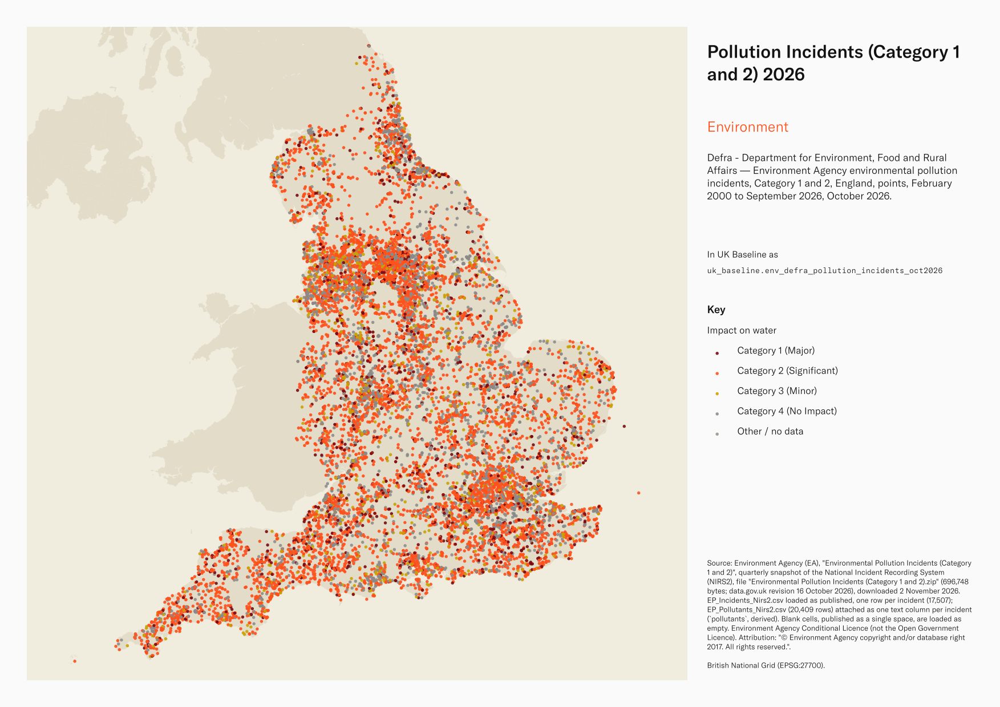
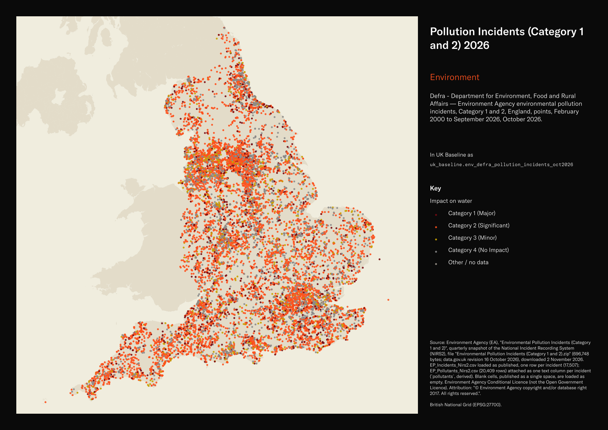

# Defra - Department for Environment, Food and Rural Affairs — Environment Agency environmental pollution incidents, Category 1 and 2, England, points, February 2000 to September 2026, October 2026

Pollution Incidents (Category 1 and 2) 2026

`env_defra_pollution_incidents_oct2026`<button class="md-clipboard md-icon" data-clipboard-text="env_defra_pollution_incidents_oct2026" title="Copy table name" aria-label="Copy table name" data-search-exclude></button>
{: .layer-table }

**SOURCE**
{: .sec-label }

- Environment Agency (EA), "Environmental Pollution Incidents (Category 1 and 2)", quarterly snapshot of the National Incident Recording System (NIRS2), file "Environmental Pollution Incidents (Category 1 and 2).zip" (696,748 bytes; data.gov.uk revision 16 October 2026), downloaded 2 November 2026. EP_Incidents_Nirs2.csv loaded as published, one row per incident (17,507); EP_Pollutants_Nirs2.csv (20,409 rows) attached as one text column per incident (`pollutants`, derived). Blank cells, published as a single space, are loaded as empty.

**DOCUMENTATION**
{: .sec-label }

- data.gov.uk record : https://www.data.gov.uk/dataset/c8625e18-c329-4032-b4c7-444b33af6780/environmental-pollution-incidents-category-1-and-2
- Common Incident Classification Scheme : https://assets.publishing.service.gov.uk/media/688c746564845fffe80890e0/Appendix_4.18_LIT_11227_-_Incidents_and_their_classification_common_incident_classification_scheme__CICS_.pdf
- Licence : https://www.gov.uk/government/publications/environment-agency-conditional-licence/environment-agency-conditional-licence

**DEFINITIONS**
{: .sec-label }

- The dataset "only includes substantiated completed and closed Environment Management incidents (predominantly pollution), where the environment impact level is either category 1 (major) or category 2 (significant) to at least 1 media (i.e. water, land or air)." (data.gov.uk record)
- "Category 1 - major, serious, persistent and/or extensive impact or effect on the environment, people and/or property or on our operations"; "Category 2 - significant impact or effect on the environment, people and/or property or on our operations" (EA Common Incident Classification Scheme).

**SCOPE**
{: .sec-label }

- England. 17,507 incidents dated 15 February 2000 to 22 September 2026; 17,468 of 17,507 points fall inside an England or Wales district in the loader's spatial check; 39 do not. The cause of these unmatched locations has not been established.
- Highest impact by medium (Category 1 / Category 2): water 1,420 / 9,005; land 172 / 4,184; air 207 / 3,689.

**CRS**
{: .sec-label }

- EPSG:27700 (British National Grid). Points built from the published easting and northing (`X_CONF`, `Y_CONF`), which the EA metadata states are British National Grid. No reprojection.

**LICENCE**
{: .sec-label }

- Environment Agency Conditional Licence (not the Open Government Licence). Attribution: "© Environment Agency copyright and/or database right 2017. All rights reserved."
- The record states that "this Licence has a limited duration of one year at the end of which it will terminate automatically without notice", and that the information "contains some data that we believe is within the definition of 'personal data' under the Data Protection Act 1998".
- Downloaded 2 November 2026. If the licence commenced on that date, its one-year term ends on 2 November 2027, subject to earlier termination under the licence. The published terms do not state that downloading again renews this licence.
- Users must check their compliance when holding, using or sharing the personal data identified by the EA. Include or link to the specified attribution and, where possible, link to the licence.

**DATA QUALITY CAVEATS**
{: .sec-label }

- County and Spatial Development Strategy columns are England and Wales only; rows elsewhere carry no county or SDS. Wales and the Isles of Scilly carry a county but no SDS. Rows with no Local Authority District code are NULL in all four columns.
- "There is an inherent lag time in investigating and recording the necessary incident details to complete a record and recent incidents may not appear." (data.gov.uk record) Recent quarters may be incomplete because investigation and recording take time; records may also change following quality assurance or further information.
- "no inference should be drawn that the site or property owner necessarily was responsible" (EA information warning).
- The current EA record carries no data dictionary for the CSV columns; historical EA field documentation exists (a 2009 user guide). [UNDOCUMENTED] identifies a field whose specific published definition has not been verified in the sources consulted. Area columns are names in capitals, not codes; 111 incidents carry the old EA administrative region "EA Wales" while lying in English districts.

**ENRICHMENT**
{: .sec-label }

- `sds_name` / `sds_group` — Spatial Development Strategy area and devolution status, a Prior + Partners categorisation over Ministry of Housing, Communities and Local Government (MHCLG) English devolution policy, joined at load on the row's Local Authority District 2025 code via uk.ref_lad25_ctyua25_sds_lu_jul2026.
- `msoa21hclnm` — House of Commons Library readable MSOA name, assigned at load from the feature's representative point in its 2021 MSOA (uk_baseline.adm_ons_msoa_boundary_2021). Open Parliament Licence.

**LOADED INTO uk_baseline**
{: .sec-label }

- Loaded by PNC, 2 November 2026.

## Columns

| Column | Type | Description / unit |
|---|---|---|
| `gid` | `bigint` |  |
| `not_id` | `integer` | Source field `NOT_ID`; notification ID, unique in EP_Incidents_Nirs2.csv; the current EA record gives no definition, a 2009 EA user guide (third-party copy) names it "NOT_ID (Notification ID)". |
| `not_date` | `timestamp without time zone` | Source field `NOT_DATE`; incident date and time, loaded from DD/MM/YYYY HH:MM:SS text [UNDOCUMENTED]. |
| `region_wm` | `text` | Source field `REGION_WM`; EA region name [UNDOCUMENTED; two region systems are published, suffix WM and PF]. |
| `area_wm` | `text` | Source field `AREA_WM`; EA area name [UNDOCUMENTED; WM system]. |
| `region_pf` | `text` | Source field `REGION_PF`; EA region name [UNDOCUMENTED; PF system]. |
| `area_pf` | `text` | Source field `AREA_PF`; EA area name [UNDOCUMENTED; PF system]. |
| `county` | `text` | Source field `COUNTY`; county name in capitals with the suffix COUNTY, as published; empty where none. Field-specific EA definition not verified [UNDOCUMENTED]; interpretation based on the published field name, values and dataset metadata. |
| `unitary` | `text` | Source field `UNITARY`; unitary authority name in capitals, as published; empty where none. Field-specific EA definition not verified [UNDOCUMENTED]; interpretation based on the published field name, values and dataset metadata. |
| `district` | `text` | Source field `DISTRICT`; district name in capitals with the suffix DISTRICT, as published; empty where none. Field-specific EA definition not verified [UNDOCUMENTED]; interpretation based on the published field name, values and dataset metadata. |
| `ngr_conf` | `text` | Source field `NGR_CONF`; Ordnance Survey grid reference text of the incident location. Field-specific EA definition not verified [UNDOCUMENTED]; interpretation based on the published field name, values and dataset metadata. |
| `x_conf` | `integer` | Source field `X_CONF`; easting, British National Grid (EPSG:27700); unit metres; the point geometry is built from it. Field-specific EA definition not verified [UNDOCUMENTED]; interpretation based on the published field name, values and dataset metadata. |
| `y_conf` | `integer` | Source field `Y_CONF`; northing, British National Grid (EPSG:27700); unit metres; the point geometry is built from it. Field-specific EA definition not verified [UNDOCUMENTED]; interpretation based on the published field name, values and dataset metadata. |
| `ep_inc` | `text` | Source field `EP_INC`; environmental protection incident flag, Yes on every row [UNDOCUMENTED]. |
| `eil_air` | `text` | Source field `EIL_AIR`; environmental impact level on air: Category 1 (Major) to Category 4 (No Impact), as published. Field-specific EA definition not verified [UNDOCUMENTED]; interpretation based on the published field name, values and dataset metadata. |
| `eil_land` | `text` | Source field `EIL_LAND`; environmental impact level on land: Category 1 (Major) to Category 4 (No Impact), as published. Field-specific EA definition not verified [UNDOCUMENTED]; interpretation based on the published field name, values and dataset metadata. |
| `eil_water` | `text` | Source field `EIL_WATER`; environmental impact level on water: Category 1 (Major) to Category 4 (No Impact), as published. Field-specific EA definition not verified [UNDOCUMENTED]; interpretation based on the published field name, values and dataset metadata. |
| `pollutants` | `text` | Derived at load: every pollutant recorded for the incident in EP_Pollutants_Nirs2.csv, as "POLL_TYPE: POLLUTANT" pairs joined by "; ", sorted; 20,409 pollutant rows on 17,507 incidents. |
| `geom` | `geometry(Point,27700)` | Point geometry derived from source fields `X_CONF` and `Y_CONF`; EPSG:27700, coordinate units metres; no reprojection. |
| `msoa21cd` | `text` | Middle Layer Super Output Area (MSOA) 2021 code. Assigned at load from the feature's representative point located in uk_baseline.adm_ons_msoa_boundary_2021. Open Government Licence v3.0. |
| `msoa21nm` | `text` | Official Office for National Statistics MSOA 2021 name. Assigned at load from the feature's representative point located in uk_baseline.adm_ons_msoa_boundary_2021. Open Government Licence v3.0. |
| `msoa21hclnm` | `text` | House of Commons Library readable MSOA name. Assigned at load from the feature's representative point located in its 2021 MSOA (uk_baseline.adm_ons_msoa_boundary_2021, which carries the House of Commons Library name). Open Parliament Licence. |
| `lad22cd` | `text` | Local Authority District 2022 code (2021 LAD geography). Assigned at load from the feature's representative point located in uk_baseline.adm_ons_lad_boundary_may2022. Open Government Licence v3.0. |
| `lad22nm` | `text` | Local Authority District 2022 name (2021 LAD geography). Assigned at load from the feature's representative point located in uk_baseline.adm_ons_lad_boundary_may2022. Open Government Licence v3.0. |
| `lad25cd` | `text` | Local Authority District 2025 code (current administering authority). Assigned at load from the feature's representative point located in uk_baseline.adm_ons_lad_boundary_may2025. Open Government Licence v3.0. |
| `lad25nm` | `text` | Local Authority District 2025 name (current administering authority). Assigned at load from the feature's representative point located in uk_baseline.adm_ons_lad_boundary_may2025. Open Government Licence v3.0. |
| `ctyua25cd` | `text` | County or unitary authority code at 1 April 2025. Joined at load via uk.ref_lad25_ctyua25_sds_lu_jul2026 on the row's Local Authority District 2025 code. Open Government Licence v3.0. |
| `ctyua25nm` | `text` | County or unitary authority name at 1 April 2025. Joined at load via uk.ref_lad25_ctyua25_sds_lu_jul2026 on the row's Local Authority District 2025 code. Open Government Licence v3.0. |
| `sds_name` | `text` | Spatial Development Strategy (SDS) area, a Prior + Partners categorisation over Ministry of Housing, Communities and Local Government (MHCLG) English devolution policy. Joined at load via uk.ref_lad25_ctyua25_sds_lu_jul2026 on the row's Local Authority District 2025 code. Open Government Licence v3.0. |
| `sds_group` | `text` | Devolution status of the Spatial Development Strategy area: Existing Devolution Footprints, Devolution Priority Programme, Other Proposed Geographies or Remaining Areas. Joined at load via uk.ref_lad25_ctyua25_sds_lu_jul2026 on the row's Local Authority District 2025 code. Open Government Licence v3.0. |
