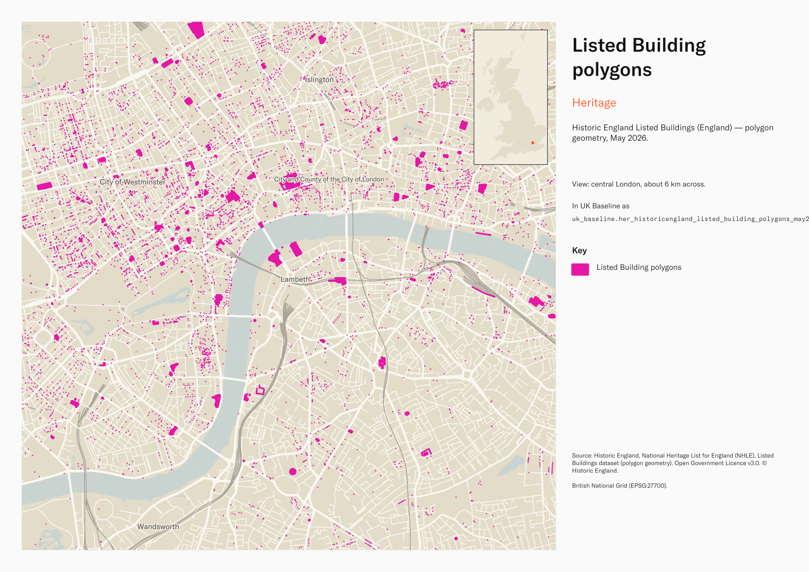

# Historic England Listed Buildings (England) — polygon geometry, May 2026

Listed Building polygons

`her_historicengland_listed_building_polygons_may2026`<button class="md-clipboard md-icon" data-clipboard-text="her_historicengland_listed_building_polygons_may2026" title="Copy table name" aria-label="Copy table name" data-search-exclude></button>
{: .layer-table }

**SOURCE**
{: .sec-label }

- Historic England, National Heritage List for England (NHLE), Listed Buildings dataset (polygon geometry).

**DOCUMENTATION**
{: .sec-label }

- NHLE              : https://historicengland.org.uk/listing/the-list/
- HE data downloads : https://historicengland.org.uk/listing/the-list/data-downloads/
- Listed Buildings : https://historicengland.org.uk/listing/what-is-designation/listed-buildings/

**DEFINITIONS**
{: .sec-label }

- "Listed buildings are buildings of special architectural or historic interest with legal protection." (Historic England, Listed Buildings)
- Listing grades: Grade I — buildings of exceptional interest; Grade II* — particularly important buildings of more than special interest; Grade II — buildings of special interest. (Historic England, Listed Buildings)

**SCOPE**
{: .sec-label }

- England. 380,263 polygon rows representing 379,329 distinct List Entry Numbers (a small number of buildings have more than one polygon).

**CRS**
{: .sec-label }

- EPSG:27700 (OSGB 1936 / British National Grid). Geometry type MultiPolygon.

**LICENCE**
{: .sec-label }

- Open Government Licence v3.0. © Historic England.

**DATA QUALITY CAVEATS**
{: .sec-label }

- The row count counts split pieces, not source features: this layer was split by Middle Layer Super Output Area, so it holds one row per feature per MSOA piece, plus whole and remainder rows to keep 100% of the source geometry. 381,254 rows represent 380,263 source features, measured 25 August 2026. `source_fid` identifies the originating feature.
- Geography keys are NULL on 8 of 381,254 rows, measured 25 August 2026: 6 are residual fragments left by the MSOA split, each under 100 sqm or 10 m; 2 fall outside every district — offshore, inter-tidal, or beyond Great Britain.
- County and Spatial Development Strategy columns are England and Wales only; rows elsewhere carry no county or SDS. Wales and the Isles of Scilly carry a county but no SDS. Rows with no Local Authority District code are NULL in all four columns.

**ENRICHMENT**
{: .sec-label }

- `sds_name` / `sds_group` — Spatial Development Strategy area and devolution status, a Prior + Partners categorisation over Ministry of Housing, Communities and Local Government (MHCLG) English devolution policy, joined at load on the row's Local Authority District 2025 code via uk.ref_lad25_ctyua25_sds_lu_jul2026.

**LOADED INTO uk_baseline**
{: .sec-label }

- Loaded by PNC, May 2026.

MSOA SPLIT (added 3 July 2026)

- Geometry split to one row per (source feature x MSOA 2021). Each row carries that MSOA's msoa21cd / msoa21nm / msoa21hclnm and best-fit lad22 / lad25. The source feature's original primary key is preserved as `source_fid`; `gid` is a fresh surrogate primary key. Features with no MSOA overlap (offshore or outside England & Wales) are kept whole with NULL geography columns.

## Columns

| Column | Type | Description / unit |
|---|---|---|
| `source_fid` | `bigint` | Primary key of the source feature in the pre-split layer uk.her_historicengland_listed_building_polygons_may2026__preswap_j (non-unique here: a feature spanning N MSOAs has N rows). |
| `fid_original` | `integer` | ArcGIS source identifier preserved at load; not stable across Historic England re-publications. |
| `listentry` | `integer` | Source field "ListEntry"; National Heritage List for England (NHLE) List Entry Number — the canonical national identifier for the heritage asset. |
| `name` | `character varying` | Source field "Name"; heritage asset name as published on the NHLE. |
| `grade` | `character varying` | Source field "Grade"; statutory listing grade. Observed values: "I", "II*", "II". |
| `listdate` | `timestamp with time zone` | Source field "ListDate"; date first listed. |
| `amenddate` | `timestamp with time zone` | Source field "AmendDate"; date of the most recent amendment to the listing. |
| `capturescale` | `character varying` | Source field "CaptureScale"; cartographic scale at which the geometry was captured (e.g. "1:1250"). |
| `hyperlink` | `character varying` | Source field "Hyperlink"; URL of the listing page on the Historic England website. |
| `ngr` | `character varying` | Source field "NGR"; alphanumeric National Grid Reference (e.g. "SP 12345 67890"). |
| `easting` | `double precision` | Source field "Easting"; British National Grid easting. Unit: metres (EPSG:27700). |
| `northing` | `double precision` | Source field "Northing"; British National Grid northing. Unit: metres (EPSG:27700). |
| `wd25cd` | `character varying` | Joined at load from ONS Ward 2025 lookup; 2025 Ward GSS code. |
| `wd25nm` | `character varying` | Joined at load from ONS Ward 2025 lookup; 2025 Ward name. |
| `area_ha` | `double precision` | Area in hectares of this row's own geometry, computed at load from the EPSG:27700 geometry. On layers split by Middle Layer Super Output Area this is the area of the piece inside its MSOA, not the area of the whole source feature. |
| `rgn22cd` | `text` | Joined at load from ONS LAD->Region lookup; 2022 Region GSS code. |
| `rgn22nm` | `text` | Joined at load from ONS LAD->Region lookup; 2022 Region name. |
| `msoa21cd` | `character varying` | Middle Layer Super Output Area (MSOA) 2021 code of this piece. Open Government Licence v3.0. |
| `msoa21nm` | `character varying` | Official ONS MSOA 2021 name of this piece. Open Government Licence v3.0. |
| `msoa21hclnm` | `text` | House of Commons Library readable MSOA name of this piece. Open Parliament Licence. |
| `lad22cd` | `text` | Local Authority District 2022 code (2021 LAD geography, anchored to the MSOA 2021 name scoping), best-fit from this piece's msoa21cd. Open Government Licence v3.0. |
| `lad22nm` | `text` | Local Authority District 2022 name (2021 LAD geography), best-fit from this piece's msoa21cd. Open Government Licence v3.0. |
| `lad25cd` | `text` | Local Authority District 2025 code (current administering authority), best-fit from this piece's msoa21cd. Open Government Licence v3.0. |
| `lad25nm` | `text` | Local Authority District 2025 name (current administering authority), best-fit from this piece's msoa21cd. Open Government Licence v3.0. |
| `geom` | `geometry(MultiPolygon,27700)` | MultiPolygon in EPSG:27700. Listed building polygon. |
| `gid` | `bigint` |  |
| `ctyua25cd` | `text` | County or unitary authority code at 1 April 2025. Joined at load via uk.ref_lad25_ctyua25_sds_lu_jul2026 on the row's Local Authority District 2025 code. Open Government Licence v3.0. |
| `ctyua25nm` | `text` | County or unitary authority name at 1 April 2025. Joined at load via uk.ref_lad25_ctyua25_sds_lu_jul2026 on the row's Local Authority District 2025 code. Open Government Licence v3.0. |
| `sds_name` | `text` | Spatial Development Strategy (SDS) area, a Prior + Partners categorisation over Ministry of Housing, Communities and Local Government (MHCLG) English devolution policy. Joined at load via uk.ref_lad25_ctyua25_sds_lu_jul2026 on the row's Local Authority District 2025 code. Open Government Licence v3.0. |
| `sds_group` | `text` | Devolution status of the Spatial Development Strategy area: Existing Devolution Footprints, Devolution Priority Programme, Other Proposed Geographies or Remaining Areas. Joined at load via uk.ref_lad25_ctyua25_sds_lu_jul2026 on the row's Local Authority District 2025 code. Open Government Licence v3.0. |
| `msoa_area_ha` | `double precision` | Area in hectares of the Middle Layer Super Output Area this row falls in, computed from uk_baseline.adm_ons_msoa_boundary_2021 — the same boundary the layer was split against. Provided as the denominator for MSOA coverage shares. NULL wherever msoa21cd is NULL. Open Government Licence v3.0. |
