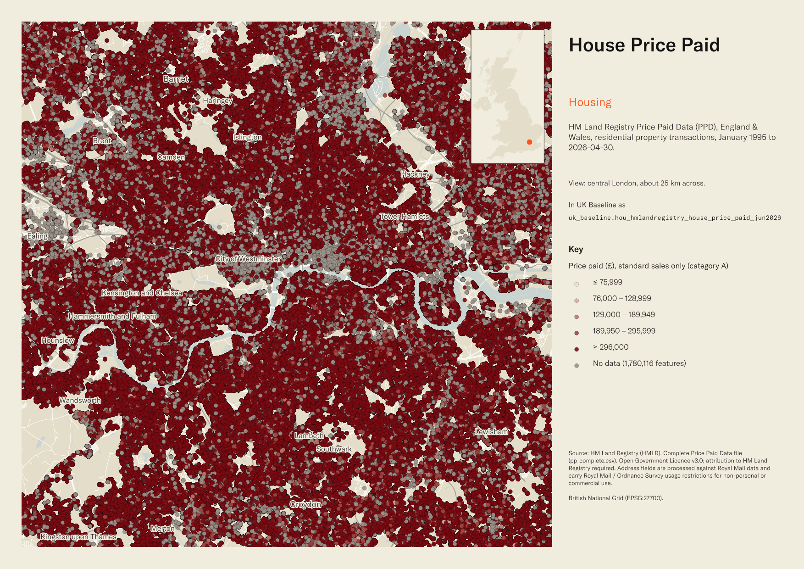
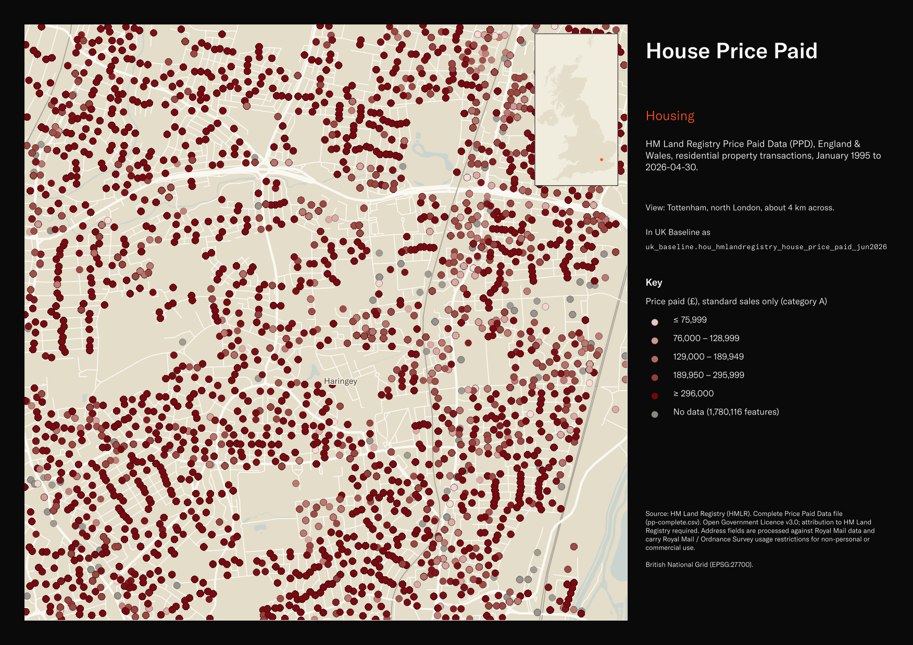

# HM Land Registry Price Paid Data (PPD), England & Wales, residential property transactions, January 1995 to 2026-04-30

House Price Paid

`hou_hmlandregistry_house_price_paid_jun2026`<button class="md-clipboard md-icon" data-clipboard-text="hou_hmlandregistry_house_price_paid_jun2026" title="Copy table name" aria-label="Copy table name" data-search-exclude></button>
{: .layer-table }

**SOURCE**
{: .sec-label }

- HM Land Registry (HMLR). Complete Price Paid Data file (pp-complete.csv).

**DOCUMENTATION**
{: .sec-label }

- Downloads : https://www.gov.uk/government/statistical-data-sets/price-paid-data-downloads
- About PPD : https://www.gov.uk/guidance/about-the-price-paid-data

**DEFINITIONS**
{: .sec-label }

- "Price Paid Data includes information on all property sales in England and Wales that are sold for value and are lodged with us for registration." (HM Land Registry, About the Price Paid Data)
- One row per registered transaction (transaction unique identifier).

**SCOPE**
{: .sec-label }

- England & Wales. 31,270,275 transactions, January 1995 to 2026-04-30.
- Includes PPD Category A (standard residential sales) and Category B (repossessions, buy-to-lets identifiable by a mortgage, transfers to non-private individuals, and 'Other' property types).

**CRS**
{: .sec-label }

- EPSG:27700 (OSGB36 British National Grid). `geom` derived at load from the postcode via the postcode-centroid lookup; populated for 31,218,814 of 31,270,275 rows (99.8%). NULL where the postcode is blank or could not be matched.

**LICENCE**
{: .sec-label }

- Open Government Licence v3.0; attribution to HM Land Registry required. Address fields are processed against Royal Mail data and carry Royal Mail / Ordnance Survey usage restrictions for non-personal or commercial use.

**DATA QUALITY CAVEATS**
{: .sec-label }

- 821 rows carry a district but no Middle Layer Super Output Area: they lie outside every 2021 MSOA but inside a district, so the district was assigned from the feature's representative point while the MSOA columns stay NULL.
- Category B entries are included; filter on `ppd_category_type` = 'A' for standard residential sales only.
- `geom` is postcode-centroid precision, not exact address location; postcodes may have been reallocated since the sale.

**ENRICHMENT**
{: .sec-label }

- `msoa21hclnm` — House of Commons Library readable MSOA name, assigned at load from the transaction's postcode MSOA (via uk_baseline.adm_ons_postcode_centroid_feb2026). Open Parliament Licence.

**LOADED INTO uk_baseline**
{: .sec-label }

- Loaded by PNC, 1 June 2026.

## Columns

| Column | Type | Description / unit |
|---|---|---|
| `transaction_id` | `text` | Source field, HM Land Registry transaction unique identifier. "A reference number which is generated automatically recording each published sale." Primary key. |
| `price` | `bigint` | Source field `Price`. "Sale price stated on the transfer deed." Unit: pounds sterling. Cast to bigint at load. |
| `transfer_date` | `date` | Source field `Date of Transfer`. "Date when the sale was completed, as stated on the transfer deed." Cast to date at load. |
| `postcode` | `text` | Source field `Postcode`. Postcode at the time of the transaction; reallocations since are not reflected. Used to derive `geom`. |
| `property_type` | `text` | Source field `Property Type`. D = Detached; S = Semi-Detached; T = Terraced; F = Flats/Maisonettes; O = Other. |
| `old_new` | `text` | Source field `Old/New`. Y = newly built property; N = established building. |
| `duration` | `text` | Source field `Duration`. F = Freehold; L = Leasehold. Leases of 7 years or less are excluded. |
| `paon` | `text` | Source field `PAON`. Primary Addressable Object Name (typically the house number or name). |
| `saon` | `text` | Source field `SAON`. Secondary Addressable Object Name (where a property is sub-divided, e.g. flats). |
| `street` | `text` | Source field `Street`. |
| `locality` | `text` | Source field `Locality`. |
| `town_city` | `text` | Source field `Town/City`. |
| `district` | `text` | Source field `District`. |
| `county` | `text` | Source field `County`. |
| `ppd_category_type` | `text` | Source field `PPD Category Type`. A = Standard Price Paid entry (single residential property sold for value); B = Additional Price Paid entry (repossessions / power-of-sale, buy-to-lets identifiable by a mortgage, transfers to non-private individuals, and sales where property type is 'Other'). |
| `record_status` | `text` | Source field `Record Status`. Monthly-file change indicator: A = addition, C = change, D = delete. The complete-file load is a current snapshot (status A). |
| `geom` | `geometry(Point,27700)` | Point geometry in EPSG:27700, derived at load by joining the normalised `postcode` to uk_baseline.adm_ons_postcode_centroid_feb2026 (GB postcode-unit centroid). NULL where the postcode is blank or unmatched. Postcode-centroid precision, not exact address location. |
| `msoa21cd` | `text` | Middle Layer Super Output Area (MSOA) 2021 code. Assigned at load from the transaction's postcode via uk_baseline.adm_ons_postcode_centroid_feb2026 (pcds). Open Government Licence v3.0. |
| `msoa21nm` | `text` | Official ONS MSOA 2021 name for the postcode's MSOA (via uk_baseline.adm_ons_postcode_centroid_feb2026). Open Government Licence v3.0. |
| `msoa21hclnm` | `text` | House of Commons Library readable MSOA name for the postcode's MSOA (via uk_baseline.adm_ons_postcode_centroid_feb2026, which carries the House of Commons Library name). Open Parliament Licence. |
| `lad22cd` | `text` | Local Authority District 2022 code (2021 LAD geography, anchored to the MSOA 2021 name scoping), best-fit from the postcode's msoa21cd. Joined at load from the ONS MSOA (2021) to LAD (2022) best-fit lookup. Open Government Licence v3.0. |
| `lad22nm` | `text` | Local Authority District 2022 name (2021 LAD geography), best-fit from the postcode's msoa21cd. Joined at load from the ONS MSOA (2021) to LAD (2022) best-fit lookup. Open Government Licence v3.0. |
| `lad25cd` | `text` | Local Authority District 2025 code (current administering authority) for the postcode, from uk_baseline.adm_ons_postcode_centroid_feb2026. Open Government Licence v3.0. Rows lying outside every 2021 MSOA were assigned at load from the feature's representative point located in uk_baseline.adm_ons_lad_boundary_may2025. |
| `lad25nm` | `character varying(100)` | Local Authority District 2025 name for the postcode's lad25cd, from uk_baseline.adm_ons_lad_boundary_may2025. Open Government Licence v3.0. Rows lying outside every 2021 MSOA were assigned at load from the feature's representative point located in uk_baseline.adm_ons_lad_boundary_may2025. |
