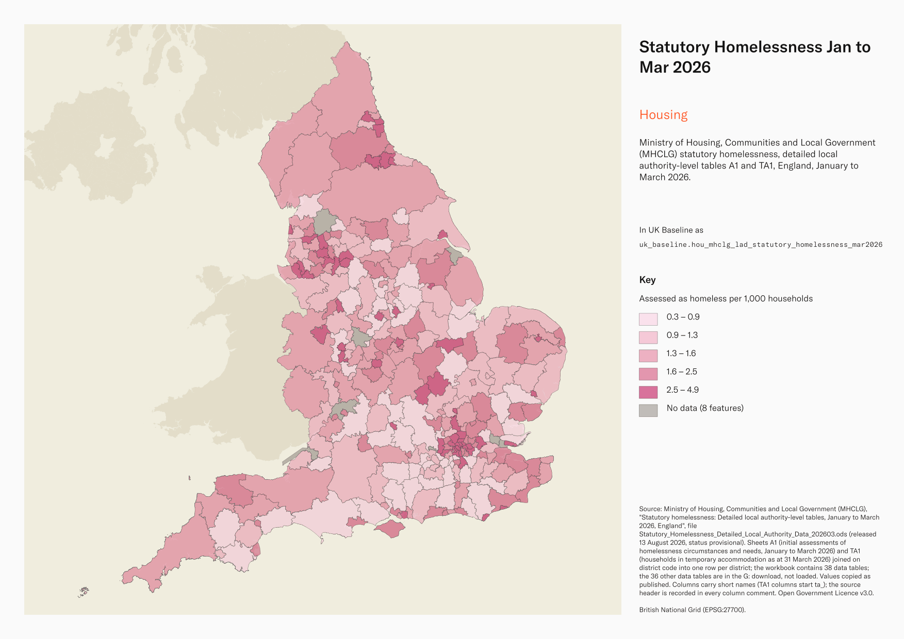
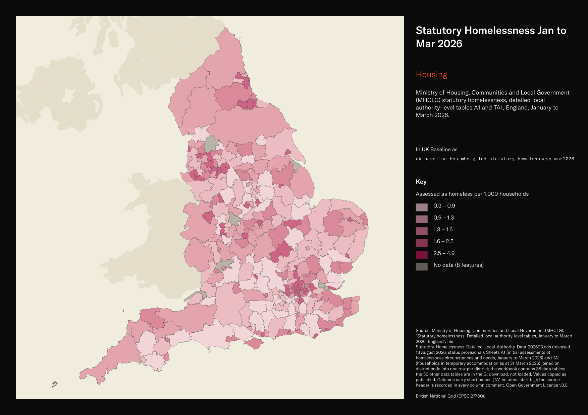

# Ministry of Housing, Communities and Local Government (MHCLG) statutory homelessness, detailed local authority-level tables A1 and TA1, England, January to March 2026

Statutory Homelessness Jan to Mar 2026

`hou_mhclg_lad_statutory_homelessness_mar2026`<button class="md-clipboard md-icon" data-clipboard-text="hou_mhclg_lad_statutory_homelessness_mar2026" title="Copy table name" aria-label="Copy table name" data-search-exclude></button>
{: .layer-table }

**SOURCE**
{: .sec-label }

- Ministry of Housing, Communities and Local Government (MHCLG), "Statutory homelessness: Detailed local authority-level tables, January to March 2026, England", file Statutory_Homelessness_Detailed_Local_Authority_Data_202603.ods (released 13 August 2026, status provisional). Sheets A1 (initial assessments of homelessness circumstances and needs, January to March 2026) and TA1 (households in temporary accommodation as at 31 March 2026) joined on district code into one row per district; the workbook contains 38 data tables; the 36 other data tables are in the G: download, not loaded. Values copied as published. Columns carry short names (TA1 columns start ta_); the source header is recorded in every column comment.

**DOCUMENTATION**
{: .sec-label }

- Live tables : https://www.gov.uk/government/statistical-data-sets/live-tables-on-homelessness
- Release : https://www.gov.uk/government/statistics/statutory-homelessness-in-england-january-to-march-2026

**DEFINITIONS**
{: .sec-label }

- "The relief duty is owed to households that are already homeless on approaching a local authority, and require help to secure settled accommodation." (Definitions sheet)
- The prevention duty is "aimed at preventing a household threatened with homelessness within 56 days from becoming homeless." (Definitions sheet)
- Temporary accommodation is "accommodation secured by a local housing authority under their statutory homelessness functions." (Definitions sheet)
- "Households with children are counted from birth of the child." (Definitions sheet)

**SCOPE**
{: .sec-label }

- England. 296 rows, one per local housing authority, using published codes matched to the May 2025 boundary; every English district in uk_baseline.adm_ons_lad_boundary_may2025.
- A1: assessments made January to March 2026. TA1: stock at 31 March 2026. Rates per thousand households use 2022-based household projections (note 5).

**CRS**
{: .sec-label }

- EPSG:27700 (British National Grid). The source has no geometry; geometry is copied from uk_baseline.adm_ons_lad_boundary_may2025 by matching the source district code to lad25cd. No reprojection.

**LICENCE**
{: .sec-label }

- Open Government Licence v3.0.

**DATA QUALITY CAVEATS**
{: .sec-label }

- County and Spatial Development Strategy columns are England and Wales only; rows elsewhere carry no county or SDS. Wales and the Isles of Scilly carry a county but no SDS. Rows with no Local Authority District code are NULL in all four columns.
- Provisional: "Data in each new release is provisional and subject to revision in future quarters." (cover sheet)
- Empty cells are MHCLG markers, never zero: "[c]" suppressed (388 cells) and "[x]" missing (344 cells). 8 districts made no A1 return and 12 no TA1 return this quarter.
- The households-in-area column appears on both sheets with identical values; it is carried once.
- TA figures are attributed to the reporting authority and can include households accommodated outside its district; the district geometry does not locate their accommodation.

**ENRICHMENT**
{: .sec-label }

- `sds_name` / `sds_group` — Spatial Development Strategy area and devolution status, a Prior + Partners categorisation over Ministry of Housing, Communities and Local Government (MHCLG) English devolution policy, joined at load on the row's Local Authority District 2025 code via uk.ref_lad25_ctyua25_sds_lu_jul2026.

**LOADED INTO uk_baseline**
{: .sec-label }

- Loaded by PNC, 2 November 2026.

## Columns

| Column | Type | Description / unit |
|---|---|---|
| `gid` | `bigint` |  |
| `lad25cd` | `text` | Source field `Organisation Identification Code`; ONS GSS district code as published. The publisher does not state a code-edition year. Matched to the boundary at load. |
| `lad25nm` | `text` | Source field `Area Name`; district name as published. |
| `initial_assessments_total` | `integer` | Source field `Initial assessments \| Total \| [note 2]` on sheet A1, assessments January to March 2026. Unit: households. Empty where MHCLG marks [c] or [x]. |
| `owed_duty_total` | `integer` | Source field `Assessed as owed a duty \| Owed a prevention or relief duty \| Total` on sheet A1, assessments January to March 2026. Unit: households. Empty where MHCLG marks [c] or [x]. |
| `prevention_duty_owed` | `integer` | Source field `Assessed as owed a duty \| Threatened with homelessness within 56 days, Prevention duty owed` on sheet A1, assessments January to March 2026. Unit: households. Empty where MHCLG marks [c] or [x]. |
| `prevention_duty_s21_notice` | `integer` | Source field `Assessed as owed a duty \| Threatened with homelessness due to service of valid section 21 notice \| [note 3]` on sheet A1, assessments January to March 2026. Unit: households. Empty where MHCLG marks [c] or [x]. |
| `relief_duty_owed` | `integer` | Source field `Assessed as owed a duty \| Homeless, Relief duty owed \| [note 4]` on sheet A1, assessments January to March 2026. Unit: households. Empty where MHCLG marks [c] or [x]. |
| `no_duty_not_threatened` | `integer` | Source field `No duty owed \| Not threatened with homelessness within 56 days` on sheet A1, assessments January to March 2026. Unit: households. Empty where MHCLG marks [c] or [x]. |
| `no_duty_withdrew` | `integer` | Source field `No duty owed \| Withdrew application before assessment` on sheet A1, assessments January to March 2026. Unit: households. Empty where MHCLG marks [c] or [x]. |
| `no_duty_not_eligible` | `integer` | Source field `No duty owed \| Not eligible or no longer eligible` on sheet A1, assessments January to March 2026. Unit: households. Empty where MHCLG marks [c] or [x]. |
| `households_in_area_thousands` | `double precision` | Source field `Households in area \| (thousands) \| [note 5]` on sheet A1. Unit: thousands of households, from 2022-based household projections; denominator for the published rates. The identical TA1 denominator is carried once. Empty where MHCLG marks [c] or [x]. |
| `threatened_per_thousand` | `double precision` | Source field `Households assessed as threatened with homelessness \| (per thousand)` on sheet A1, assessments January to March 2026. Unit: "(per thousand)" households in the area. Empty where MHCLG marks [c] or [x]. |
| `homeless_per_thousand` | `double precision` | Source field `Households assessed as homeless \| (per thousand)` on sheet A1, assessments January to March 2026. Unit: "(per thousand)" households in the area. Empty where MHCLG marks [c] or [x]. |
| `ta_households_total` | `integer` | Source field `Households in TA \| Total \| [note 34]` on sheet TA1, as at 31 March 2026. Unit: households. Empty where MHCLG marks [c] or [x]. |
| `ta_per_thousand` | `double precision` | Source field `Households in TA \| Total \| (per thousand) \| Total` on sheet TA1, as at 31 March 2026. Unit: "(per thousand)" households in the area. Empty where MHCLG marks [c] or [x]. |
| `ta_households_with_children` | `integer` | Source field `Households in TA with children \| Total` on sheet TA1, as at 31 March 2026. Unit: households. Empty where MHCLG marks [c] or [x]. |
| `ta_children` | `integer` | Source field `Children in TA \| Total` on sheet TA1, as at 31 March 2026. Unit: children. Empty where MHCLG marks [c] or [x]. |
| `ta_bnb_total` | `integer` | Source field `Households in B&Bs including shared annexes \| Total` on sheet TA1, as at 31 March 2026. Unit: households. Empty where MHCLG marks [c] or [x]. |
| `ta_bnb_with_children` | `integer` | Source field `Households in B&Bs including shared annexes \| With children` on sheet TA1, as at 31 March 2026. Unit: households. Empty where MHCLG marks [c] or [x]. |
| `ta_bnb_children_over_6_weeks` | `integer` | Source field `Households in B&Bs including shared annexes \| With children and resident more than 6 weeks` on sheet TA1, as at 31 March 2026. Unit: households. Empty where MHCLG marks [c] or [x]. |
| `ta_bnb_children_6wk_review` | `integer` | Source field `Households in B&Bs including shared annexes \| With children and resident more than 6 weeks and pending review or appeal` on sheet TA1, as at 31 March 2026. Unit: households. Empty where MHCLG marks [c] or [x]. |
| `ta_bnb_16_17_applicant` | `integer` | Source field `Households in B&Bs including shared annexes \| With 16 or 17 year old main applicant` on sheet TA1, as at 31 March 2026. Unit: households. Empty where MHCLG marks [c] or [x]. |
| `ta_nightly_paid_total` | `integer` | Source field `Households in nightly paid, privately managed accommodation, self-contained \| Total` on sheet TA1, as at 31 March 2026. Unit: households. Empty where MHCLG marks [c] or [x]. |
| `ta_nightly_paid_with_children` | `integer` | Source field `Households in nightly paid, privately managed accommodation, self-contained \| With children` on sheet TA1, as at 31 March 2026. Unit: households. Empty where MHCLG marks [c] or [x]. |
| `ta_hostels_total` | `integer` | Source field `Households in hostels, including reception centres, emergency units and refuges \| Total` on sheet TA1, as at 31 March 2026. Unit: households. Empty where MHCLG marks [c] or [x]. |
| `ta_hostels_with_children` | `integer` | Source field `Households in hostels, including reception centres, emergency units and refuges \| With children` on sheet TA1, as at 31 March 2026. Unit: households. Empty where MHCLG marks [c] or [x]. |
| `ta_private_sector_total` | `integer` | Source field `Households in private sector accommodation \| Total` on sheet TA1, as at 31 March 2026. Unit: households. Empty where MHCLG marks [c] or [x]. |
| `ta_private_sector_children` | `integer` | Source field `Households in private sector accommodation \| With children` on sheet TA1, as at 31 March 2026. Unit: households with children. Empty where MHCLG marks [c] or [x]. |
| `ta_la_ha_stock_total` | `integer` | Source field `Households in LA or HA stock \| Total` on sheet TA1, as at 31 March 2026. Unit: households. Empty where MHCLG marks [c] or [x]. |
| `ta_la_ha_stock_with_children` | `integer` | Source field `Households in LA or HA stock \| With children` on sheet TA1, as at 31 March 2026. Unit: households. Empty where MHCLG marks [c] or [x]. |
| `ta_other_total` | `integer` | Source field `Households in any other type of TA, including private landlord and not known \| Total \| [note 35]` on sheet TA1, as at 31 March 2026. Unit: households. Empty where MHCLG marks [c] or [x]. |
| `ta_other_with_children` | `integer` | Source field `Households in any other type of TA, including private landlord and not known \| With children \| [note 35]` on sheet TA1, as at 31 March 2026. Unit: households. Empty where MHCLG marks [c] or [x]. |
| `ta_duty_in_another_la` | `integer` | Source field `Households owed a TA duty in another LA \| Total \| [note 36]` on sheet TA1, as at 31 March 2026. These households are owed a temporary accommodation duty by the reporting authority and are living in another local authority area. Unit: households. Empty where MHCLG marks [c] or [x]. |
| `ta_no_accommodation_total` | `integer` | Source field `Households in duty owed, no accommodation secured \| Total \| [note 37]` on sheet TA1, as at 31 March 2026. Unit: households. Empty where MHCLG marks [c] or [x]. |
| `ta_no_accommodation_children` | `integer` | Source field `Households in duty owed, no accommodation secured \| With children \| [note 37]` on sheet TA1, as at 31 March 2026. Unit: households with children. Empty where MHCLG marks [c] or [x]. |
| `geom` | `geometry(MultiPolygon,27700)` | MultiPolygon in EPSG:27700, copied at load from the boundary named in the table comment's CRS section. |
| `ctyua25cd` | `text` | County or unitary authority code at 1 April 2025. Joined at load via uk.ref_lad25_ctyua25_sds_lu_jul2026 on the row's Local Authority District 2025 code. Open Government Licence v3.0. |
| `ctyua25nm` | `text` | County or unitary authority name at 1 April 2025. Joined at load via uk.ref_lad25_ctyua25_sds_lu_jul2026 on the row's Local Authority District 2025 code. Open Government Licence v3.0. |
| `sds_name` | `text` | Spatial Development Strategy (SDS) area, a Prior + Partners categorisation over Ministry of Housing, Communities and Local Government (MHCLG) English devolution policy. Joined at load via uk.ref_lad25_ctyua25_sds_lu_jul2026 on the row's Local Authority District 2025 code. Open Government Licence v3.0. |
| `sds_group` | `text` | Devolution status of the Spatial Development Strategy area: Existing Devolution Footprints, Devolution Priority Programme, Other Proposed Geographies or Remaining Areas. Joined at load via uk.ref_lad25_ctyua25_sds_lu_jul2026 on the row's Local Authority District 2025 code. Open Government Licence v3.0. |
| `census_2021_population` | `integer` | Census 2021 usual residents of this area: ONS Census 2021 TS001 "Number of usual residents in households and communal establishments", Census Day 21 March 2021, joined on lad25cd from uk_new.ref_census21_ts001_usual_residents. Unit: "Person". The four unitary authorities formed in April 2023 carry the sum of their former districts' figures; Barnsley and Sheffield carry their 2021 figures under their 2025 codes. |
