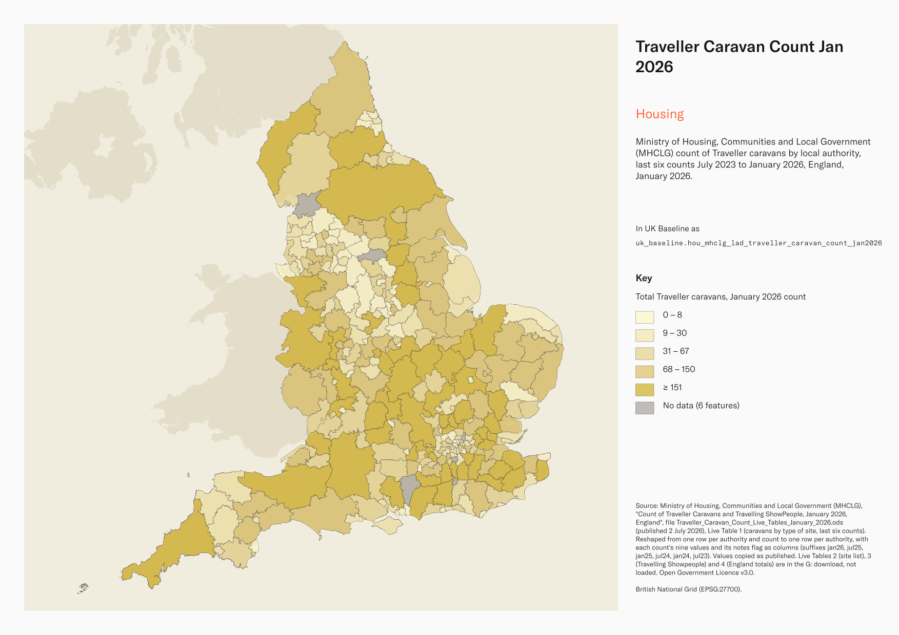
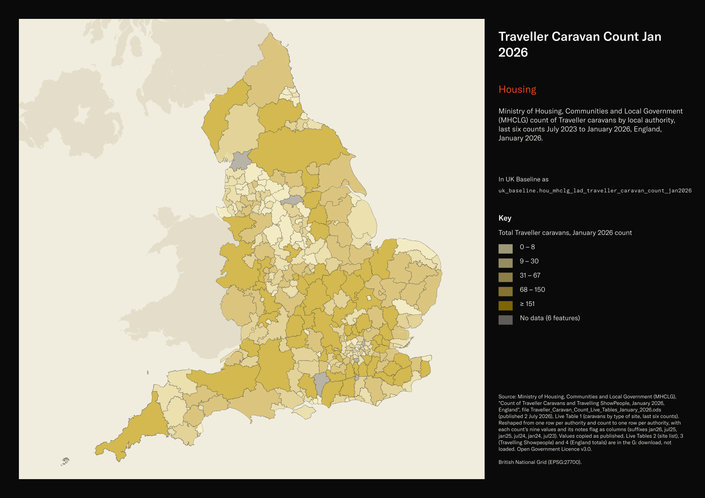

# Ministry of Housing, Communities and Local Government (MHCLG) count of Traveller caravans by local authority, last six counts July 2023 to January 2026, England, January 2026

Traveller Caravan Count Jan 2026

`hou_mhclg_lad_traveller_caravan_count_jan2026`<button class="md-clipboard md-icon" data-clipboard-text="hou_mhclg_lad_traveller_caravan_count_jan2026" title="Copy table name" aria-label="Copy table name" data-search-exclude></button>
{: .layer-table }

**SOURCE**
{: .sec-label }

- Ministry of Housing, Communities and Local Government (MHCLG), "Count of Traveller Caravans and Travelling ShowPeople, January 2026, England", file Traveller_Caravan_Count_Live_Tables_January_2026.ods (published 2 July 2026), Live Table 1 (caravans by type of site, last six counts). Reshaped from one row per authority and count to one row per authority, with each count's nine values and its notes flag as columns (suffixes jan26, jul25, jan25, jul24, jan24, jul23). Values copied as published. Live Tables 2 (site list), 3 (Travelling Showpeople) and 4 (England totals) are in the G: download, not loaded.

**DOCUMENTATION**
{: .sec-label }

- Statistics page : https://www.gov.uk/government/statistics/traveller-caravan-count-january-2026
- Technical notes : https://www.gov.uk/government/statistics/traveller-caravan-count-january-2026/count-of-traveller-caravans-technical-notes

**DEFINITIONS**
{: .sec-label }

- Caravans are "all mobile homes, caravans, trailers and other living vehicles on Gypsy/Traveller sites and encampments, whether or not they meet the strict legal definition of a caravan" (technical notes).
- Unauthorised development: "sites on land owned by travellers for which planning permission had not been granted at the time of count"; unauthorised encampment: "sites on land not owned by travellers and which do not have planning permission" (technical notes).
- The count "does not cover the number of occupants residing in these caravans or caravan sites" (technical notes).

**SCOPE**
{: .sec-label }

- England. 296 rows, one per local authority with housing responsibilities, using published codes matched to the May 2025 boundary; every English district in uk_baseline.adm_ons_lad_boundary_may2025.
- Counts on or around 22 January 2026 and the five previous counts (July 2025, January 2025, July 2024, January 2024, July 2023). From 2026 the count is annual (January only).

**CRS**
{: .sec-label }

- EPSG:27700 (British National Grid). The source has no geometry; geometry is copied from uk_baseline.adm_ons_lad_boundary_may2025 by matching the source district code to lad25cd. No reprojection.

**LICENCE**
{: .sec-label }

- Open Government Licence v3.0.

**DATA QUALITY CAVEATS**
{: .sec-label }

- County and Spatial Development Strategy columns are England and Wales only; rows elsewhere carry no county or SDS. Wales and the Isles of Scilly carry a county but no SDS. Rows with no Local Authority District code are NULL in all four columns.
- Notes flags per count (MHCLG): "[i]" imputed, "records have been carried forward from most recent submitted data"; "[k]" partly imputed; "[n]" long-term non-response, with authority-level values not reported (values empty, 26 authority-counts); "[r]" revised.
- England totals published by MHCLG include long-term non-responders not shown at authority level: the January 2026 district sum is 29,094 against the England figure of 29,402.
- Where a minor boundary change needed a new code, MHCLG uses the current code for every count (for example Barnsley and Sheffield).

**ENRICHMENT**
{: .sec-label }

- `sds_name` / `sds_group` — Spatial Development Strategy area and devolution status, a Prior + Partners categorisation over Ministry of Housing, Communities and Local Government (MHCLG) English devolution policy, joined at load on the row's Local Authority District 2025 code via uk.ref_lad25_ctyua25_sds_lu_jul2026.

**LOADED INTO uk_baseline**
{: .sec-label }

- Loaded by PNC, 2 November 2026.

## Columns

| Column | Type | Description / unit |
|---|---|---|
| `gid` | `bigint` |  |
| `lad25cd` | `text` | Source field `ONS code`; ONS GSS district code as published. The publisher does not state a code-edition year. Matched to the boundary at load. |
| `lad25nm` | `text` | Source field `Local authority/ region name`; district name as published. |
| `region_name` | `text` | Source field `Local authority region`; English region as published. |
| `social_rented_jan26` | `integer` | Source field `Caravans on socially rented sites [note 1]` for the January 2026 count. Unit: caravans. Empty where MHCLG publishes [n] for long-term non-response; populated values may be imputed or revised, as indicated by the corresponding notes column. |
| `private_temporary_jan26` | `integer` | Source field `Caravans on authorised privately funded sites with temporary planning permission` for the January 2026 count. Unit: caravans. Empty where MHCLG publishes [n] for long-term non-response; populated values may be imputed or revised, as indicated by the corresponding notes column. |
| `private_permanent_jan26` | `integer` | Source field `Caravans on authorised privately funded sites with permanent planning permission` for the January 2026 count. Unit: caravans. Empty where MHCLG publishes [n] for long-term non-response; populated values may be imputed or revised, as indicated by the corresponding notes column. |
| `private_total_jan26` | `integer` | Source field `Total caravans on authorised privately funded sites` for the January 2026 count. Unit: caravans. Empty where MHCLG publishes [n] for long-term non-response; populated values may be imputed or revised, as indicated by the corresponding notes column. |
| `unauth_dev_tolerated_jan26` | `integer` | Source field `Tolerated unauthorised caravans on land owned by Travellers` for the January 2026 count. Unit: caravans. Empty where MHCLG publishes [n] for long-term non-response; populated values may be imputed or revised, as indicated by the corresponding notes column. |
| `unauth_dev_not_tolerated_jan26` | `integer` | Source field `Not tolerated unauthorised caravans on land owned by Travellers` for the January 2026 count. Unit: caravans. Empty where MHCLG publishes [n] for long-term non-response; populated values may be imputed or revised, as indicated by the corresponding notes column. |
| `unauth_enc_tolerated_jan26` | `integer` | Source field `Tolerated unauthorised caravans on land not owned by Travellers` for the January 2026 count. Unit: caravans. Empty where MHCLG publishes [n] for long-term non-response; populated values may be imputed or revised, as indicated by the corresponding notes column. |
| `unauth_enc_not_tolerated_jan26` | `integer` | Source field `Not tolerated unauthorised caravans on land not owned by Travellers` for the January 2026 count. Unit: caravans. Empty where MHCLG publishes [n] for long-term non-response; populated values may be imputed or revised, as indicated by the corresponding notes column. |
| `total_caravans_jan26` | `integer` | Source field `Total caravans` for the January 2026 count. Unit: caravans. Empty where MHCLG publishes [n] for long-term non-response; populated values may be imputed or revised, as indicated by the corresponding notes column. |
| `notes_jan26` | `text` | Source field `Notes` for the January 2026 count; MHCLG flag: [i] imputed, [k] partly imputed, [n] long-term non-response, with authority-level values not reported, [r] revised; empty = none. |
| `social_rented_jul25` | `integer` | Source field `Caravans on socially rented sites [note 1]` for the July 2025 count. Unit: caravans. Empty where MHCLG publishes [n] for long-term non-response; populated values may be imputed or revised, as indicated by the corresponding notes column. |
| `private_temporary_jul25` | `integer` | Source field `Caravans on authorised privately funded sites with temporary planning permission` for the July 2025 count. Unit: caravans. Empty where MHCLG publishes [n] for long-term non-response; populated values may be imputed or revised, as indicated by the corresponding notes column. |
| `private_permanent_jul25` | `integer` | Source field `Caravans on authorised privately funded sites with permanent planning permission` for the July 2025 count. Unit: caravans. Empty where MHCLG publishes [n] for long-term non-response; populated values may be imputed or revised, as indicated by the corresponding notes column. |
| `private_total_jul25` | `integer` | Source field `Total caravans on authorised privately funded sites` for the July 2025 count. Unit: caravans. Empty where MHCLG publishes [n] for long-term non-response; populated values may be imputed or revised, as indicated by the corresponding notes column. |
| `unauth_dev_tolerated_jul25` | `integer` | Source field `Tolerated unauthorised caravans on land owned by Travellers` for the July 2025 count. Unit: caravans. Empty where MHCLG publishes [n] for long-term non-response; populated values may be imputed or revised, as indicated by the corresponding notes column. |
| `unauth_dev_not_tolerated_jul25` | `integer` | Source field `Not tolerated unauthorised caravans on land owned by Travellers` for the July 2025 count. Unit: caravans. Empty where MHCLG publishes [n] for long-term non-response; populated values may be imputed or revised, as indicated by the corresponding notes column. |
| `unauth_enc_tolerated_jul25` | `integer` | Source field `Tolerated unauthorised caravans on land not owned by Travellers` for the July 2025 count. Unit: caravans. Empty where MHCLG publishes [n] for long-term non-response; populated values may be imputed or revised, as indicated by the corresponding notes column. |
| `unauth_enc_not_tolerated_jul25` | `integer` | Source field `Not tolerated unauthorised caravans on land not owned by Travellers` for the July 2025 count. Unit: caravans. Empty where MHCLG publishes [n] for long-term non-response; populated values may be imputed or revised, as indicated by the corresponding notes column. |
| `total_caravans_jul25` | `integer` | Source field `Total caravans` for the July 2025 count. Unit: caravans. Empty where MHCLG publishes [n] for long-term non-response; populated values may be imputed or revised, as indicated by the corresponding notes column. |
| `notes_jul25` | `text` | Source field `Notes` for the July 2025 count; MHCLG flag: [i] imputed, [k] partly imputed, [n] long-term non-response, with authority-level values not reported, [r] revised; empty = none. |
| `social_rented_jan25` | `integer` | Source field `Caravans on socially rented sites [note 1]` for the January 2025 count. Unit: caravans. Empty where MHCLG publishes [n] for long-term non-response; populated values may be imputed or revised, as indicated by the corresponding notes column. |
| `private_temporary_jan25` | `integer` | Source field `Caravans on authorised privately funded sites with temporary planning permission` for the January 2025 count. Unit: caravans. Empty where MHCLG publishes [n] for long-term non-response; populated values may be imputed or revised, as indicated by the corresponding notes column. |
| `private_permanent_jan25` | `integer` | Source field `Caravans on authorised privately funded sites with permanent planning permission` for the January 2025 count. Unit: caravans. Empty where MHCLG publishes [n] for long-term non-response; populated values may be imputed or revised, as indicated by the corresponding notes column. |
| `private_total_jan25` | `integer` | Source field `Total caravans on authorised privately funded sites` for the January 2025 count. Unit: caravans. Empty where MHCLG publishes [n] for long-term non-response; populated values may be imputed or revised, as indicated by the corresponding notes column. |
| `unauth_dev_tolerated_jan25` | `integer` | Source field `Tolerated unauthorised caravans on land owned by Travellers` for the January 2025 count. Unit: caravans. Empty where MHCLG publishes [n] for long-term non-response; populated values may be imputed or revised, as indicated by the corresponding notes column. |
| `unauth_dev_not_tolerated_jan25` | `integer` | Source field `Not tolerated unauthorised caravans on land owned by Travellers` for the January 2025 count. Unit: caravans. Empty where MHCLG publishes [n] for long-term non-response; populated values may be imputed or revised, as indicated by the corresponding notes column. |
| `unauth_enc_tolerated_jan25` | `integer` | Source field `Tolerated unauthorised caravans on land not owned by Travellers` for the January 2025 count. Unit: caravans. Empty where MHCLG publishes [n] for long-term non-response; populated values may be imputed or revised, as indicated by the corresponding notes column. |
| `unauth_enc_not_tolerated_jan25` | `integer` | Source field `Not tolerated unauthorised caravans on land not owned by Travellers` for the January 2025 count. Unit: caravans. Empty where MHCLG publishes [n] for long-term non-response; populated values may be imputed or revised, as indicated by the corresponding notes column. |
| `total_caravans_jan25` | `integer` | Source field `Total caravans` for the January 2025 count. Unit: caravans. Empty where MHCLG publishes [n] for long-term non-response; populated values may be imputed or revised, as indicated by the corresponding notes column. |
| `notes_jan25` | `text` | Source field `Notes` for the January 2025 count; MHCLG flag: [i] imputed, [k] partly imputed, [n] long-term non-response, with authority-level values not reported, [r] revised; empty = none. |
| `social_rented_jul24` | `integer` | Source field `Caravans on socially rented sites [note 1]` for the July 2024 count. Unit: caravans. Empty where MHCLG publishes [n] for long-term non-response; populated values may be imputed or revised, as indicated by the corresponding notes column. |
| `private_temporary_jul24` | `integer` | Source field `Caravans on authorised privately funded sites with temporary planning permission` for the July 2024 count. Unit: caravans. Empty where MHCLG publishes [n] for long-term non-response; populated values may be imputed or revised, as indicated by the corresponding notes column. |
| `private_permanent_jul24` | `integer` | Source field `Caravans on authorised privately funded sites with permanent planning permission` for the July 2024 count. Unit: caravans. Empty where MHCLG publishes [n] for long-term non-response; populated values may be imputed or revised, as indicated by the corresponding notes column. |
| `private_total_jul24` | `integer` | Source field `Total caravans on authorised privately funded sites` for the July 2024 count. Unit: caravans. Empty where MHCLG publishes [n] for long-term non-response; populated values may be imputed or revised, as indicated by the corresponding notes column. |
| `unauth_dev_tolerated_jul24` | `integer` | Source field `Tolerated unauthorised caravans on land owned by Travellers` for the July 2024 count. Unit: caravans. Empty where MHCLG publishes [n] for long-term non-response; populated values may be imputed or revised, as indicated by the corresponding notes column. |
| `unauth_dev_not_tolerated_jul24` | `integer` | Source field `Not tolerated unauthorised caravans on land owned by Travellers` for the July 2024 count. Unit: caravans. Empty where MHCLG publishes [n] for long-term non-response; populated values may be imputed or revised, as indicated by the corresponding notes column. |
| `unauth_enc_tolerated_jul24` | `integer` | Source field `Tolerated unauthorised caravans on land not owned by Travellers` for the July 2024 count. Unit: caravans. Empty where MHCLG publishes [n] for long-term non-response; populated values may be imputed or revised, as indicated by the corresponding notes column. |
| `unauth_enc_not_tolerated_jul24` | `integer` | Source field `Not tolerated unauthorised caravans on land not owned by Travellers` for the July 2024 count. Unit: caravans. Empty where MHCLG publishes [n] for long-term non-response; populated values may be imputed or revised, as indicated by the corresponding notes column. |
| `total_caravans_jul24` | `integer` | Source field `Total caravans` for the July 2024 count. Unit: caravans. Empty where MHCLG publishes [n] for long-term non-response; populated values may be imputed or revised, as indicated by the corresponding notes column. |
| `notes_jul24` | `text` | Source field `Notes` for the July 2024 count; MHCLG flag: [i] imputed, [k] partly imputed, [n] long-term non-response, with authority-level values not reported, [r] revised; empty = none. |
| `social_rented_jan24` | `integer` | Source field `Caravans on socially rented sites [note 1]` for the January 2024 count. Unit: caravans. Empty where MHCLG publishes [n] for long-term non-response; populated values may be imputed or revised, as indicated by the corresponding notes column. |
| `private_temporary_jan24` | `integer` | Source field `Caravans on authorised privately funded sites with temporary planning permission` for the January 2024 count. Unit: caravans. Empty where MHCLG publishes [n] for long-term non-response; populated values may be imputed or revised, as indicated by the corresponding notes column. |
| `private_permanent_jan24` | `integer` | Source field `Caravans on authorised privately funded sites with permanent planning permission` for the January 2024 count. Unit: caravans. Empty where MHCLG publishes [n] for long-term non-response; populated values may be imputed or revised, as indicated by the corresponding notes column. |
| `private_total_jan24` | `integer` | Source field `Total caravans on authorised privately funded sites` for the January 2024 count. Unit: caravans. Empty where MHCLG publishes [n] for long-term non-response; populated values may be imputed or revised, as indicated by the corresponding notes column. |
| `unauth_dev_tolerated_jan24` | `integer` | Source field `Tolerated unauthorised caravans on land owned by Travellers` for the January 2024 count. Unit: caravans. Empty where MHCLG publishes [n] for long-term non-response; populated values may be imputed or revised, as indicated by the corresponding notes column. |
| `unauth_dev_not_tolerated_jan24` | `integer` | Source field `Not tolerated unauthorised caravans on land owned by Travellers` for the January 2024 count. Unit: caravans. Empty where MHCLG publishes [n] for long-term non-response; populated values may be imputed or revised, as indicated by the corresponding notes column. |
| `unauth_enc_tolerated_jan24` | `integer` | Source field `Tolerated unauthorised caravans on land not owned by Travellers` for the January 2024 count. Unit: caravans. Empty where MHCLG publishes [n] for long-term non-response; populated values may be imputed or revised, as indicated by the corresponding notes column. |
| `unauth_enc_not_tolerated_jan24` | `integer` | Source field `Not tolerated unauthorised caravans on land not owned by Travellers` for the January 2024 count. Unit: caravans. Empty where MHCLG publishes [n] for long-term non-response; populated values may be imputed or revised, as indicated by the corresponding notes column. |
| `total_caravans_jan24` | `integer` | Source field `Total caravans` for the January 2024 count. Unit: caravans. Empty where MHCLG publishes [n] for long-term non-response; populated values may be imputed or revised, as indicated by the corresponding notes column. |
| `notes_jan24` | `text` | Source field `Notes` for the January 2024 count; MHCLG flag: [i] imputed, [k] partly imputed, [n] long-term non-response, with authority-level values not reported, [r] revised; empty = none. |
| `social_rented_jul23` | `integer` | Source field `Caravans on socially rented sites [note 1]` for the July 2023 count. Unit: caravans. Empty where MHCLG publishes [n] for long-term non-response; populated values may be imputed or revised, as indicated by the corresponding notes column. |
| `private_temporary_jul23` | `integer` | Source field `Caravans on authorised privately funded sites with temporary planning permission` for the July 2023 count. Unit: caravans. Empty where MHCLG publishes [n] for long-term non-response; populated values may be imputed or revised, as indicated by the corresponding notes column. |
| `private_permanent_jul23` | `integer` | Source field `Caravans on authorised privately funded sites with permanent planning permission` for the July 2023 count. Unit: caravans. Empty where MHCLG publishes [n] for long-term non-response; populated values may be imputed or revised, as indicated by the corresponding notes column. |
| `private_total_jul23` | `integer` | Source field `Total caravans on authorised privately funded sites` for the July 2023 count. Unit: caravans. Empty where MHCLG publishes [n] for long-term non-response; populated values may be imputed or revised, as indicated by the corresponding notes column. |
| `unauth_dev_tolerated_jul23` | `integer` | Source field `Tolerated unauthorised caravans on land owned by Travellers` for the July 2023 count. Unit: caravans. Empty where MHCLG publishes [n] for long-term non-response; populated values may be imputed or revised, as indicated by the corresponding notes column. |
| `unauth_dev_not_tolerated_jul23` | `integer` | Source field `Not tolerated unauthorised caravans on land owned by Travellers` for the July 2023 count. Unit: caravans. Empty where MHCLG publishes [n] for long-term non-response; populated values may be imputed or revised, as indicated by the corresponding notes column. |
| `unauth_enc_tolerated_jul23` | `integer` | Source field `Tolerated unauthorised caravans on land not owned by Travellers` for the July 2023 count. Unit: caravans. Empty where MHCLG publishes [n] for long-term non-response; populated values may be imputed or revised, as indicated by the corresponding notes column. |
| `unauth_enc_not_tolerated_jul23` | `integer` | Source field `Not tolerated unauthorised caravans on land not owned by Travellers` for the July 2023 count. Unit: caravans. Empty where MHCLG publishes [n] for long-term non-response; populated values may be imputed or revised, as indicated by the corresponding notes column. |
| `total_caravans_jul23` | `integer` | Source field `Total caravans` for the July 2023 count. Unit: caravans. Empty where MHCLG publishes [n] for long-term non-response; populated values may be imputed or revised, as indicated by the corresponding notes column. |
| `notes_jul23` | `text` | Source field `Notes` for the July 2023 count; MHCLG flag: [i] imputed, [k] partly imputed, [n] long-term non-response, with authority-level values not reported, [r] revised; empty = none. |
| `geom` | `geometry(MultiPolygon,27700)` | MultiPolygon in EPSG:27700, copied at load from the boundary named in the table comment's CRS section. |
| `ctyua25cd` | `text` | County or unitary authority code at 1 April 2025. Joined at load via uk.ref_lad25_ctyua25_sds_lu_jul2026 on the row's Local Authority District 2025 code. Open Government Licence v3.0. |
| `ctyua25nm` | `text` | County or unitary authority name at 1 April 2025. Joined at load via uk.ref_lad25_ctyua25_sds_lu_jul2026 on the row's Local Authority District 2025 code. Open Government Licence v3.0. |
| `sds_name` | `text` | Spatial Development Strategy (SDS) area, a Prior + Partners categorisation over Ministry of Housing, Communities and Local Government (MHCLG) English devolution policy. Joined at load via uk.ref_lad25_ctyua25_sds_lu_jul2026 on the row's Local Authority District 2025 code. Open Government Licence v3.0. |
| `sds_group` | `text` | Devolution status of the Spatial Development Strategy area: Existing Devolution Footprints, Devolution Priority Programme, Other Proposed Geographies or Remaining Areas. Joined at load via uk.ref_lad25_ctyua25_sds_lu_jul2026 on the row's Local Authority District 2025 code. Open Government Licence v3.0. |
| `census_2021_population` | `integer` | Census 2021 usual residents of this area: ONS Census 2021 TS001 "Number of usual residents in households and communal establishments", Census Day 21 March 2021, joined on lad25cd from uk_new.ref_census21_ts001_usual_residents. Unit: "Person". The four unitary authorities formed in April 2023 carry the sum of their former districts' figures; Barnsley and Sheffield carry their 2021 figures under their 2025 codes. |
