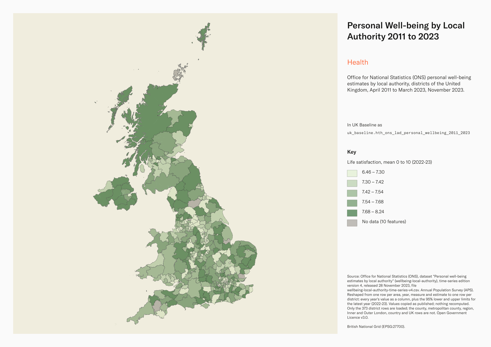
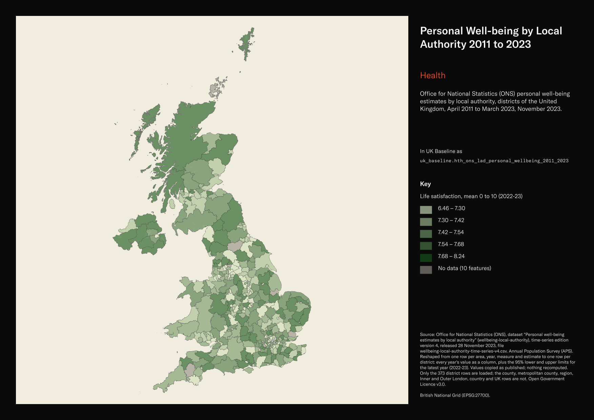

# Office for National Statistics (ONS) personal well-being estimates by local authority, districts of the United Kingdom, April 2011 to March 2023, November 2023

Personal Well-being by Local Authority 2011 to 2023

`hth_ons_lad_personal_wellbeing_2011_2023`<button class="md-clipboard md-icon" data-clipboard-text="hth_ons_lad_personal_wellbeing_2011_2023" title="Copy table name" aria-label="Copy table name" data-search-exclude></button>
{: .layer-table }

**SOURCE**
{: .sec-label }

- Office for National Statistics (ONS), dataset "Personal well-being estimates by local authority" (wellbeing-local-authority), time-series edition version 4, released 28 November 2023, file wellbeing-local-authority-time-series-v4.csv. Annual Population Survey (APS). Reshaped from one row per area, year, measure and estimate to one row per district: every year's value as a column, plus the 95% lower and upper limits for the latest year (2022-23). Values copied as published; nothing recomputed. Only the 373 district rows are loaded; the county, metropolitan county, region, Inner and Outer London, country and UK rows are not.

**DOCUMENTATION**
{: .sec-label }

- ONS dataset : https://www.ons.gov.uk/datasets/wellbeing-local-authority/editions/time-series/versions/4
- Annual personal well-being estimates : https://www.ons.gov.uk/peoplepopulationandcommunity/wellbeing/datasets/headlineestimatesofpersonalwellbeing
- Personal well-being in the UK: April 2022 to March 2023 : https://www.ons.gov.uk/peoplepopulationandcommunity/wellbeing/bulletins/measuringnationalwellbeing/april2022tomarch2023
- Quality and methodology : https://www.ons.gov.uk/peoplepopulationandcommunity/wellbeing/methodologies/personalwellbeingintheukqmi

**DEFINITIONS**
{: .sec-label }

- The four questions: "overall, how satisfied are you with your life nowadays? overall, to what extent do you feel the things you do in your life are worthwhile? overall, how happy did you feel yesterday? overall, how anxious did you feel yesterday?" "People are asked to respond on a scale of 0 to 10, where 0 is "not at all" and 10 is "completely"." (ONS bulletin glossary)
- Thresholds: for life satisfaction, worthwhile and happiness "0 to 4 (low) 5 to 6 (medium) 7 to 8 (high) 9 to 10 (very high)"; for anxiety "0 to 1 (very low) 2 to 3 (low) 4 to 5 (medium) 6 to 10 (high)" (ONS bulletin glossary).
- "Poor = Low levels of life satisfaction, worthwhile, happiness and high levels of anxiety." "Fair = Medium levels". "Good = High levels of life satisfaction, worthwhile, happiness and low levels of anxiety." "Very good = Very high levels of life satisfaction, worthwhile, happiness and very low levels of anxiety." (ONS dataset metadata)

**SCOPE**
{: .sec-label }

- United Kingdom. 373 rows, one per local authority district on May 2022 codes (England 308, Wales 22, Scotland 32, Northern Ireland 11). The Isles of Scilly is not published.
- Financial years April 2011 to March 2012 through April 2022 to March 2023 (12 years).

**CRS**
{: .sec-label }

- EPSG:27700 (British National Grid). The source has no geometry; geometry is copied from uk_baseline.adm_ons_lad_boundary_may2022 by matching `administrative-geography` to lad22cd. No reprojection.

**LICENCE**
{: .sec-label }

- Open Government Licence v3.0.

**DATA QUALITY CAVEATS**
{: .sec-label }

- County and Spatial Development Strategy columns are England and Wales only; rows elsewhere carry no county or SDS. Wales and the Isles of Scilly carry a county but no SDS. Rows with no Local Authority District code are NULL in all four columns.
- `lad25cd` and `lad25nm` cover England and Wales only; Scottish and Northern Irish rows carry no 2025 district code.
- Survey estimates. Empty cells are suppressed or missing at source, never zero: "[c]" small number of respondents, "[w]" no people recorded in the category, "[u]" sample of 50 or fewer, "[x]" not available (ONS dataset notes). In the loaded rows 5,798 of 89,520 yearly value cells and 1,436 of 14,920 latest-year limit cells are empty for these reasons.
- ONS paused the local authority release after this edition; "As of 8 October 2024, ONS statistics produced from the Annual Population Survey are not considered accredited official statistics and are designated as official statistics in development" (ONS bulletin notice). This 2022-23 edition is the latest at local authority level.
- Districts are on their 2022 codes; Cumbria, North Yorkshire and Somerset districts abolished in April 2023 still appear as separate rows.
- Never average districts unweighted; the estimates carry no respondent counts.

**ENRICHMENT**
{: .sec-label }

- `sds_name` / `sds_group` — Spatial Development Strategy area and devolution status, a Prior + Partners categorisation over Ministry of Housing, Communities and Local Government (MHCLG) English devolution policy, joined at load on the row's Local Authority District 2025 code via uk.ref_lad25_ctyua25_sds_lu_jul2026.

**LOADED INTO uk_baseline**
{: .sec-label }

- Loaded by PNC, 2 November 2026.

## Columns

| Column | Type | Description / unit |
|---|---|---|
| `gid` | `bigint` |  |
| `lad22cd` | `text` | Source field `administrative-geography`; Local Authority District code (May 2022 codes). Matched to the boundary at load. |
| `lad22nm` | `text` | Source field `Geography`; district name as published. |
| `lifesat_mean_2011_12` | `double precision` | Source field `v4_3` for measure `life-satisfaction`, estimate `average-mean`, time `2011-12`; Life satisfaction, Average (mean), 2011-12 (April 2011 to March 2012). Unit: mean rating on the 0 to 10 scale. Empty where ONS suppressed or did not publish the value. |
| `lifesat_mean_2012_13` | `double precision` | Source field `v4_3` for measure `life-satisfaction`, estimate `average-mean`, time `2012-13`; Life satisfaction, Average (mean), 2012-13 (April 2012 to March 2013). Unit: mean rating on the 0 to 10 scale. Empty where ONS suppressed or did not publish the value. |
| `lifesat_mean_2013_14` | `double precision` | Source field `v4_3` for measure `life-satisfaction`, estimate `average-mean`, time `2013-14`; Life satisfaction, Average (mean), 2013-14 (April 2013 to March 2014). Unit: mean rating on the 0 to 10 scale. Empty where ONS suppressed or did not publish the value. |
| `lifesat_mean_2014_15` | `double precision` | Source field `v4_3` for measure `life-satisfaction`, estimate `average-mean`, time `2014-15`; Life satisfaction, Average (mean), 2014-15 (April 2014 to March 2015). Unit: mean rating on the 0 to 10 scale. Empty where ONS suppressed or did not publish the value. |
| `lifesat_mean_2015_16` | `double precision` | Source field `v4_3` for measure `life-satisfaction`, estimate `average-mean`, time `2015-16`; Life satisfaction, Average (mean), 2015-16 (April 2015 to March 2016). Unit: mean rating on the 0 to 10 scale. Empty where ONS suppressed or did not publish the value. |
| `lifesat_mean_2016_17` | `double precision` | Source field `v4_3` for measure `life-satisfaction`, estimate `average-mean`, time `2016-17`; Life satisfaction, Average (mean), 2016-17 (April 2016 to March 2017). Unit: mean rating on the 0 to 10 scale. Empty where ONS suppressed or did not publish the value. |
| `lifesat_mean_2017_18` | `double precision` | Source field `v4_3` for measure `life-satisfaction`, estimate `average-mean`, time `2017-18`; Life satisfaction, Average (mean), 2017-18 (April 2017 to March 2018). Unit: mean rating on the 0 to 10 scale. Empty where ONS suppressed or did not publish the value. |
| `lifesat_mean_2018_19` | `double precision` | Source field `v4_3` for measure `life-satisfaction`, estimate `average-mean`, time `2018-19`; Life satisfaction, Average (mean), 2018-19 (April 2018 to March 2019). Unit: mean rating on the 0 to 10 scale. Empty where ONS suppressed or did not publish the value. |
| `lifesat_mean_2019_20` | `double precision` | Source field `v4_3` for measure `life-satisfaction`, estimate `average-mean`, time `2019-20`; Life satisfaction, Average (mean), 2019-20 (April 2019 to March 2020). Unit: mean rating on the 0 to 10 scale. Empty where ONS suppressed or did not publish the value. |
| `lifesat_mean_2020_21` | `double precision` | Source field `v4_3` for measure `life-satisfaction`, estimate `average-mean`, time `2020-21`; Life satisfaction, Average (mean), 2020-21 (April 2020 to March 2021). Unit: mean rating on the 0 to 10 scale. Empty where ONS suppressed or did not publish the value. |
| `lifesat_mean_2021_22` | `double precision` | Source field `v4_3` for measure `life-satisfaction`, estimate `average-mean`, time `2021-22`; Life satisfaction, Average (mean), 2021-22 (April 2021 to March 2022). Unit: mean rating on the 0 to 10 scale. Empty where ONS suppressed or did not publish the value. |
| `lifesat_mean_2022_23` | `double precision` | Source field `v4_3` for measure `life-satisfaction`, estimate `average-mean`, time `2022-23`; Life satisfaction, Average (mean), 2022-23 (April 2022 to March 2023). Unit: mean rating on the 0 to 10 scale. Empty where ONS suppressed or did not publish the value. |
| `lifesat_mean_2022_23_lower` | `double precision` | Source field `Lower limit` for measure `life-satisfaction`, estimate `average-mean`, time `2022-23`; lower 95% limit of the Life satisfaction, Average (mean), 2022-23 (April 2022 to March 2023). Unit: mean rating on the 0 to 10 scale. Empty where ONS suppressed or did not publish the value. |
| `lifesat_mean_2022_23_upper` | `double precision` | Source field `Upper limit` for measure `life-satisfaction`, estimate `average-mean`, time `2022-23`; upper 95% limit of the Life satisfaction, Average (mean), 2022-23 (April 2022 to March 2023). Unit: mean rating on the 0 to 10 scale. Empty where ONS suppressed or did not publish the value. |
| `lifesat_poor_2011_12` | `double precision` | Source field `v4_3` for measure `life-satisfaction`, estimate `poor`, time `2011-12`; Life satisfaction, Poor, 2011-12 (April 2011 to March 2012). Unit: percentage of respondents in this threshold band. Empty where ONS suppressed or did not publish the value. |
| `lifesat_poor_2012_13` | `double precision` | Source field `v4_3` for measure `life-satisfaction`, estimate `poor`, time `2012-13`; Life satisfaction, Poor, 2012-13 (April 2012 to March 2013). Unit: percentage of respondents in this threshold band. Empty where ONS suppressed or did not publish the value. |
| `lifesat_poor_2013_14` | `double precision` | Source field `v4_3` for measure `life-satisfaction`, estimate `poor`, time `2013-14`; Life satisfaction, Poor, 2013-14 (April 2013 to March 2014). Unit: percentage of respondents in this threshold band. Empty where ONS suppressed or did not publish the value. |
| `lifesat_poor_2014_15` | `double precision` | Source field `v4_3` for measure `life-satisfaction`, estimate `poor`, time `2014-15`; Life satisfaction, Poor, 2014-15 (April 2014 to March 2015). Unit: percentage of respondents in this threshold band. Empty where ONS suppressed or did not publish the value. |
| `lifesat_poor_2015_16` | `double precision` | Source field `v4_3` for measure `life-satisfaction`, estimate `poor`, time `2015-16`; Life satisfaction, Poor, 2015-16 (April 2015 to March 2016). Unit: percentage of respondents in this threshold band. Empty where ONS suppressed or did not publish the value. |
| `lifesat_poor_2016_17` | `double precision` | Source field `v4_3` for measure `life-satisfaction`, estimate `poor`, time `2016-17`; Life satisfaction, Poor, 2016-17 (April 2016 to March 2017). Unit: percentage of respondents in this threshold band. Empty where ONS suppressed or did not publish the value. |
| `lifesat_poor_2017_18` | `double precision` | Source field `v4_3` for measure `life-satisfaction`, estimate `poor`, time `2017-18`; Life satisfaction, Poor, 2017-18 (April 2017 to March 2018). Unit: percentage of respondents in this threshold band. Empty where ONS suppressed or did not publish the value. |
| `lifesat_poor_2018_19` | `double precision` | Source field `v4_3` for measure `life-satisfaction`, estimate `poor`, time `2018-19`; Life satisfaction, Poor, 2018-19 (April 2018 to March 2019). Unit: percentage of respondents in this threshold band. Empty where ONS suppressed or did not publish the value. |
| `lifesat_poor_2019_20` | `double precision` | Source field `v4_3` for measure `life-satisfaction`, estimate `poor`, time `2019-20`; Life satisfaction, Poor, 2019-20 (April 2019 to March 2020). Unit: percentage of respondents in this threshold band. Empty where ONS suppressed or did not publish the value. |
| `lifesat_poor_2020_21` | `double precision` | Source field `v4_3` for measure `life-satisfaction`, estimate `poor`, time `2020-21`; Life satisfaction, Poor, 2020-21 (April 2020 to March 2021). Unit: percentage of respondents in this threshold band. Empty where ONS suppressed or did not publish the value. |
| `lifesat_poor_2021_22` | `double precision` | Source field `v4_3` for measure `life-satisfaction`, estimate `poor`, time `2021-22`; Life satisfaction, Poor, 2021-22 (April 2021 to March 2022). Unit: percentage of respondents in this threshold band. Empty where ONS suppressed or did not publish the value. |
| `lifesat_poor_2022_23` | `double precision` | Source field `v4_3` for measure `life-satisfaction`, estimate `poor`, time `2022-23`; Life satisfaction, Poor, 2022-23 (April 2022 to March 2023). Unit: percentage of respondents in this threshold band. Empty where ONS suppressed or did not publish the value. |
| `lifesat_poor_2022_23_lower` | `double precision` | Source field `Lower limit` for measure `life-satisfaction`, estimate `poor`, time `2022-23`; lower 95% limit of the Life satisfaction, Poor, 2022-23 (April 2022 to March 2023). Unit: percentage of respondents in this threshold band. Empty where ONS suppressed or did not publish the value. |
| `lifesat_poor_2022_23_upper` | `double precision` | Source field `Upper limit` for measure `life-satisfaction`, estimate `poor`, time `2022-23`; upper 95% limit of the Life satisfaction, Poor, 2022-23 (April 2022 to March 2023). Unit: percentage of respondents in this threshold band. Empty where ONS suppressed or did not publish the value. |
| `lifesat_fair_2011_12` | `double precision` | Source field `v4_3` for measure `life-satisfaction`, estimate `fair`, time `2011-12`; Life satisfaction, Fair, 2011-12 (April 2011 to March 2012). Unit: percentage of respondents in this threshold band. Empty where ONS suppressed or did not publish the value. |
| `lifesat_fair_2012_13` | `double precision` | Source field `v4_3` for measure `life-satisfaction`, estimate `fair`, time `2012-13`; Life satisfaction, Fair, 2012-13 (April 2012 to March 2013). Unit: percentage of respondents in this threshold band. Empty where ONS suppressed or did not publish the value. |
| `lifesat_fair_2013_14` | `double precision` | Source field `v4_3` for measure `life-satisfaction`, estimate `fair`, time `2013-14`; Life satisfaction, Fair, 2013-14 (April 2013 to March 2014). Unit: percentage of respondents in this threshold band. Empty where ONS suppressed or did not publish the value. |
| `lifesat_fair_2014_15` | `double precision` | Source field `v4_3` for measure `life-satisfaction`, estimate `fair`, time `2014-15`; Life satisfaction, Fair, 2014-15 (April 2014 to March 2015). Unit: percentage of respondents in this threshold band. Empty where ONS suppressed or did not publish the value. |
| `lifesat_fair_2015_16` | `double precision` | Source field `v4_3` for measure `life-satisfaction`, estimate `fair`, time `2015-16`; Life satisfaction, Fair, 2015-16 (April 2015 to March 2016). Unit: percentage of respondents in this threshold band. Empty where ONS suppressed or did not publish the value. |
| `lifesat_fair_2016_17` | `double precision` | Source field `v4_3` for measure `life-satisfaction`, estimate `fair`, time `2016-17`; Life satisfaction, Fair, 2016-17 (April 2016 to March 2017). Unit: percentage of respondents in this threshold band. Empty where ONS suppressed or did not publish the value. |
| `lifesat_fair_2017_18` | `double precision` | Source field `v4_3` for measure `life-satisfaction`, estimate `fair`, time `2017-18`; Life satisfaction, Fair, 2017-18 (April 2017 to March 2018). Unit: percentage of respondents in this threshold band. Empty where ONS suppressed or did not publish the value. |
| `lifesat_fair_2018_19` | `double precision` | Source field `v4_3` for measure `life-satisfaction`, estimate `fair`, time `2018-19`; Life satisfaction, Fair, 2018-19 (April 2018 to March 2019). Unit: percentage of respondents in this threshold band. Empty where ONS suppressed or did not publish the value. |
| `lifesat_fair_2019_20` | `double precision` | Source field `v4_3` for measure `life-satisfaction`, estimate `fair`, time `2019-20`; Life satisfaction, Fair, 2019-20 (April 2019 to March 2020). Unit: percentage of respondents in this threshold band. Empty where ONS suppressed or did not publish the value. |
| `lifesat_fair_2020_21` | `double precision` | Source field `v4_3` for measure `life-satisfaction`, estimate `fair`, time `2020-21`; Life satisfaction, Fair, 2020-21 (April 2020 to March 2021). Unit: percentage of respondents in this threshold band. Empty where ONS suppressed or did not publish the value. |
| `lifesat_fair_2021_22` | `double precision` | Source field `v4_3` for measure `life-satisfaction`, estimate `fair`, time `2021-22`; Life satisfaction, Fair, 2021-22 (April 2021 to March 2022). Unit: percentage of respondents in this threshold band. Empty where ONS suppressed or did not publish the value. |
| `lifesat_fair_2022_23` | `double precision` | Source field `v4_3` for measure `life-satisfaction`, estimate `fair`, time `2022-23`; Life satisfaction, Fair, 2022-23 (April 2022 to March 2023). Unit: percentage of respondents in this threshold band. Empty where ONS suppressed or did not publish the value. |
| `lifesat_fair_2022_23_lower` | `double precision` | Source field `Lower limit` for measure `life-satisfaction`, estimate `fair`, time `2022-23`; lower 95% limit of the Life satisfaction, Fair, 2022-23 (April 2022 to March 2023). Unit: percentage of respondents in this threshold band. Empty where ONS suppressed or did not publish the value. |
| `lifesat_fair_2022_23_upper` | `double precision` | Source field `Upper limit` for measure `life-satisfaction`, estimate `fair`, time `2022-23`; upper 95% limit of the Life satisfaction, Fair, 2022-23 (April 2022 to March 2023). Unit: percentage of respondents in this threshold band. Empty where ONS suppressed or did not publish the value. |
| `lifesat_good_2011_12` | `double precision` | Source field `v4_3` for measure `life-satisfaction`, estimate `good`, time `2011-12`; Life satisfaction, Good, 2011-12 (April 2011 to March 2012). Unit: percentage of respondents in this threshold band. Empty where ONS suppressed or did not publish the value. |
| `lifesat_good_2012_13` | `double precision` | Source field `v4_3` for measure `life-satisfaction`, estimate `good`, time `2012-13`; Life satisfaction, Good, 2012-13 (April 2012 to March 2013). Unit: percentage of respondents in this threshold band. Empty where ONS suppressed or did not publish the value. |
| `lifesat_good_2013_14` | `double precision` | Source field `v4_3` for measure `life-satisfaction`, estimate `good`, time `2013-14`; Life satisfaction, Good, 2013-14 (April 2013 to March 2014). Unit: percentage of respondents in this threshold band. Empty where ONS suppressed or did not publish the value. |
| `lifesat_good_2014_15` | `double precision` | Source field `v4_3` for measure `life-satisfaction`, estimate `good`, time `2014-15`; Life satisfaction, Good, 2014-15 (April 2014 to March 2015). Unit: percentage of respondents in this threshold band. Empty where ONS suppressed or did not publish the value. |
| `lifesat_good_2015_16` | `double precision` | Source field `v4_3` for measure `life-satisfaction`, estimate `good`, time `2015-16`; Life satisfaction, Good, 2015-16 (April 2015 to March 2016). Unit: percentage of respondents in this threshold band. Empty where ONS suppressed or did not publish the value. |
| `lifesat_good_2016_17` | `double precision` | Source field `v4_3` for measure `life-satisfaction`, estimate `good`, time `2016-17`; Life satisfaction, Good, 2016-17 (April 2016 to March 2017). Unit: percentage of respondents in this threshold band. Empty where ONS suppressed or did not publish the value. |
| `lifesat_good_2017_18` | `double precision` | Source field `v4_3` for measure `life-satisfaction`, estimate `good`, time `2017-18`; Life satisfaction, Good, 2017-18 (April 2017 to March 2018). Unit: percentage of respondents in this threshold band. Empty where ONS suppressed or did not publish the value. |
| `lifesat_good_2018_19` | `double precision` | Source field `v4_3` for measure `life-satisfaction`, estimate `good`, time `2018-19`; Life satisfaction, Good, 2018-19 (April 2018 to March 2019). Unit: percentage of respondents in this threshold band. Empty where ONS suppressed or did not publish the value. |
| `lifesat_good_2019_20` | `double precision` | Source field `v4_3` for measure `life-satisfaction`, estimate `good`, time `2019-20`; Life satisfaction, Good, 2019-20 (April 2019 to March 2020). Unit: percentage of respondents in this threshold band. Empty where ONS suppressed or did not publish the value. |
| `lifesat_good_2020_21` | `double precision` | Source field `v4_3` for measure `life-satisfaction`, estimate `good`, time `2020-21`; Life satisfaction, Good, 2020-21 (April 2020 to March 2021). Unit: percentage of respondents in this threshold band. Empty where ONS suppressed or did not publish the value. |
| `lifesat_good_2021_22` | `double precision` | Source field `v4_3` for measure `life-satisfaction`, estimate `good`, time `2021-22`; Life satisfaction, Good, 2021-22 (April 2021 to March 2022). Unit: percentage of respondents in this threshold band. Empty where ONS suppressed or did not publish the value. |
| `lifesat_good_2022_23` | `double precision` | Source field `v4_3` for measure `life-satisfaction`, estimate `good`, time `2022-23`; Life satisfaction, Good, 2022-23 (April 2022 to March 2023). Unit: percentage of respondents in this threshold band. Empty where ONS suppressed or did not publish the value. |
| `lifesat_good_2022_23_lower` | `double precision` | Source field `Lower limit` for measure `life-satisfaction`, estimate `good`, time `2022-23`; lower 95% limit of the Life satisfaction, Good, 2022-23 (April 2022 to March 2023). Unit: percentage of respondents in this threshold band. Empty where ONS suppressed or did not publish the value. |
| `lifesat_good_2022_23_upper` | `double precision` | Source field `Upper limit` for measure `life-satisfaction`, estimate `good`, time `2022-23`; upper 95% limit of the Life satisfaction, Good, 2022-23 (April 2022 to March 2023). Unit: percentage of respondents in this threshold band. Empty where ONS suppressed or did not publish the value. |
| `lifesat_vgood_2011_12` | `double precision` | Source field `v4_3` for measure `life-satisfaction`, estimate `very-good`, time `2011-12`; Life satisfaction, Very good, 2011-12 (April 2011 to March 2012). Unit: percentage of respondents in this threshold band. Empty where ONS suppressed or did not publish the value. |
| `lifesat_vgood_2012_13` | `double precision` | Source field `v4_3` for measure `life-satisfaction`, estimate `very-good`, time `2012-13`; Life satisfaction, Very good, 2012-13 (April 2012 to March 2013). Unit: percentage of respondents in this threshold band. Empty where ONS suppressed or did not publish the value. |
| `lifesat_vgood_2013_14` | `double precision` | Source field `v4_3` for measure `life-satisfaction`, estimate `very-good`, time `2013-14`; Life satisfaction, Very good, 2013-14 (April 2013 to March 2014). Unit: percentage of respondents in this threshold band. Empty where ONS suppressed or did not publish the value. |
| `lifesat_vgood_2014_15` | `double precision` | Source field `v4_3` for measure `life-satisfaction`, estimate `very-good`, time `2014-15`; Life satisfaction, Very good, 2014-15 (April 2014 to March 2015). Unit: percentage of respondents in this threshold band. Empty where ONS suppressed or did not publish the value. |
| `lifesat_vgood_2015_16` | `double precision` | Source field `v4_3` for measure `life-satisfaction`, estimate `very-good`, time `2015-16`; Life satisfaction, Very good, 2015-16 (April 2015 to March 2016). Unit: percentage of respondents in this threshold band. Empty where ONS suppressed or did not publish the value. |
| `lifesat_vgood_2016_17` | `double precision` | Source field `v4_3` for measure `life-satisfaction`, estimate `very-good`, time `2016-17`; Life satisfaction, Very good, 2016-17 (April 2016 to March 2017). Unit: percentage of respondents in this threshold band. Empty where ONS suppressed or did not publish the value. |
| `lifesat_vgood_2017_18` | `double precision` | Source field `v4_3` for measure `life-satisfaction`, estimate `very-good`, time `2017-18`; Life satisfaction, Very good, 2017-18 (April 2017 to March 2018). Unit: percentage of respondents in this threshold band. Empty where ONS suppressed or did not publish the value. |
| `lifesat_vgood_2018_19` | `double precision` | Source field `v4_3` for measure `life-satisfaction`, estimate `very-good`, time `2018-19`; Life satisfaction, Very good, 2018-19 (April 2018 to March 2019). Unit: percentage of respondents in this threshold band. Empty where ONS suppressed or did not publish the value. |
| `lifesat_vgood_2019_20` | `double precision` | Source field `v4_3` for measure `life-satisfaction`, estimate `very-good`, time `2019-20`; Life satisfaction, Very good, 2019-20 (April 2019 to March 2020). Unit: percentage of respondents in this threshold band. Empty where ONS suppressed or did not publish the value. |
| `lifesat_vgood_2020_21` | `double precision` | Source field `v4_3` for measure `life-satisfaction`, estimate `very-good`, time `2020-21`; Life satisfaction, Very good, 2020-21 (April 2020 to March 2021). Unit: percentage of respondents in this threshold band. Empty where ONS suppressed or did not publish the value. |
| `lifesat_vgood_2021_22` | `double precision` | Source field `v4_3` for measure `life-satisfaction`, estimate `very-good`, time `2021-22`; Life satisfaction, Very good, 2021-22 (April 2021 to March 2022). Unit: percentage of respondents in this threshold band. Empty where ONS suppressed or did not publish the value. |
| `lifesat_vgood_2022_23` | `double precision` | Source field `v4_3` for measure `life-satisfaction`, estimate `very-good`, time `2022-23`; Life satisfaction, Very good, 2022-23 (April 2022 to March 2023). Unit: percentage of respondents in this threshold band. Empty where ONS suppressed or did not publish the value. |
| `lifesat_vgood_2022_23_lower` | `double precision` | Source field `Lower limit` for measure `life-satisfaction`, estimate `very-good`, time `2022-23`; lower 95% limit of the Life satisfaction, Very good, 2022-23 (April 2022 to March 2023). Unit: percentage of respondents in this threshold band. Empty where ONS suppressed or did not publish the value. |
| `lifesat_vgood_2022_23_upper` | `double precision` | Source field `Upper limit` for measure `life-satisfaction`, estimate `very-good`, time `2022-23`; upper 95% limit of the Life satisfaction, Very good, 2022-23 (April 2022 to March 2023). Unit: percentage of respondents in this threshold band. Empty where ONS suppressed or did not publish the value. |
| `worth_mean_2011_12` | `double precision` | Source field `v4_3` for measure `worthwhile`, estimate `average-mean`, time `2011-12`; Worthwhile, Average (mean), 2011-12 (April 2011 to March 2012). Unit: mean rating on the 0 to 10 scale. Empty where ONS suppressed or did not publish the value. |
| `worth_mean_2012_13` | `double precision` | Source field `v4_3` for measure `worthwhile`, estimate `average-mean`, time `2012-13`; Worthwhile, Average (mean), 2012-13 (April 2012 to March 2013). Unit: mean rating on the 0 to 10 scale. Empty where ONS suppressed or did not publish the value. |
| `worth_mean_2013_14` | `double precision` | Source field `v4_3` for measure `worthwhile`, estimate `average-mean`, time `2013-14`; Worthwhile, Average (mean), 2013-14 (April 2013 to March 2014). Unit: mean rating on the 0 to 10 scale. Empty where ONS suppressed or did not publish the value. |
| `worth_mean_2014_15` | `double precision` | Source field `v4_3` for measure `worthwhile`, estimate `average-mean`, time `2014-15`; Worthwhile, Average (mean), 2014-15 (April 2014 to March 2015). Unit: mean rating on the 0 to 10 scale. Empty where ONS suppressed or did not publish the value. |
| `worth_mean_2015_16` | `double precision` | Source field `v4_3` for measure `worthwhile`, estimate `average-mean`, time `2015-16`; Worthwhile, Average (mean), 2015-16 (April 2015 to March 2016). Unit: mean rating on the 0 to 10 scale. Empty where ONS suppressed or did not publish the value. |
| `worth_mean_2016_17` | `double precision` | Source field `v4_3` for measure `worthwhile`, estimate `average-mean`, time `2016-17`; Worthwhile, Average (mean), 2016-17 (April 2016 to March 2017). Unit: mean rating on the 0 to 10 scale. Empty where ONS suppressed or did not publish the value. |
| `worth_mean_2017_18` | `double precision` | Source field `v4_3` for measure `worthwhile`, estimate `average-mean`, time `2017-18`; Worthwhile, Average (mean), 2017-18 (April 2017 to March 2018). Unit: mean rating on the 0 to 10 scale. Empty where ONS suppressed or did not publish the value. |
| `worth_mean_2018_19` | `double precision` | Source field `v4_3` for measure `worthwhile`, estimate `average-mean`, time `2018-19`; Worthwhile, Average (mean), 2018-19 (April 2018 to March 2019). Unit: mean rating on the 0 to 10 scale. Empty where ONS suppressed or did not publish the value. |
| `worth_mean_2019_20` | `double precision` | Source field `v4_3` for measure `worthwhile`, estimate `average-mean`, time `2019-20`; Worthwhile, Average (mean), 2019-20 (April 2019 to March 2020). Unit: mean rating on the 0 to 10 scale. Empty where ONS suppressed or did not publish the value. |
| `worth_mean_2020_21` | `double precision` | Source field `v4_3` for measure `worthwhile`, estimate `average-mean`, time `2020-21`; Worthwhile, Average (mean), 2020-21 (April 2020 to March 2021). Unit: mean rating on the 0 to 10 scale. Empty where ONS suppressed or did not publish the value. |
| `worth_mean_2021_22` | `double precision` | Source field `v4_3` for measure `worthwhile`, estimate `average-mean`, time `2021-22`; Worthwhile, Average (mean), 2021-22 (April 2021 to March 2022). Unit: mean rating on the 0 to 10 scale. Empty where ONS suppressed or did not publish the value. |
| `worth_mean_2022_23` | `double precision` | Source field `v4_3` for measure `worthwhile`, estimate `average-mean`, time `2022-23`; Worthwhile, Average (mean), 2022-23 (April 2022 to March 2023). Unit: mean rating on the 0 to 10 scale. Empty where ONS suppressed or did not publish the value. |
| `worth_mean_2022_23_lower` | `double precision` | Source field `Lower limit` for measure `worthwhile`, estimate `average-mean`, time `2022-23`; lower 95% limit of the Worthwhile, Average (mean), 2022-23 (April 2022 to March 2023). Unit: mean rating on the 0 to 10 scale. Empty where ONS suppressed or did not publish the value. |
| `worth_mean_2022_23_upper` | `double precision` | Source field `Upper limit` for measure `worthwhile`, estimate `average-mean`, time `2022-23`; upper 95% limit of the Worthwhile, Average (mean), 2022-23 (April 2022 to March 2023). Unit: mean rating on the 0 to 10 scale. Empty where ONS suppressed or did not publish the value. |
| `worth_poor_2011_12` | `double precision` | Source field `v4_3` for measure `worthwhile`, estimate `poor`, time `2011-12`; Worthwhile, Poor, 2011-12 (April 2011 to March 2012). Unit: percentage of respondents in this threshold band. Empty where ONS suppressed or did not publish the value. |
| `worth_poor_2012_13` | `double precision` | Source field `v4_3` for measure `worthwhile`, estimate `poor`, time `2012-13`; Worthwhile, Poor, 2012-13 (April 2012 to March 2013). Unit: percentage of respondents in this threshold band. Empty where ONS suppressed or did not publish the value. |
| `worth_poor_2013_14` | `double precision` | Source field `v4_3` for measure `worthwhile`, estimate `poor`, time `2013-14`; Worthwhile, Poor, 2013-14 (April 2013 to March 2014). Unit: percentage of respondents in this threshold band. Empty where ONS suppressed or did not publish the value. |
| `worth_poor_2014_15` | `double precision` | Source field `v4_3` for measure `worthwhile`, estimate `poor`, time `2014-15`; Worthwhile, Poor, 2014-15 (April 2014 to March 2015). Unit: percentage of respondents in this threshold band. Empty where ONS suppressed or did not publish the value. |
| `worth_poor_2015_16` | `double precision` | Source field `v4_3` for measure `worthwhile`, estimate `poor`, time `2015-16`; Worthwhile, Poor, 2015-16 (April 2015 to March 2016). Unit: percentage of respondents in this threshold band. Empty where ONS suppressed or did not publish the value. |
| `worth_poor_2016_17` | `double precision` | Source field `v4_3` for measure `worthwhile`, estimate `poor`, time `2016-17`; Worthwhile, Poor, 2016-17 (April 2016 to March 2017). Unit: percentage of respondents in this threshold band. Empty where ONS suppressed or did not publish the value. |
| `worth_poor_2017_18` | `double precision` | Source field `v4_3` for measure `worthwhile`, estimate `poor`, time `2017-18`; Worthwhile, Poor, 2017-18 (April 2017 to March 2018). Unit: percentage of respondents in this threshold band. Empty where ONS suppressed or did not publish the value. |
| `worth_poor_2018_19` | `double precision` | Source field `v4_3` for measure `worthwhile`, estimate `poor`, time `2018-19`; Worthwhile, Poor, 2018-19 (April 2018 to March 2019). Unit: percentage of respondents in this threshold band. Empty where ONS suppressed or did not publish the value. |
| `worth_poor_2019_20` | `double precision` | Source field `v4_3` for measure `worthwhile`, estimate `poor`, time `2019-20`; Worthwhile, Poor, 2019-20 (April 2019 to March 2020). Unit: percentage of respondents in this threshold band. Empty where ONS suppressed or did not publish the value. |
| `worth_poor_2020_21` | `double precision` | Source field `v4_3` for measure `worthwhile`, estimate `poor`, time `2020-21`; Worthwhile, Poor, 2020-21 (April 2020 to March 2021). Unit: percentage of respondents in this threshold band. Empty where ONS suppressed or did not publish the value. |
| `worth_poor_2021_22` | `double precision` | Source field `v4_3` for measure `worthwhile`, estimate `poor`, time `2021-22`; Worthwhile, Poor, 2021-22 (April 2021 to March 2022). Unit: percentage of respondents in this threshold band. Empty where ONS suppressed or did not publish the value. |
| `worth_poor_2022_23` | `double precision` | Source field `v4_3` for measure `worthwhile`, estimate `poor`, time `2022-23`; Worthwhile, Poor, 2022-23 (April 2022 to March 2023). Unit: percentage of respondents in this threshold band. Empty where ONS suppressed or did not publish the value. |
| `worth_poor_2022_23_lower` | `double precision` | Source field `Lower limit` for measure `worthwhile`, estimate `poor`, time `2022-23`; lower 95% limit of the Worthwhile, Poor, 2022-23 (April 2022 to March 2023). Unit: percentage of respondents in this threshold band. Empty where ONS suppressed or did not publish the value. |
| `worth_poor_2022_23_upper` | `double precision` | Source field `Upper limit` for measure `worthwhile`, estimate `poor`, time `2022-23`; upper 95% limit of the Worthwhile, Poor, 2022-23 (April 2022 to March 2023). Unit: percentage of respondents in this threshold band. Empty where ONS suppressed or did not publish the value. |
| `worth_fair_2011_12` | `double precision` | Source field `v4_3` for measure `worthwhile`, estimate `fair`, time `2011-12`; Worthwhile, Fair, 2011-12 (April 2011 to March 2012). Unit: percentage of respondents in this threshold band. Empty where ONS suppressed or did not publish the value. |
| `worth_fair_2012_13` | `double precision` | Source field `v4_3` for measure `worthwhile`, estimate `fair`, time `2012-13`; Worthwhile, Fair, 2012-13 (April 2012 to March 2013). Unit: percentage of respondents in this threshold band. Empty where ONS suppressed or did not publish the value. |
| `worth_fair_2013_14` | `double precision` | Source field `v4_3` for measure `worthwhile`, estimate `fair`, time `2013-14`; Worthwhile, Fair, 2013-14 (April 2013 to March 2014). Unit: percentage of respondents in this threshold band. Empty where ONS suppressed or did not publish the value. |
| `worth_fair_2014_15` | `double precision` | Source field `v4_3` for measure `worthwhile`, estimate `fair`, time `2014-15`; Worthwhile, Fair, 2014-15 (April 2014 to March 2015). Unit: percentage of respondents in this threshold band. Empty where ONS suppressed or did not publish the value. |
| `worth_fair_2015_16` | `double precision` | Source field `v4_3` for measure `worthwhile`, estimate `fair`, time `2015-16`; Worthwhile, Fair, 2015-16 (April 2015 to March 2016). Unit: percentage of respondents in this threshold band. Empty where ONS suppressed or did not publish the value. |
| `worth_fair_2016_17` | `double precision` | Source field `v4_3` for measure `worthwhile`, estimate `fair`, time `2016-17`; Worthwhile, Fair, 2016-17 (April 2016 to March 2017). Unit: percentage of respondents in this threshold band. Empty where ONS suppressed or did not publish the value. |
| `worth_fair_2017_18` | `double precision` | Source field `v4_3` for measure `worthwhile`, estimate `fair`, time `2017-18`; Worthwhile, Fair, 2017-18 (April 2017 to March 2018). Unit: percentage of respondents in this threshold band. Empty where ONS suppressed or did not publish the value. |
| `worth_fair_2018_19` | `double precision` | Source field `v4_3` for measure `worthwhile`, estimate `fair`, time `2018-19`; Worthwhile, Fair, 2018-19 (April 2018 to March 2019). Unit: percentage of respondents in this threshold band. Empty where ONS suppressed or did not publish the value. |
| `worth_fair_2019_20` | `double precision` | Source field `v4_3` for measure `worthwhile`, estimate `fair`, time `2019-20`; Worthwhile, Fair, 2019-20 (April 2019 to March 2020). Unit: percentage of respondents in this threshold band. Empty where ONS suppressed or did not publish the value. |
| `worth_fair_2020_21` | `double precision` | Source field `v4_3` for measure `worthwhile`, estimate `fair`, time `2020-21`; Worthwhile, Fair, 2020-21 (April 2020 to March 2021). Unit: percentage of respondents in this threshold band. Empty where ONS suppressed or did not publish the value. |
| `worth_fair_2021_22` | `double precision` | Source field `v4_3` for measure `worthwhile`, estimate `fair`, time `2021-22`; Worthwhile, Fair, 2021-22 (April 2021 to March 2022). Unit: percentage of respondents in this threshold band. Empty where ONS suppressed or did not publish the value. |
| `worth_fair_2022_23` | `double precision` | Source field `v4_3` for measure `worthwhile`, estimate `fair`, time `2022-23`; Worthwhile, Fair, 2022-23 (April 2022 to March 2023). Unit: percentage of respondents in this threshold band. Empty where ONS suppressed or did not publish the value. |
| `worth_fair_2022_23_lower` | `double precision` | Source field `Lower limit` for measure `worthwhile`, estimate `fair`, time `2022-23`; lower 95% limit of the Worthwhile, Fair, 2022-23 (April 2022 to March 2023). Unit: percentage of respondents in this threshold band. Empty where ONS suppressed or did not publish the value. |
| `worth_fair_2022_23_upper` | `double precision` | Source field `Upper limit` for measure `worthwhile`, estimate `fair`, time `2022-23`; upper 95% limit of the Worthwhile, Fair, 2022-23 (April 2022 to March 2023). Unit: percentage of respondents in this threshold band. Empty where ONS suppressed or did not publish the value. |
| `worth_good_2011_12` | `double precision` | Source field `v4_3` for measure `worthwhile`, estimate `good`, time `2011-12`; Worthwhile, Good, 2011-12 (April 2011 to March 2012). Unit: percentage of respondents in this threshold band. Empty where ONS suppressed or did not publish the value. |
| `worth_good_2012_13` | `double precision` | Source field `v4_3` for measure `worthwhile`, estimate `good`, time `2012-13`; Worthwhile, Good, 2012-13 (April 2012 to March 2013). Unit: percentage of respondents in this threshold band. Empty where ONS suppressed or did not publish the value. |
| `worth_good_2013_14` | `double precision` | Source field `v4_3` for measure `worthwhile`, estimate `good`, time `2013-14`; Worthwhile, Good, 2013-14 (April 2013 to March 2014). Unit: percentage of respondents in this threshold band. Empty where ONS suppressed or did not publish the value. |
| `worth_good_2014_15` | `double precision` | Source field `v4_3` for measure `worthwhile`, estimate `good`, time `2014-15`; Worthwhile, Good, 2014-15 (April 2014 to March 2015). Unit: percentage of respondents in this threshold band. Empty where ONS suppressed or did not publish the value. |
| `worth_good_2015_16` | `double precision` | Source field `v4_3` for measure `worthwhile`, estimate `good`, time `2015-16`; Worthwhile, Good, 2015-16 (April 2015 to March 2016). Unit: percentage of respondents in this threshold band. Empty where ONS suppressed or did not publish the value. |
| `worth_good_2016_17` | `double precision` | Source field `v4_3` for measure `worthwhile`, estimate `good`, time `2016-17`; Worthwhile, Good, 2016-17 (April 2016 to March 2017). Unit: percentage of respondents in this threshold band. Empty where ONS suppressed or did not publish the value. |
| `worth_good_2017_18` | `double precision` | Source field `v4_3` for measure `worthwhile`, estimate `good`, time `2017-18`; Worthwhile, Good, 2017-18 (April 2017 to March 2018). Unit: percentage of respondents in this threshold band. Empty where ONS suppressed or did not publish the value. |
| `worth_good_2018_19` | `double precision` | Source field `v4_3` for measure `worthwhile`, estimate `good`, time `2018-19`; Worthwhile, Good, 2018-19 (April 2018 to March 2019). Unit: percentage of respondents in this threshold band. Empty where ONS suppressed or did not publish the value. |
| `worth_good_2019_20` | `double precision` | Source field `v4_3` for measure `worthwhile`, estimate `good`, time `2019-20`; Worthwhile, Good, 2019-20 (April 2019 to March 2020). Unit: percentage of respondents in this threshold band. Empty where ONS suppressed or did not publish the value. |
| `worth_good_2020_21` | `double precision` | Source field `v4_3` for measure `worthwhile`, estimate `good`, time `2020-21`; Worthwhile, Good, 2020-21 (April 2020 to March 2021). Unit: percentage of respondents in this threshold band. Empty where ONS suppressed or did not publish the value. |
| `worth_good_2021_22` | `double precision` | Source field `v4_3` for measure `worthwhile`, estimate `good`, time `2021-22`; Worthwhile, Good, 2021-22 (April 2021 to March 2022). Unit: percentage of respondents in this threshold band. Empty where ONS suppressed or did not publish the value. |
| `worth_good_2022_23` | `double precision` | Source field `v4_3` for measure `worthwhile`, estimate `good`, time `2022-23`; Worthwhile, Good, 2022-23 (April 2022 to March 2023). Unit: percentage of respondents in this threshold band. Empty where ONS suppressed or did not publish the value. |
| `worth_good_2022_23_lower` | `double precision` | Source field `Lower limit` for measure `worthwhile`, estimate `good`, time `2022-23`; lower 95% limit of the Worthwhile, Good, 2022-23 (April 2022 to March 2023). Unit: percentage of respondents in this threshold band. Empty where ONS suppressed or did not publish the value. |
| `worth_good_2022_23_upper` | `double precision` | Source field `Upper limit` for measure `worthwhile`, estimate `good`, time `2022-23`; upper 95% limit of the Worthwhile, Good, 2022-23 (April 2022 to March 2023). Unit: percentage of respondents in this threshold band. Empty where ONS suppressed or did not publish the value. |
| `worth_vgood_2011_12` | `double precision` | Source field `v4_3` for measure `worthwhile`, estimate `very-good`, time `2011-12`; Worthwhile, Very good, 2011-12 (April 2011 to March 2012). Unit: percentage of respondents in this threshold band. Empty where ONS suppressed or did not publish the value. |
| `worth_vgood_2012_13` | `double precision` | Source field `v4_3` for measure `worthwhile`, estimate `very-good`, time `2012-13`; Worthwhile, Very good, 2012-13 (April 2012 to March 2013). Unit: percentage of respondents in this threshold band. Empty where ONS suppressed or did not publish the value. |
| `worth_vgood_2013_14` | `double precision` | Source field `v4_3` for measure `worthwhile`, estimate `very-good`, time `2013-14`; Worthwhile, Very good, 2013-14 (April 2013 to March 2014). Unit: percentage of respondents in this threshold band. Empty where ONS suppressed or did not publish the value. |
| `worth_vgood_2014_15` | `double precision` | Source field `v4_3` for measure `worthwhile`, estimate `very-good`, time `2014-15`; Worthwhile, Very good, 2014-15 (April 2014 to March 2015). Unit: percentage of respondents in this threshold band. Empty where ONS suppressed or did not publish the value. |
| `worth_vgood_2015_16` | `double precision` | Source field `v4_3` for measure `worthwhile`, estimate `very-good`, time `2015-16`; Worthwhile, Very good, 2015-16 (April 2015 to March 2016). Unit: percentage of respondents in this threshold band. Empty where ONS suppressed or did not publish the value. |
| `worth_vgood_2016_17` | `double precision` | Source field `v4_3` for measure `worthwhile`, estimate `very-good`, time `2016-17`; Worthwhile, Very good, 2016-17 (April 2016 to March 2017). Unit: percentage of respondents in this threshold band. Empty where ONS suppressed or did not publish the value. |
| `worth_vgood_2017_18` | `double precision` | Source field `v4_3` for measure `worthwhile`, estimate `very-good`, time `2017-18`; Worthwhile, Very good, 2017-18 (April 2017 to March 2018). Unit: percentage of respondents in this threshold band. Empty where ONS suppressed or did not publish the value. |
| `worth_vgood_2018_19` | `double precision` | Source field `v4_3` for measure `worthwhile`, estimate `very-good`, time `2018-19`; Worthwhile, Very good, 2018-19 (April 2018 to March 2019). Unit: percentage of respondents in this threshold band. Empty where ONS suppressed or did not publish the value. |
| `worth_vgood_2019_20` | `double precision` | Source field `v4_3` for measure `worthwhile`, estimate `very-good`, time `2019-20`; Worthwhile, Very good, 2019-20 (April 2019 to March 2020). Unit: percentage of respondents in this threshold band. Empty where ONS suppressed or did not publish the value. |
| `worth_vgood_2020_21` | `double precision` | Source field `v4_3` for measure `worthwhile`, estimate `very-good`, time `2020-21`; Worthwhile, Very good, 2020-21 (April 2020 to March 2021). Unit: percentage of respondents in this threshold band. Empty where ONS suppressed or did not publish the value. |
| `worth_vgood_2021_22` | `double precision` | Source field `v4_3` for measure `worthwhile`, estimate `very-good`, time `2021-22`; Worthwhile, Very good, 2021-22 (April 2021 to March 2022). Unit: percentage of respondents in this threshold band. Empty where ONS suppressed or did not publish the value. |
| `worth_vgood_2022_23` | `double precision` | Source field `v4_3` for measure `worthwhile`, estimate `very-good`, time `2022-23`; Worthwhile, Very good, 2022-23 (April 2022 to March 2023). Unit: percentage of respondents in this threshold band. Empty where ONS suppressed or did not publish the value. |
| `worth_vgood_2022_23_lower` | `double precision` | Source field `Lower limit` for measure `worthwhile`, estimate `very-good`, time `2022-23`; lower 95% limit of the Worthwhile, Very good, 2022-23 (April 2022 to March 2023). Unit: percentage of respondents in this threshold band. Empty where ONS suppressed or did not publish the value. |
| `worth_vgood_2022_23_upper` | `double precision` | Source field `Upper limit` for measure `worthwhile`, estimate `very-good`, time `2022-23`; upper 95% limit of the Worthwhile, Very good, 2022-23 (April 2022 to March 2023). Unit: percentage of respondents in this threshold band. Empty where ONS suppressed or did not publish the value. |
| `happy_mean_2011_12` | `double precision` | Source field `v4_3` for measure `happiness`, estimate `average-mean`, time `2011-12`; Happiness, Average (mean), 2011-12 (April 2011 to March 2012). Unit: mean rating on the 0 to 10 scale. Empty where ONS suppressed or did not publish the value. |
| `happy_mean_2012_13` | `double precision` | Source field `v4_3` for measure `happiness`, estimate `average-mean`, time `2012-13`; Happiness, Average (mean), 2012-13 (April 2012 to March 2013). Unit: mean rating on the 0 to 10 scale. Empty where ONS suppressed or did not publish the value. |
| `happy_mean_2013_14` | `double precision` | Source field `v4_3` for measure `happiness`, estimate `average-mean`, time `2013-14`; Happiness, Average (mean), 2013-14 (April 2013 to March 2014). Unit: mean rating on the 0 to 10 scale. Empty where ONS suppressed or did not publish the value. |
| `happy_mean_2014_15` | `double precision` | Source field `v4_3` for measure `happiness`, estimate `average-mean`, time `2014-15`; Happiness, Average (mean), 2014-15 (April 2014 to March 2015). Unit: mean rating on the 0 to 10 scale. Empty where ONS suppressed or did not publish the value. |
| `happy_mean_2015_16` | `double precision` | Source field `v4_3` for measure `happiness`, estimate `average-mean`, time `2015-16`; Happiness, Average (mean), 2015-16 (April 2015 to March 2016). Unit: mean rating on the 0 to 10 scale. Empty where ONS suppressed or did not publish the value. |
| `happy_mean_2016_17` | `double precision` | Source field `v4_3` for measure `happiness`, estimate `average-mean`, time `2016-17`; Happiness, Average (mean), 2016-17 (April 2016 to March 2017). Unit: mean rating on the 0 to 10 scale. Empty where ONS suppressed or did not publish the value. |
| `happy_mean_2017_18` | `double precision` | Source field `v4_3` for measure `happiness`, estimate `average-mean`, time `2017-18`; Happiness, Average (mean), 2017-18 (April 2017 to March 2018). Unit: mean rating on the 0 to 10 scale. Empty where ONS suppressed or did not publish the value. |
| `happy_mean_2018_19` | `double precision` | Source field `v4_3` for measure `happiness`, estimate `average-mean`, time `2018-19`; Happiness, Average (mean), 2018-19 (April 2018 to March 2019). Unit: mean rating on the 0 to 10 scale. Empty where ONS suppressed or did not publish the value. |
| `happy_mean_2019_20` | `double precision` | Source field `v4_3` for measure `happiness`, estimate `average-mean`, time `2019-20`; Happiness, Average (mean), 2019-20 (April 2019 to March 2020). Unit: mean rating on the 0 to 10 scale. Empty where ONS suppressed or did not publish the value. |
| `happy_mean_2020_21` | `double precision` | Source field `v4_3` for measure `happiness`, estimate `average-mean`, time `2020-21`; Happiness, Average (mean), 2020-21 (April 2020 to March 2021). Unit: mean rating on the 0 to 10 scale. Empty where ONS suppressed or did not publish the value. |
| `happy_mean_2021_22` | `double precision` | Source field `v4_3` for measure `happiness`, estimate `average-mean`, time `2021-22`; Happiness, Average (mean), 2021-22 (April 2021 to March 2022). Unit: mean rating on the 0 to 10 scale. Empty where ONS suppressed or did not publish the value. |
| `happy_mean_2022_23` | `double precision` | Source field `v4_3` for measure `happiness`, estimate `average-mean`, time `2022-23`; Happiness, Average (mean), 2022-23 (April 2022 to March 2023). Unit: mean rating on the 0 to 10 scale. Empty where ONS suppressed or did not publish the value. |
| `happy_mean_2022_23_lower` | `double precision` | Source field `Lower limit` for measure `happiness`, estimate `average-mean`, time `2022-23`; lower 95% limit of the Happiness, Average (mean), 2022-23 (April 2022 to March 2023). Unit: mean rating on the 0 to 10 scale. Empty where ONS suppressed or did not publish the value. |
| `happy_mean_2022_23_upper` | `double precision` | Source field `Upper limit` for measure `happiness`, estimate `average-mean`, time `2022-23`; upper 95% limit of the Happiness, Average (mean), 2022-23 (April 2022 to March 2023). Unit: mean rating on the 0 to 10 scale. Empty where ONS suppressed or did not publish the value. |
| `happy_poor_2011_12` | `double precision` | Source field `v4_3` for measure `happiness`, estimate `poor`, time `2011-12`; Happiness, Poor, 2011-12 (April 2011 to March 2012). Unit: percentage of respondents in this threshold band. Empty where ONS suppressed or did not publish the value. |
| `happy_poor_2012_13` | `double precision` | Source field `v4_3` for measure `happiness`, estimate `poor`, time `2012-13`; Happiness, Poor, 2012-13 (April 2012 to March 2013). Unit: percentage of respondents in this threshold band. Empty where ONS suppressed or did not publish the value. |
| `happy_poor_2013_14` | `double precision` | Source field `v4_3` for measure `happiness`, estimate `poor`, time `2013-14`; Happiness, Poor, 2013-14 (April 2013 to March 2014). Unit: percentage of respondents in this threshold band. Empty where ONS suppressed or did not publish the value. |
| `happy_poor_2014_15` | `double precision` | Source field `v4_3` for measure `happiness`, estimate `poor`, time `2014-15`; Happiness, Poor, 2014-15 (April 2014 to March 2015). Unit: percentage of respondents in this threshold band. Empty where ONS suppressed or did not publish the value. |
| `happy_poor_2015_16` | `double precision` | Source field `v4_3` for measure `happiness`, estimate `poor`, time `2015-16`; Happiness, Poor, 2015-16 (April 2015 to March 2016). Unit: percentage of respondents in this threshold band. Empty where ONS suppressed or did not publish the value. |
| `happy_poor_2016_17` | `double precision` | Source field `v4_3` for measure `happiness`, estimate `poor`, time `2016-17`; Happiness, Poor, 2016-17 (April 2016 to March 2017). Unit: percentage of respondents in this threshold band. Empty where ONS suppressed or did not publish the value. |
| `happy_poor_2017_18` | `double precision` | Source field `v4_3` for measure `happiness`, estimate `poor`, time `2017-18`; Happiness, Poor, 2017-18 (April 2017 to March 2018). Unit: percentage of respondents in this threshold band. Empty where ONS suppressed or did not publish the value. |
| `happy_poor_2018_19` | `double precision` | Source field `v4_3` for measure `happiness`, estimate `poor`, time `2018-19`; Happiness, Poor, 2018-19 (April 2018 to March 2019). Unit: percentage of respondents in this threshold band. Empty where ONS suppressed or did not publish the value. |
| `happy_poor_2019_20` | `double precision` | Source field `v4_3` for measure `happiness`, estimate `poor`, time `2019-20`; Happiness, Poor, 2019-20 (April 2019 to March 2020). Unit: percentage of respondents in this threshold band. Empty where ONS suppressed or did not publish the value. |
| `happy_poor_2020_21` | `double precision` | Source field `v4_3` for measure `happiness`, estimate `poor`, time `2020-21`; Happiness, Poor, 2020-21 (April 2020 to March 2021). Unit: percentage of respondents in this threshold band. Empty where ONS suppressed or did not publish the value. |
| `happy_poor_2021_22` | `double precision` | Source field `v4_3` for measure `happiness`, estimate `poor`, time `2021-22`; Happiness, Poor, 2021-22 (April 2021 to March 2022). Unit: percentage of respondents in this threshold band. Empty where ONS suppressed or did not publish the value. |
| `happy_poor_2022_23` | `double precision` | Source field `v4_3` for measure `happiness`, estimate `poor`, time `2022-23`; Happiness, Poor, 2022-23 (April 2022 to March 2023). Unit: percentage of respondents in this threshold band. Empty where ONS suppressed or did not publish the value. |
| `happy_poor_2022_23_lower` | `double precision` | Source field `Lower limit` for measure `happiness`, estimate `poor`, time `2022-23`; lower 95% limit of the Happiness, Poor, 2022-23 (April 2022 to March 2023). Unit: percentage of respondents in this threshold band. Empty where ONS suppressed or did not publish the value. |
| `happy_poor_2022_23_upper` | `double precision` | Source field `Upper limit` for measure `happiness`, estimate `poor`, time `2022-23`; upper 95% limit of the Happiness, Poor, 2022-23 (April 2022 to March 2023). Unit: percentage of respondents in this threshold band. Empty where ONS suppressed or did not publish the value. |
| `happy_fair_2011_12` | `double precision` | Source field `v4_3` for measure `happiness`, estimate `fair`, time `2011-12`; Happiness, Fair, 2011-12 (April 2011 to March 2012). Unit: percentage of respondents in this threshold band. Empty where ONS suppressed or did not publish the value. |
| `happy_fair_2012_13` | `double precision` | Source field `v4_3` for measure `happiness`, estimate `fair`, time `2012-13`; Happiness, Fair, 2012-13 (April 2012 to March 2013). Unit: percentage of respondents in this threshold band. Empty where ONS suppressed or did not publish the value. |
| `happy_fair_2013_14` | `double precision` | Source field `v4_3` for measure `happiness`, estimate `fair`, time `2013-14`; Happiness, Fair, 2013-14 (April 2013 to March 2014). Unit: percentage of respondents in this threshold band. Empty where ONS suppressed or did not publish the value. |
| `happy_fair_2014_15` | `double precision` | Source field `v4_3` for measure `happiness`, estimate `fair`, time `2014-15`; Happiness, Fair, 2014-15 (April 2014 to March 2015). Unit: percentage of respondents in this threshold band. Empty where ONS suppressed or did not publish the value. |
| `happy_fair_2015_16` | `double precision` | Source field `v4_3` for measure `happiness`, estimate `fair`, time `2015-16`; Happiness, Fair, 2015-16 (April 2015 to March 2016). Unit: percentage of respondents in this threshold band. Empty where ONS suppressed or did not publish the value. |
| `happy_fair_2016_17` | `double precision` | Source field `v4_3` for measure `happiness`, estimate `fair`, time `2016-17`; Happiness, Fair, 2016-17 (April 2016 to March 2017). Unit: percentage of respondents in this threshold band. Empty where ONS suppressed or did not publish the value. |
| `happy_fair_2017_18` | `double precision` | Source field `v4_3` for measure `happiness`, estimate `fair`, time `2017-18`; Happiness, Fair, 2017-18 (April 2017 to March 2018). Unit: percentage of respondents in this threshold band. Empty where ONS suppressed or did not publish the value. |
| `happy_fair_2018_19` | `double precision` | Source field `v4_3` for measure `happiness`, estimate `fair`, time `2018-19`; Happiness, Fair, 2018-19 (April 2018 to March 2019). Unit: percentage of respondents in this threshold band. Empty where ONS suppressed or did not publish the value. |
| `happy_fair_2019_20` | `double precision` | Source field `v4_3` for measure `happiness`, estimate `fair`, time `2019-20`; Happiness, Fair, 2019-20 (April 2019 to March 2020). Unit: percentage of respondents in this threshold band. Empty where ONS suppressed or did not publish the value. |
| `happy_fair_2020_21` | `double precision` | Source field `v4_3` for measure `happiness`, estimate `fair`, time `2020-21`; Happiness, Fair, 2020-21 (April 2020 to March 2021). Unit: percentage of respondents in this threshold band. Empty where ONS suppressed or did not publish the value. |
| `happy_fair_2021_22` | `double precision` | Source field `v4_3` for measure `happiness`, estimate `fair`, time `2021-22`; Happiness, Fair, 2021-22 (April 2021 to March 2022). Unit: percentage of respondents in this threshold band. Empty where ONS suppressed or did not publish the value. |
| `happy_fair_2022_23` | `double precision` | Source field `v4_3` for measure `happiness`, estimate `fair`, time `2022-23`; Happiness, Fair, 2022-23 (April 2022 to March 2023). Unit: percentage of respondents in this threshold band. Empty where ONS suppressed or did not publish the value. |
| `happy_fair_2022_23_lower` | `double precision` | Source field `Lower limit` for measure `happiness`, estimate `fair`, time `2022-23`; lower 95% limit of the Happiness, Fair, 2022-23 (April 2022 to March 2023). Unit: percentage of respondents in this threshold band. Empty where ONS suppressed or did not publish the value. |
| `happy_fair_2022_23_upper` | `double precision` | Source field `Upper limit` for measure `happiness`, estimate `fair`, time `2022-23`; upper 95% limit of the Happiness, Fair, 2022-23 (April 2022 to March 2023). Unit: percentage of respondents in this threshold band. Empty where ONS suppressed or did not publish the value. |
| `happy_good_2011_12` | `double precision` | Source field `v4_3` for measure `happiness`, estimate `good`, time `2011-12`; Happiness, Good, 2011-12 (April 2011 to March 2012). Unit: percentage of respondents in this threshold band. Empty where ONS suppressed or did not publish the value. |
| `happy_good_2012_13` | `double precision` | Source field `v4_3` for measure `happiness`, estimate `good`, time `2012-13`; Happiness, Good, 2012-13 (April 2012 to March 2013). Unit: percentage of respondents in this threshold band. Empty where ONS suppressed or did not publish the value. |
| `happy_good_2013_14` | `double precision` | Source field `v4_3` for measure `happiness`, estimate `good`, time `2013-14`; Happiness, Good, 2013-14 (April 2013 to March 2014). Unit: percentage of respondents in this threshold band. Empty where ONS suppressed or did not publish the value. |
| `happy_good_2014_15` | `double precision` | Source field `v4_3` for measure `happiness`, estimate `good`, time `2014-15`; Happiness, Good, 2014-15 (April 2014 to March 2015). Unit: percentage of respondents in this threshold band. Empty where ONS suppressed or did not publish the value. |
| `happy_good_2015_16` | `double precision` | Source field `v4_3` for measure `happiness`, estimate `good`, time `2015-16`; Happiness, Good, 2015-16 (April 2015 to March 2016). Unit: percentage of respondents in this threshold band. Empty where ONS suppressed or did not publish the value. |
| `happy_good_2016_17` | `double precision` | Source field `v4_3` for measure `happiness`, estimate `good`, time `2016-17`; Happiness, Good, 2016-17 (April 2016 to March 2017). Unit: percentage of respondents in this threshold band. Empty where ONS suppressed or did not publish the value. |
| `happy_good_2017_18` | `double precision` | Source field `v4_3` for measure `happiness`, estimate `good`, time `2017-18`; Happiness, Good, 2017-18 (April 2017 to March 2018). Unit: percentage of respondents in this threshold band. Empty where ONS suppressed or did not publish the value. |
| `happy_good_2018_19` | `double precision` | Source field `v4_3` for measure `happiness`, estimate `good`, time `2018-19`; Happiness, Good, 2018-19 (April 2018 to March 2019). Unit: percentage of respondents in this threshold band. Empty where ONS suppressed or did not publish the value. |
| `happy_good_2019_20` | `double precision` | Source field `v4_3` for measure `happiness`, estimate `good`, time `2019-20`; Happiness, Good, 2019-20 (April 2019 to March 2020). Unit: percentage of respondents in this threshold band. Empty where ONS suppressed or did not publish the value. |
| `happy_good_2020_21` | `double precision` | Source field `v4_3` for measure `happiness`, estimate `good`, time `2020-21`; Happiness, Good, 2020-21 (April 2020 to March 2021). Unit: percentage of respondents in this threshold band. Empty where ONS suppressed or did not publish the value. |
| `happy_good_2021_22` | `double precision` | Source field `v4_3` for measure `happiness`, estimate `good`, time `2021-22`; Happiness, Good, 2021-22 (April 2021 to March 2022). Unit: percentage of respondents in this threshold band. Empty where ONS suppressed or did not publish the value. |
| `happy_good_2022_23` | `double precision` | Source field `v4_3` for measure `happiness`, estimate `good`, time `2022-23`; Happiness, Good, 2022-23 (April 2022 to March 2023). Unit: percentage of respondents in this threshold band. Empty where ONS suppressed or did not publish the value. |
| `happy_good_2022_23_lower` | `double precision` | Source field `Lower limit` for measure `happiness`, estimate `good`, time `2022-23`; lower 95% limit of the Happiness, Good, 2022-23 (April 2022 to March 2023). Unit: percentage of respondents in this threshold band. Empty where ONS suppressed or did not publish the value. |
| `happy_good_2022_23_upper` | `double precision` | Source field `Upper limit` for measure `happiness`, estimate `good`, time `2022-23`; upper 95% limit of the Happiness, Good, 2022-23 (April 2022 to March 2023). Unit: percentage of respondents in this threshold band. Empty where ONS suppressed or did not publish the value. |
| `happy_vgood_2011_12` | `double precision` | Source field `v4_3` for measure `happiness`, estimate `very-good`, time `2011-12`; Happiness, Very good, 2011-12 (April 2011 to March 2012). Unit: percentage of respondents in this threshold band. Empty where ONS suppressed or did not publish the value. |
| `happy_vgood_2012_13` | `double precision` | Source field `v4_3` for measure `happiness`, estimate `very-good`, time `2012-13`; Happiness, Very good, 2012-13 (April 2012 to March 2013). Unit: percentage of respondents in this threshold band. Empty where ONS suppressed or did not publish the value. |
| `happy_vgood_2013_14` | `double precision` | Source field `v4_3` for measure `happiness`, estimate `very-good`, time `2013-14`; Happiness, Very good, 2013-14 (April 2013 to March 2014). Unit: percentage of respondents in this threshold band. Empty where ONS suppressed or did not publish the value. |
| `happy_vgood_2014_15` | `double precision` | Source field `v4_3` for measure `happiness`, estimate `very-good`, time `2014-15`; Happiness, Very good, 2014-15 (April 2014 to March 2015). Unit: percentage of respondents in this threshold band. Empty where ONS suppressed or did not publish the value. |
| `happy_vgood_2015_16` | `double precision` | Source field `v4_3` for measure `happiness`, estimate `very-good`, time `2015-16`; Happiness, Very good, 2015-16 (April 2015 to March 2016). Unit: percentage of respondents in this threshold band. Empty where ONS suppressed or did not publish the value. |
| `happy_vgood_2016_17` | `double precision` | Source field `v4_3` for measure `happiness`, estimate `very-good`, time `2016-17`; Happiness, Very good, 2016-17 (April 2016 to March 2017). Unit: percentage of respondents in this threshold band. Empty where ONS suppressed or did not publish the value. |
| `happy_vgood_2017_18` | `double precision` | Source field `v4_3` for measure `happiness`, estimate `very-good`, time `2017-18`; Happiness, Very good, 2017-18 (April 2017 to March 2018). Unit: percentage of respondents in this threshold band. Empty where ONS suppressed or did not publish the value. |
| `happy_vgood_2018_19` | `double precision` | Source field `v4_3` for measure `happiness`, estimate `very-good`, time `2018-19`; Happiness, Very good, 2018-19 (April 2018 to March 2019). Unit: percentage of respondents in this threshold band. Empty where ONS suppressed or did not publish the value. |
| `happy_vgood_2019_20` | `double precision` | Source field `v4_3` for measure `happiness`, estimate `very-good`, time `2019-20`; Happiness, Very good, 2019-20 (April 2019 to March 2020). Unit: percentage of respondents in this threshold band. Empty where ONS suppressed or did not publish the value. |
| `happy_vgood_2020_21` | `double precision` | Source field `v4_3` for measure `happiness`, estimate `very-good`, time `2020-21`; Happiness, Very good, 2020-21 (April 2020 to March 2021). Unit: percentage of respondents in this threshold band. Empty where ONS suppressed or did not publish the value. |
| `happy_vgood_2021_22` | `double precision` | Source field `v4_3` for measure `happiness`, estimate `very-good`, time `2021-22`; Happiness, Very good, 2021-22 (April 2021 to March 2022). Unit: percentage of respondents in this threshold band. Empty where ONS suppressed or did not publish the value. |
| `happy_vgood_2022_23` | `double precision` | Source field `v4_3` for measure `happiness`, estimate `very-good`, time `2022-23`; Happiness, Very good, 2022-23 (April 2022 to March 2023). Unit: percentage of respondents in this threshold band. Empty where ONS suppressed or did not publish the value. |
| `happy_vgood_2022_23_lower` | `double precision` | Source field `Lower limit` for measure `happiness`, estimate `very-good`, time `2022-23`; lower 95% limit of the Happiness, Very good, 2022-23 (April 2022 to March 2023). Unit: percentage of respondents in this threshold band. Empty where ONS suppressed or did not publish the value. |
| `happy_vgood_2022_23_upper` | `double precision` | Source field `Upper limit` for measure `happiness`, estimate `very-good`, time `2022-23`; upper 95% limit of the Happiness, Very good, 2022-23 (April 2022 to March 2023). Unit: percentage of respondents in this threshold band. Empty where ONS suppressed or did not publish the value. |
| `anxiety_mean_2011_12` | `double precision` | Source field `v4_3` for measure `anxiety`, estimate `average-mean`, time `2011-12`; Anxiety, Average (mean), 2011-12 (April 2011 to March 2012). Unit: mean rating on the 0 to 10 scale. Empty where ONS suppressed or did not publish the value. |
| `anxiety_mean_2012_13` | `double precision` | Source field `v4_3` for measure `anxiety`, estimate `average-mean`, time `2012-13`; Anxiety, Average (mean), 2012-13 (April 2012 to March 2013). Unit: mean rating on the 0 to 10 scale. Empty where ONS suppressed or did not publish the value. |
| `anxiety_mean_2013_14` | `double precision` | Source field `v4_3` for measure `anxiety`, estimate `average-mean`, time `2013-14`; Anxiety, Average (mean), 2013-14 (April 2013 to March 2014). Unit: mean rating on the 0 to 10 scale. Empty where ONS suppressed or did not publish the value. |
| `anxiety_mean_2014_15` | `double precision` | Source field `v4_3` for measure `anxiety`, estimate `average-mean`, time `2014-15`; Anxiety, Average (mean), 2014-15 (April 2014 to March 2015). Unit: mean rating on the 0 to 10 scale. Empty where ONS suppressed or did not publish the value. |
| `anxiety_mean_2015_16` | `double precision` | Source field `v4_3` for measure `anxiety`, estimate `average-mean`, time `2015-16`; Anxiety, Average (mean), 2015-16 (April 2015 to March 2016). Unit: mean rating on the 0 to 10 scale. Empty where ONS suppressed or did not publish the value. |
| `anxiety_mean_2016_17` | `double precision` | Source field `v4_3` for measure `anxiety`, estimate `average-mean`, time `2016-17`; Anxiety, Average (mean), 2016-17 (April 2016 to March 2017). Unit: mean rating on the 0 to 10 scale. Empty where ONS suppressed or did not publish the value. |
| `anxiety_mean_2017_18` | `double precision` | Source field `v4_3` for measure `anxiety`, estimate `average-mean`, time `2017-18`; Anxiety, Average (mean), 2017-18 (April 2017 to March 2018). Unit: mean rating on the 0 to 10 scale. Empty where ONS suppressed or did not publish the value. |
| `anxiety_mean_2018_19` | `double precision` | Source field `v4_3` for measure `anxiety`, estimate `average-mean`, time `2018-19`; Anxiety, Average (mean), 2018-19 (April 2018 to March 2019). Unit: mean rating on the 0 to 10 scale. Empty where ONS suppressed or did not publish the value. |
| `anxiety_mean_2019_20` | `double precision` | Source field `v4_3` for measure `anxiety`, estimate `average-mean`, time `2019-20`; Anxiety, Average (mean), 2019-20 (April 2019 to March 2020). Unit: mean rating on the 0 to 10 scale. Empty where ONS suppressed or did not publish the value. |
| `anxiety_mean_2020_21` | `double precision` | Source field `v4_3` for measure `anxiety`, estimate `average-mean`, time `2020-21`; Anxiety, Average (mean), 2020-21 (April 2020 to March 2021). Unit: mean rating on the 0 to 10 scale. Empty where ONS suppressed or did not publish the value. |
| `anxiety_mean_2021_22` | `double precision` | Source field `v4_3` for measure `anxiety`, estimate `average-mean`, time `2021-22`; Anxiety, Average (mean), 2021-22 (April 2021 to March 2022). Unit: mean rating on the 0 to 10 scale. Empty where ONS suppressed or did not publish the value. |
| `anxiety_mean_2022_23` | `double precision` | Source field `v4_3` for measure `anxiety`, estimate `average-mean`, time `2022-23`; Anxiety, Average (mean), 2022-23 (April 2022 to March 2023). Unit: mean rating on the 0 to 10 scale. Empty where ONS suppressed or did not publish the value. |
| `anxiety_mean_2022_23_lower` | `double precision` | Source field `Lower limit` for measure `anxiety`, estimate `average-mean`, time `2022-23`; lower 95% limit of the Anxiety, Average (mean), 2022-23 (April 2022 to March 2023). Unit: mean rating on the 0 to 10 scale. Empty where ONS suppressed or did not publish the value. |
| `anxiety_mean_2022_23_upper` | `double precision` | Source field `Upper limit` for measure `anxiety`, estimate `average-mean`, time `2022-23`; upper 95% limit of the Anxiety, Average (mean), 2022-23 (April 2022 to March 2023). Unit: mean rating on the 0 to 10 scale. Empty where ONS suppressed or did not publish the value. |
| `anxiety_poor_2011_12` | `double precision` | Source field `v4_3` for measure `anxiety`, estimate `poor`, time `2011-12`; Anxiety, Poor, 2011-12 (April 2011 to March 2012). Unit: percentage of respondents in this threshold band. Empty where ONS suppressed or did not publish the value. |
| `anxiety_poor_2012_13` | `double precision` | Source field `v4_3` for measure `anxiety`, estimate `poor`, time `2012-13`; Anxiety, Poor, 2012-13 (April 2012 to March 2013). Unit: percentage of respondents in this threshold band. Empty where ONS suppressed or did not publish the value. |
| `anxiety_poor_2013_14` | `double precision` | Source field `v4_3` for measure `anxiety`, estimate `poor`, time `2013-14`; Anxiety, Poor, 2013-14 (April 2013 to March 2014). Unit: percentage of respondents in this threshold band. Empty where ONS suppressed or did not publish the value. |
| `anxiety_poor_2014_15` | `double precision` | Source field `v4_3` for measure `anxiety`, estimate `poor`, time `2014-15`; Anxiety, Poor, 2014-15 (April 2014 to March 2015). Unit: percentage of respondents in this threshold band. Empty where ONS suppressed or did not publish the value. |
| `anxiety_poor_2015_16` | `double precision` | Source field `v4_3` for measure `anxiety`, estimate `poor`, time `2015-16`; Anxiety, Poor, 2015-16 (April 2015 to March 2016). Unit: percentage of respondents in this threshold band. Empty where ONS suppressed or did not publish the value. |
| `anxiety_poor_2016_17` | `double precision` | Source field `v4_3` for measure `anxiety`, estimate `poor`, time `2016-17`; Anxiety, Poor, 2016-17 (April 2016 to March 2017). Unit: percentage of respondents in this threshold band. Empty where ONS suppressed or did not publish the value. |
| `anxiety_poor_2017_18` | `double precision` | Source field `v4_3` for measure `anxiety`, estimate `poor`, time `2017-18`; Anxiety, Poor, 2017-18 (April 2017 to March 2018). Unit: percentage of respondents in this threshold band. Empty where ONS suppressed or did not publish the value. |
| `anxiety_poor_2018_19` | `double precision` | Source field `v4_3` for measure `anxiety`, estimate `poor`, time `2018-19`; Anxiety, Poor, 2018-19 (April 2018 to March 2019). Unit: percentage of respondents in this threshold band. Empty where ONS suppressed or did not publish the value. |
| `anxiety_poor_2019_20` | `double precision` | Source field `v4_3` for measure `anxiety`, estimate `poor`, time `2019-20`; Anxiety, Poor, 2019-20 (April 2019 to March 2020). Unit: percentage of respondents in this threshold band. Empty where ONS suppressed or did not publish the value. |
| `anxiety_poor_2020_21` | `double precision` | Source field `v4_3` for measure `anxiety`, estimate `poor`, time `2020-21`; Anxiety, Poor, 2020-21 (April 2020 to March 2021). Unit: percentage of respondents in this threshold band. Empty where ONS suppressed or did not publish the value. |
| `anxiety_poor_2021_22` | `double precision` | Source field `v4_3` for measure `anxiety`, estimate `poor`, time `2021-22`; Anxiety, Poor, 2021-22 (April 2021 to March 2022). Unit: percentage of respondents in this threshold band. Empty where ONS suppressed or did not publish the value. |
| `anxiety_poor_2022_23` | `double precision` | Source field `v4_3` for measure `anxiety`, estimate `poor`, time `2022-23`; Anxiety, Poor, 2022-23 (April 2022 to March 2023). Unit: percentage of respondents in this threshold band. Empty where ONS suppressed or did not publish the value. |
| `anxiety_poor_2022_23_lower` | `double precision` | Source field `Lower limit` for measure `anxiety`, estimate `poor`, time `2022-23`; lower 95% limit of the Anxiety, Poor, 2022-23 (April 2022 to March 2023). Unit: percentage of respondents in this threshold band. Empty where ONS suppressed or did not publish the value. |
| `anxiety_poor_2022_23_upper` | `double precision` | Source field `Upper limit` for measure `anxiety`, estimate `poor`, time `2022-23`; upper 95% limit of the Anxiety, Poor, 2022-23 (April 2022 to March 2023). Unit: percentage of respondents in this threshold band. Empty where ONS suppressed or did not publish the value. |
| `anxiety_fair_2011_12` | `double precision` | Source field `v4_3` for measure `anxiety`, estimate `fair`, time `2011-12`; Anxiety, Fair, 2011-12 (April 2011 to March 2012). Unit: percentage of respondents in this threshold band. Empty where ONS suppressed or did not publish the value. |
| `anxiety_fair_2012_13` | `double precision` | Source field `v4_3` for measure `anxiety`, estimate `fair`, time `2012-13`; Anxiety, Fair, 2012-13 (April 2012 to March 2013). Unit: percentage of respondents in this threshold band. Empty where ONS suppressed or did not publish the value. |
| `anxiety_fair_2013_14` | `double precision` | Source field `v4_3` for measure `anxiety`, estimate `fair`, time `2013-14`; Anxiety, Fair, 2013-14 (April 2013 to March 2014). Unit: percentage of respondents in this threshold band. Empty where ONS suppressed or did not publish the value. |
| `anxiety_fair_2014_15` | `double precision` | Source field `v4_3` for measure `anxiety`, estimate `fair`, time `2014-15`; Anxiety, Fair, 2014-15 (April 2014 to March 2015). Unit: percentage of respondents in this threshold band. Empty where ONS suppressed or did not publish the value. |
| `anxiety_fair_2015_16` | `double precision` | Source field `v4_3` for measure `anxiety`, estimate `fair`, time `2015-16`; Anxiety, Fair, 2015-16 (April 2015 to March 2016). Unit: percentage of respondents in this threshold band. Empty where ONS suppressed or did not publish the value. |
| `anxiety_fair_2016_17` | `double precision` | Source field `v4_3` for measure `anxiety`, estimate `fair`, time `2016-17`; Anxiety, Fair, 2016-17 (April 2016 to March 2017). Unit: percentage of respondents in this threshold band. Empty where ONS suppressed or did not publish the value. |
| `anxiety_fair_2017_18` | `double precision` | Source field `v4_3` for measure `anxiety`, estimate `fair`, time `2017-18`; Anxiety, Fair, 2017-18 (April 2017 to March 2018). Unit: percentage of respondents in this threshold band. Empty where ONS suppressed or did not publish the value. |
| `anxiety_fair_2018_19` | `double precision` | Source field `v4_3` for measure `anxiety`, estimate `fair`, time `2018-19`; Anxiety, Fair, 2018-19 (April 2018 to March 2019). Unit: percentage of respondents in this threshold band. Empty where ONS suppressed or did not publish the value. |
| `anxiety_fair_2019_20` | `double precision` | Source field `v4_3` for measure `anxiety`, estimate `fair`, time `2019-20`; Anxiety, Fair, 2019-20 (April 2019 to March 2020). Unit: percentage of respondents in this threshold band. Empty where ONS suppressed or did not publish the value. |
| `anxiety_fair_2020_21` | `double precision` | Source field `v4_3` for measure `anxiety`, estimate `fair`, time `2020-21`; Anxiety, Fair, 2020-21 (April 2020 to March 2021). Unit: percentage of respondents in this threshold band. Empty where ONS suppressed or did not publish the value. |
| `anxiety_fair_2021_22` | `double precision` | Source field `v4_3` for measure `anxiety`, estimate `fair`, time `2021-22`; Anxiety, Fair, 2021-22 (April 2021 to March 2022). Unit: percentage of respondents in this threshold band. Empty where ONS suppressed or did not publish the value. |
| `anxiety_fair_2022_23` | `double precision` | Source field `v4_3` for measure `anxiety`, estimate `fair`, time `2022-23`; Anxiety, Fair, 2022-23 (April 2022 to March 2023). Unit: percentage of respondents in this threshold band. Empty where ONS suppressed or did not publish the value. |
| `anxiety_fair_2022_23_lower` | `double precision` | Source field `Lower limit` for measure `anxiety`, estimate `fair`, time `2022-23`; lower 95% limit of the Anxiety, Fair, 2022-23 (April 2022 to March 2023). Unit: percentage of respondents in this threshold band. Empty where ONS suppressed or did not publish the value. |
| `anxiety_fair_2022_23_upper` | `double precision` | Source field `Upper limit` for measure `anxiety`, estimate `fair`, time `2022-23`; upper 95% limit of the Anxiety, Fair, 2022-23 (April 2022 to March 2023). Unit: percentage of respondents in this threshold band. Empty where ONS suppressed or did not publish the value. |
| `anxiety_good_2011_12` | `double precision` | Source field `v4_3` for measure `anxiety`, estimate `good`, time `2011-12`; Anxiety, Good, 2011-12 (April 2011 to March 2012). Unit: percentage of respondents in this threshold band. Empty where ONS suppressed or did not publish the value. |
| `anxiety_good_2012_13` | `double precision` | Source field `v4_3` for measure `anxiety`, estimate `good`, time `2012-13`; Anxiety, Good, 2012-13 (April 2012 to March 2013). Unit: percentage of respondents in this threshold band. Empty where ONS suppressed or did not publish the value. |
| `anxiety_good_2013_14` | `double precision` | Source field `v4_3` for measure `anxiety`, estimate `good`, time `2013-14`; Anxiety, Good, 2013-14 (April 2013 to March 2014). Unit: percentage of respondents in this threshold band. Empty where ONS suppressed or did not publish the value. |
| `anxiety_good_2014_15` | `double precision` | Source field `v4_3` for measure `anxiety`, estimate `good`, time `2014-15`; Anxiety, Good, 2014-15 (April 2014 to March 2015). Unit: percentage of respondents in this threshold band. Empty where ONS suppressed or did not publish the value. |
| `anxiety_good_2015_16` | `double precision` | Source field `v4_3` for measure `anxiety`, estimate `good`, time `2015-16`; Anxiety, Good, 2015-16 (April 2015 to March 2016). Unit: percentage of respondents in this threshold band. Empty where ONS suppressed or did not publish the value. |
| `anxiety_good_2016_17` | `double precision` | Source field `v4_3` for measure `anxiety`, estimate `good`, time `2016-17`; Anxiety, Good, 2016-17 (April 2016 to March 2017). Unit: percentage of respondents in this threshold band. Empty where ONS suppressed or did not publish the value. |
| `anxiety_good_2017_18` | `double precision` | Source field `v4_3` for measure `anxiety`, estimate `good`, time `2017-18`; Anxiety, Good, 2017-18 (April 2017 to March 2018). Unit: percentage of respondents in this threshold band. Empty where ONS suppressed or did not publish the value. |
| `anxiety_good_2018_19` | `double precision` | Source field `v4_3` for measure `anxiety`, estimate `good`, time `2018-19`; Anxiety, Good, 2018-19 (April 2018 to March 2019). Unit: percentage of respondents in this threshold band. Empty where ONS suppressed or did not publish the value. |
| `anxiety_good_2019_20` | `double precision` | Source field `v4_3` for measure `anxiety`, estimate `good`, time `2019-20`; Anxiety, Good, 2019-20 (April 2019 to March 2020). Unit: percentage of respondents in this threshold band. Empty where ONS suppressed or did not publish the value. |
| `anxiety_good_2020_21` | `double precision` | Source field `v4_3` for measure `anxiety`, estimate `good`, time `2020-21`; Anxiety, Good, 2020-21 (April 2020 to March 2021). Unit: percentage of respondents in this threshold band. Empty where ONS suppressed or did not publish the value. |
| `anxiety_good_2021_22` | `double precision` | Source field `v4_3` for measure `anxiety`, estimate `good`, time `2021-22`; Anxiety, Good, 2021-22 (April 2021 to March 2022). Unit: percentage of respondents in this threshold band. Empty where ONS suppressed or did not publish the value. |
| `anxiety_good_2022_23` | `double precision` | Source field `v4_3` for measure `anxiety`, estimate `good`, time `2022-23`; Anxiety, Good, 2022-23 (April 2022 to March 2023). Unit: percentage of respondents in this threshold band. Empty where ONS suppressed or did not publish the value. |
| `anxiety_good_2022_23_lower` | `double precision` | Source field `Lower limit` for measure `anxiety`, estimate `good`, time `2022-23`; lower 95% limit of the Anxiety, Good, 2022-23 (April 2022 to March 2023). Unit: percentage of respondents in this threshold band. Empty where ONS suppressed or did not publish the value. |
| `anxiety_good_2022_23_upper` | `double precision` | Source field `Upper limit` for measure `anxiety`, estimate `good`, time `2022-23`; upper 95% limit of the Anxiety, Good, 2022-23 (April 2022 to March 2023). Unit: percentage of respondents in this threshold band. Empty where ONS suppressed or did not publish the value. |
| `anxiety_vgood_2011_12` | `double precision` | Source field `v4_3` for measure `anxiety`, estimate `very-good`, time `2011-12`; Anxiety, Very good, 2011-12 (April 2011 to March 2012). Unit: percentage of respondents in this threshold band. Empty where ONS suppressed or did not publish the value. |
| `anxiety_vgood_2012_13` | `double precision` | Source field `v4_3` for measure `anxiety`, estimate `very-good`, time `2012-13`; Anxiety, Very good, 2012-13 (April 2012 to March 2013). Unit: percentage of respondents in this threshold band. Empty where ONS suppressed or did not publish the value. |
| `anxiety_vgood_2013_14` | `double precision` | Source field `v4_3` for measure `anxiety`, estimate `very-good`, time `2013-14`; Anxiety, Very good, 2013-14 (April 2013 to March 2014). Unit: percentage of respondents in this threshold band. Empty where ONS suppressed or did not publish the value. |
| `anxiety_vgood_2014_15` | `double precision` | Source field `v4_3` for measure `anxiety`, estimate `very-good`, time `2014-15`; Anxiety, Very good, 2014-15 (April 2014 to March 2015). Unit: percentage of respondents in this threshold band. Empty where ONS suppressed or did not publish the value. |
| `anxiety_vgood_2015_16` | `double precision` | Source field `v4_3` for measure `anxiety`, estimate `very-good`, time `2015-16`; Anxiety, Very good, 2015-16 (April 2015 to March 2016). Unit: percentage of respondents in this threshold band. Empty where ONS suppressed or did not publish the value. |
| `anxiety_vgood_2016_17` | `double precision` | Source field `v4_3` for measure `anxiety`, estimate `very-good`, time `2016-17`; Anxiety, Very good, 2016-17 (April 2016 to March 2017). Unit: percentage of respondents in this threshold band. Empty where ONS suppressed or did not publish the value. |
| `anxiety_vgood_2017_18` | `double precision` | Source field `v4_3` for measure `anxiety`, estimate `very-good`, time `2017-18`; Anxiety, Very good, 2017-18 (April 2017 to March 2018). Unit: percentage of respondents in this threshold band. Empty where ONS suppressed or did not publish the value. |
| `anxiety_vgood_2018_19` | `double precision` | Source field `v4_3` for measure `anxiety`, estimate `very-good`, time `2018-19`; Anxiety, Very good, 2018-19 (April 2018 to March 2019). Unit: percentage of respondents in this threshold band. Empty where ONS suppressed or did not publish the value. |
| `anxiety_vgood_2019_20` | `double precision` | Source field `v4_3` for measure `anxiety`, estimate `very-good`, time `2019-20`; Anxiety, Very good, 2019-20 (April 2019 to March 2020). Unit: percentage of respondents in this threshold band. Empty where ONS suppressed or did not publish the value. |
| `anxiety_vgood_2020_21` | `double precision` | Source field `v4_3` for measure `anxiety`, estimate `very-good`, time `2020-21`; Anxiety, Very good, 2020-21 (April 2020 to March 2021). Unit: percentage of respondents in this threshold band. Empty where ONS suppressed or did not publish the value. |
| `anxiety_vgood_2021_22` | `double precision` | Source field `v4_3` for measure `anxiety`, estimate `very-good`, time `2021-22`; Anxiety, Very good, 2021-22 (April 2021 to March 2022). Unit: percentage of respondents in this threshold band. Empty where ONS suppressed or did not publish the value. |
| `anxiety_vgood_2022_23` | `double precision` | Source field `v4_3` for measure `anxiety`, estimate `very-good`, time `2022-23`; Anxiety, Very good, 2022-23 (April 2022 to March 2023). Unit: percentage of respondents in this threshold band. Empty where ONS suppressed or did not publish the value. |
| `anxiety_vgood_2022_23_lower` | `double precision` | Source field `Lower limit` for measure `anxiety`, estimate `very-good`, time `2022-23`; lower 95% limit of the Anxiety, Very good, 2022-23 (April 2022 to March 2023). Unit: percentage of respondents in this threshold band. Empty where ONS suppressed or did not publish the value. |
| `anxiety_vgood_2022_23_upper` | `double precision` | Source field `Upper limit` for measure `anxiety`, estimate `very-good`, time `2022-23`; upper 95% limit of the Anxiety, Very good, 2022-23 (April 2022 to March 2023). Unit: percentage of respondents in this threshold band. Empty where ONS suppressed or did not publish the value. |
| `geom` | `geometry(MultiPolygon,27700)` | MultiPolygon in EPSG:27700, copied at load from the boundary named in the table comment's CRS section. |
| `lad25cd` | `text` | Local Authority District 2025 code (current administering authority). Traced via uk.ref_lad25_ctyua25_sds_lu_jul2026 from the row's Local Authority District 2022 code. Open Government Licence v3.0. |
| `lad25nm` | `text` | Local Authority District 2025 name (current administering authority). Traced via uk.ref_lad25_ctyua25_sds_lu_jul2026 from the row's Local Authority District 2022 code. Open Government Licence v3.0. |
| `ctyua25cd` | `text` | County or unitary authority code at 1 April 2025. Joined at load via uk.ref_lad25_ctyua25_sds_lu_jul2026 on the row's Local Authority District 2025 code. Open Government Licence v3.0. |
| `ctyua25nm` | `text` | County or unitary authority name at 1 April 2025. Joined at load via uk.ref_lad25_ctyua25_sds_lu_jul2026 on the row's Local Authority District 2025 code. Open Government Licence v3.0. |
| `sds_name` | `text` | Spatial Development Strategy (SDS) area, a Prior + Partners categorisation over Ministry of Housing, Communities and Local Government (MHCLG) English devolution policy. Joined at load via uk.ref_lad25_ctyua25_sds_lu_jul2026 on the row's Local Authority District 2025 code. Open Government Licence v3.0. |
| `sds_group` | `text` | Devolution status of the Spatial Development Strategy area: Existing Devolution Footprints, Devolution Priority Programme, Other Proposed Geographies or Remaining Areas. Joined at load via uk.ref_lad25_ctyua25_sds_lu_jul2026 on the row's Local Authority District 2025 code. Open Government Licence v3.0. |
| `census_2021_population` | `integer` | Census 2021 usual residents of this area: ONS Census 2021 TS001 "Number of usual residents in households and communal establishments", Census Day 21 March 2021, joined on lad22cd from uk_new.ref_census21_ts001_usual_residents. Unit: "Person". Empty outside England and Wales. |
