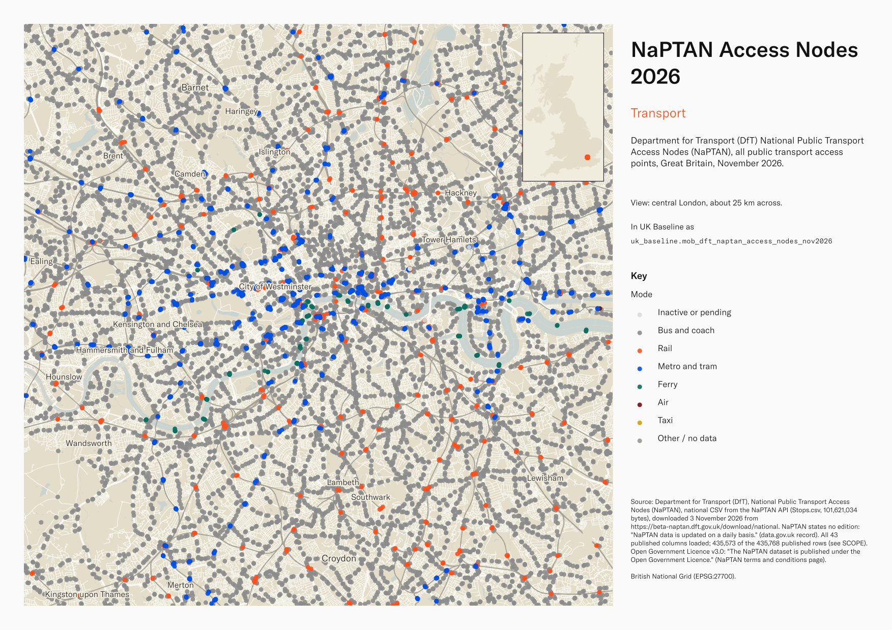
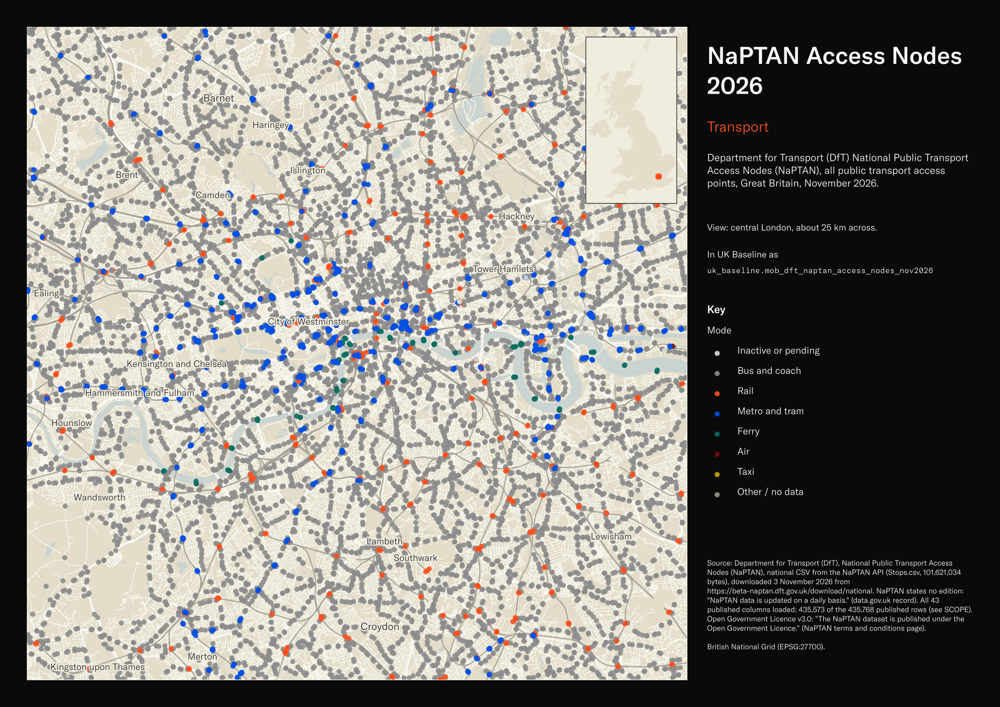

# Department for Transport (DfT) National Public Transport Access Nodes (NaPTAN), all public transport access points, Great Britain, November 2026

NaPTAN Access Nodes 2026

`mob_dft_naptan_access_nodes_nov2026`<button class="md-clipboard md-icon" data-clipboard-text="mob_dft_naptan_access_nodes_nov2026" title="Copy table name" aria-label="Copy table name" data-search-exclude></button>
{: .layer-table }

**SOURCE**
{: .sec-label }

- Department for Transport (DfT), National Public Transport Access Nodes (NaPTAN), national CSV from the NaPTAN API (Stops.csv, 101,621,034 bytes), downloaded 3 November 2026 from https://beta-naptan.dft.gov.uk/download/national. NaPTAN states no edition: "NaPTAN data is updated on a daily basis." (data.gov.uk record). All 43 published columns loaded; 435,573 of the 435,768 published rows (see SCOPE).

**DOCUMENTATION**
{: .sec-label }

- Download page : https://beta-naptan.dft.gov.uk/download/national
- data.gov.uk record : https://www.data.gov.uk/dataset/ff93ffc1-6656-47d8-9155-85ea0b8f2251/national-public-transport-access-nodes-naptan
- Schema and guides : https://www.gov.uk/government/publications/national-public-transport-access-node-schema
- Schema file (version 2.4) : http://www.naptan.org.uk/schema/2.4/napt/NaPT_stop-v2-4.xsd
- Data quality notice : https://beta-naptan.dft.gov.uk/article/na-ptan-data-quality

**DEFINITIONS**
{: .sec-label }

- "The national public transport access nodes (NaPTAN) is a national dataset of all public transport 'stops' in England, Scotland and Wales." (NaPTAN user guide, GOV.UK)
- ATCOCode: "Full NaPTAN stop identifier that uniquely identifies the stop within the UK." (NaPTAN schema 2.4)
- Status: 'Active': "Stop is either in use or available to be used."; 'Inactive': "Stop is in database but is marked as 'inactive' and is not currently in use or available for use."; 'Pending' delete: "Stop is missing, or flagged as deleted from the most recent data upload, and may be in process of being made inactive." (NPTG and NaPTAN Schema Guide 2.4)
- StopType: "Classification of the stop as one of the NaPTAN stop types." (NaPTAN schema 2.4) Codes in this table: BCT "On street Bus / Coach / Tram Stop" 416,805; BCS "Bus / Coach bay / stand / stance within Bus / Coach Stations" 4,968; RSE "Rail Station Entrance" 4,280; RLY "Rail Platform Access Area" 2,716; PLT "Metro and Underground Platform Access Area" 1,633; TMU "Tram / Metro / Underground Entrance" 1,527; MET "Metro, tram or underground interchange area." 987; TXR "Taxi Rank (head of)" 853; FER "Ferry / Dock Berth Area" 505; FBT "Ferry berth." 345; FTD "Ferry Terminal / Dock Entrance" 327; BCE "Bus / Coach Station Entrance" 194; BCQ "Unassigned stop within a Bus or Coach station." 165; GAT "Air Airside Area" 84; STR "Shared Taxi Rank (head of)" 71; AIR "Airport Entrance" 70; BST "Bus or Coach station non-specific access area." 40; RPL "Specific platform." 3 (meanings from the stop type list and classification elements of the schema).

**SCOPE**
{: .sec-label }

- England, Scotland and Wales; "This does not include Northern Ireland." (NaPTAN download page). 435,573 points: status active 388,153, inactive 47,419, pending 1.
- Not loaded: 195 published rows, all with Status inactive, whose Easting or Northing is 0 (placeholder coordinates, for example Easting 7, Northing 0).
- 435,460 points fall inside a Local Authority District (May 2025); the other 113 are mainly ferry berths and terminals (FER, FBT, FTD) at sea or in estuaries.

**CRS**
{: .sec-label }

- EPSG:27700 (British National Grid). Points built from the source fields Easting and Northing; no reprojection. The source also carries WGS84 Longitude and Latitude, kept as published columns.

**LICENCE**
{: .sec-label }

- Open Government Licence v3.0: "The NaPTAN dataset is published under the Open Government Licence." (NaPTAN terms and conditions page)

**DATA QUALITY CAVEATS**
{: .sec-label }

- County and Spatial Development Strategy columns are England and Wales only; rows elsewhere carry no county or SDS. Wales and the Isles of Scilly carry a county but no SDS. Rows with no Local Authority District code are NULL in all four columns.
- The publisher advises ignoring three fields: "there are three fields that we advise data consumers to ignore" — Modification, Revision Number and Cleardown Code (NaPTAN data quality notice, 10 February 2025).
- GridType is blank on 15,695 rows; the schema guide states "UKOS is assumed by default." (NPTG and NaPTAN Schema Guide 2.4), and their points are built in British National Grid.
- Longitude and Latitude are blank on 37,212 rows. Local authorities supply converted coordinates, and DfT recommends "that the data consumers of NaPTAN data calculate conversions using the Ordnance Survey methodology" (NaPTAN article, 5 August 2024). The point geometry uses Easting and Northing only.
- Some timestamps are implausible as published (CreationDateTime up to 7 February 2106; ModificationDateTime from 31 December 1969); loaded as published.
- Bus stops also appear in mob_dft_bods_bus_stops (Bus Open Data Service).

**ENRICHMENT**
{: .sec-label }

- `sds_name` / `sds_group` — Spatial Development Strategy area and devolution status, a Prior + Partners categorisation over Ministry of Housing, Communities and Local Government (MHCLG) English devolution policy, joined at load on the row's Local Authority District 2025 code via uk.ref_lad25_ctyua25_sds_lu_jul2026.
- `msoa21hclnm` — House of Commons Library readable MSOA name, assigned at load from the feature's representative point in its 2021 MSOA (uk_baseline.adm_ons_msoa_boundary_2021). Open Parliament Licence.

**LOADED INTO uk_baseline**
{: .sec-label }

- Loaded by PNC, 4 November 2026.

## Columns

| Column | Type | Description / unit |
|---|---|---|
| `gid` | `bigint` |  |
| `atco_code` | `text` | Source field `ATCOCode`; "Full NaPTAN stop identifier that uniquely identifies the stop within the UK." (NaPTAN schema 2.4). Unique in this table. |
| `naptan_code` | `text` | Source field `NaptanCode`; "Short NaPTAN code for passengers to use when uniquely identifying the stop by SMS and other self-service channels." (NaPTAN schema 2.4). |
| `plate_code` | `text` | Source field `PlateCode`; "Plate number for stop. An arbitrary asset number that may be placed on stop to identify it." (NaPTAN schema 2.4). |
| `cleardown_code` | `text` | Source field `CleardownCode`; "A 20 bit number used for wireless cleardown of stop displays by some AVL systems. Number format defined by RTIG." (NaPTAN schema 2.4). The publisher advises consumers to ignore this field: "this technology is no longer used" (DfT, NaPTAN data quality notice, 10 February 2025). |
| `common_name` | `text` | Source field `CommonName`; "Common name for the stop in a specified language." (NaPTAN schema 2.4). |
| `common_name_lang` | `text` | Source field `CommonNameLang`; language of `CommonName` (interpretation of the publisher's documented xml:language field type; NaPTAN guide for data managers, Table 1). |
| `short_common_name` | `text` | Source field `ShortCommonName`; "Alternative short name for stop. Length limit is set by administrative area." (NaPTAN schema 2.4). |
| `short_common_name_lang` | `text` | Source field `ShortCommonNameLang`; language of `ShortCommonName` (interpretation of the publisher's documented xml:language field type; NaPTAN guide for data managers, Table 1). |
| `landmark` | `text` | Source field `Landmark`; "Description of the nearest landmark to the stop, for example 'Town Hall'." (NaPTAN schema 2.4). |
| `landmark_lang` | `text` | Source field `LandmarkLang`; language of `Landmark` (interpretation of the publisher's documented xml:language field type; NaPTAN guide for data managers, Table 1). |
| `street` | `text` | Source field `Street`; "Street of stop. May be road name eg B2710." (NaPTAN schema 2.4). |
| `street_lang` | `text` | Source field `StreetLang`; language of `Street` (interpretation of the publisher's documented xml:language field type; NaPTAN guide for data managers, Table 1). |
| `crossing` | `text` | Source field `Crossing`; "Where there is a street that intersects the Street, as well as a Landmark, the name of the crossing street may be included separately here." (NaPTAN schema 2.4). |
| `crossing_lang` | `text` | Source field `CrossingLang`; language of `Crossing` (interpretation of the publisher's documented xml:language field type; NaPTAN guide for data managers, Table 1). |
| `indicator` | `text` | Source field `Indicator`; "Indicative description of the relative position of the stop, for example, "100 yards from Town Hall". Bay Stand or Stance number should be placed here." (NaPTAN schema 2.4). |
| `indicator_lang` | `text` | Source field `IndicatorLang`; language of `Indicator` (interpretation of the publisher's documented xml:language field type; NaPTAN guide for data managers, Table 1). |
| `bearing` | `text` | Source field `Bearing`; "Direction along street in which vehicle is pointing when stopped at stopping point." (NaPTAN schema 2.4). |
| `nptg_locality_code` | `text` | Source field `NptgLocalityCode`; "NPTG locality within which stop lies." (NaPTAN schema 2.4). |
| `locality_name` | `text` | Source field `LocalityName`; "Name of the locality." (NaPTAN schema 2.4); the schema adds that it is a value derived from the NPTG locality database, included as an informative label. |
| `parent_locality_name` | `text` | Source field `ParentLocalityName`; name of the parent NPTG locality [UNDOCUMENTED]; interpretation from the field name. |
| `grand_parent_locality_name` | `text` | Source field `GrandParentLocalityName`; name of the grandparent NPTG locality [UNDOCUMENTED]; interpretation from the field name. |
| `town` | `text` | Source field `Town`; "Town within which stop lies." (NaPTAN schema 2.4). |
| `town_lang` | `text` | Source field `TownLang`; language of `Town` (interpretation of the publisher's documented xml:language field type; NaPTAN guide for data managers, Table 1). |
| `suburb` | `text` | Source field `Suburb`; "Suburb within which stop lies." (NaPTAN schema 2.4). |
| `suburb_lang` | `text` | Source field `SuburbLang`; language of `Suburb` (interpretation of the publisher's documented xml:language field type; NaPTAN guide for data managers, Table 1). |
| `locality_centre` | `text` | Source field `LocalityCentre`; "Whether the locality is a centre or not." (NaPTAN schema 2.4). |
| `grid_type` | `text` | Source field `GridType`; "Nominated grid system e.g. UKOS or IrishOS; UKOS is assumed by default." (NPTG and NaPTAN Schema Guide 2.4); in this table UKOS 419,878, blank 15,695. |
| `easting` | `integer` | Source field `Easting`; "Easting grid coordinates of stop." (NPTG and NaPTAN Schema Guide 2.4). Unit: metres, British National Grid. The point geometry is built from Easting and Northing. |
| `northing` | `integer` | Source field `Northing`; "Northing grid coordinates of stop." (NPTG and NaPTAN Schema Guide 2.4). Unit: metres, British National Grid. The point geometry is built from Easting and Northing. |
| `longitude` | `double precision` | Source field `Longitude`; "Longitude of stop in WGS84 coordinates." (NPTG and NaPTAN Schema Guide 2.4), as supplied by local authorities. Unit: decimal degrees. Blank on 37,212 rows. |
| `latitude` | `double precision` | Source field `Latitude`; "Latitude of stop in WGS84 coordinates." (NPTG and NaPTAN Schema Guide 2.4), as supplied by local authorities. Unit: decimal degrees. Blank on 37,212 rows. |
| `stop_type` | `text` | Source field `StopType`; "Classification of the stop as one of the NaPTAN stop types." (NaPTAN schema 2.4). Codes and their meanings are listed in the table comment (DEFINITIONS). |
| `bus_stop_type` | `text` | Source field `BusStopType`; "Classification of the bus stop as one of the NaPTAN bus stop types." (NaPTAN schema 2.4). Codes: MKD "Marked (pole, shelter etc)."; HAR "Hail and Ride"; CUS "Custom (unmarked, or only marked on road)."; FLX "Flexible zone." |
| `timing_status` | `text` | Source field `TimingStatus`; "Status of the registration of the bus stop as a timing point." (NaPTAN schema 2.4). Codes: PPT "Principal Point"; TIP "Time Info Point"; PTP "Principal and Time Info Point"; OTH "Other Bus Stop". |
| `default_wait_time` | `text` | Source field `DefaultWaitTime`; "Default time to wait at the bus stop as a Duration." (NaPTAN schema 2.4). |
| `notes` | `text` | Source field `Notes`; "Notes about a stop." (NaPTAN schema 2.4). |
| `notes_lang` | `text` | Source field `NotesLang`; language of `Notes` (interpretation of the publisher's documented xml:language field type; NaPTAN guide for data managers, Table 1). |
| `administrative_area_code` | `text` | Source field `AdministrativeAreaCode`; "NPTG administrative area that manages stop data." (NaPTAN schema 2.4). |
| `creation_date_time` | `timestamp without time zone` | Source field `CreationDateTime`; "Date and Time stamp in ISO format. Should be set when the entity is first created, and not subsequently be changed." (NPTG and NaPTAN Schema Guide 2.4, Table 11-2); some values are implausible as published. |
| `modification_date_time` | `timestamp without time zone` | Source field `ModificationDateTime`; date and time stamp in ISO format that "Should be changed every time an entity is changed" (NPTG and NaPTAN Schema Guide 2.4, Table 11-2); some values are implausible as published. |
| `revision_number` | `integer` | Source field `RevisionNumber`; record revision number; the publisher advises consumers to ignore it: "this is inconsistently applied by software across the entire LA ecosystem" (DfT, NaPTAN data quality notice, 10 February 2025). |
| `modification` | `text` | Source field `Modification`; record modification type (new, revise, delete); the publisher advises consumers to ignore it: "this is inconsistently applied by software across the entire LA ecosystem" (DfT, NaPTAN data quality notice, 10 February 2025). |
| `status` | `text` | Source field `Status`; record status; 'Active': "Stop is either in use or available to be used."; 'Inactive': "Stop is in database but is marked as 'inactive' and is not currently in use or available for use."; 'Pending' delete: "Stop is missing, or flagged as deleted from the most recent data upload, and may be in process of being made inactive." (NPTG and NaPTAN Schema Guide 2.4); in this table active 388,153, inactive 47,419, pending 1. |
| `geom` | `geometry(Point,27700)` | Point geometry built from source fields `Easting` and `Northing`; EPSG:27700, coordinate units metres; no reprojection. |
| `msoa21cd` | `text` | Middle Layer Super Output Area (MSOA) 2021 code. Assigned at load from the feature's representative point located in uk_baseline.adm_ons_msoa_boundary_2021. Open Government Licence v3.0. |
| `msoa21nm` | `text` | Official Office for National Statistics MSOA 2021 name. Assigned at load from the feature's representative point located in uk_baseline.adm_ons_msoa_boundary_2021. Open Government Licence v3.0. |
| `msoa21hclnm` | `text` | House of Commons Library readable MSOA name. Assigned at load from the feature's representative point located in its 2021 MSOA (uk_baseline.adm_ons_msoa_boundary_2021, which carries the House of Commons Library name). Open Parliament Licence. |
| `lad22cd` | `text` | Local Authority District 2022 code (2021 LAD geography). Assigned at load from the feature's representative point located in uk_baseline.adm_ons_lad_boundary_may2022. Open Government Licence v3.0. |
| `lad22nm` | `text` | Local Authority District 2022 name (2021 LAD geography). Assigned at load from the feature's representative point located in uk_baseline.adm_ons_lad_boundary_may2022. Open Government Licence v3.0. |
| `lad25cd` | `text` | Local Authority District 2025 code (current administering authority). Assigned at load from the feature's representative point located in uk_baseline.adm_ons_lad_boundary_may2025. Open Government Licence v3.0. |
| `lad25nm` | `text` | Local Authority District 2025 name (current administering authority). Assigned at load from the feature's representative point located in uk_baseline.adm_ons_lad_boundary_may2025. Open Government Licence v3.0. |
| `ctyua25cd` | `text` | County or unitary authority code at 1 April 2025. Joined at load via uk.ref_lad25_ctyua25_sds_lu_jul2026 on the row's Local Authority District 2025 code. Open Government Licence v3.0. |
| `ctyua25nm` | `text` | County or unitary authority name at 1 April 2025. Joined at load via uk.ref_lad25_ctyua25_sds_lu_jul2026 on the row's Local Authority District 2025 code. Open Government Licence v3.0. |
| `sds_name` | `text` | Spatial Development Strategy (SDS) area, a Prior + Partners categorisation over Ministry of Housing, Communities and Local Government (MHCLG) English devolution policy. Joined at load via uk.ref_lad25_ctyua25_sds_lu_jul2026 on the row's Local Authority District 2025 code. Open Government Licence v3.0. |
| `sds_group` | `text` | Devolution status of the Spatial Development Strategy area: Existing Devolution Footprints, Devolution Priority Programme, Other Proposed Geographies or Remaining Areas. Joined at load via uk.ref_lad25_ctyua25_sds_lu_jul2026 on the row's Local Authority District 2025 code. Open Government Licence v3.0. |
