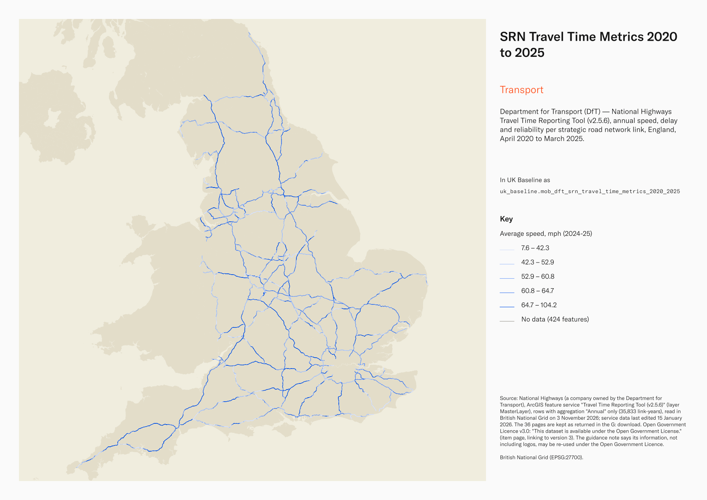
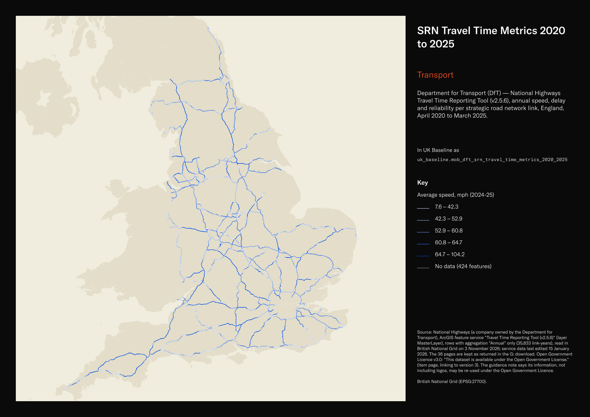

# Department for Transport (DfT) — National Highways Travel Time Reporting Tool (v2.5.6), annual speed, delay and reliability per strategic road network link, England, April 2020 to March 2025

SRN Travel Time Metrics 2020 to 2025

`mob_dft_srn_travel_time_metrics_2020_2025`<button class="md-clipboard md-icon" data-clipboard-text="mob_dft_srn_travel_time_metrics_2020_2025" title="Copy table name" aria-label="Copy table name" data-search-exclude></button>
{: .layer-table }

**SOURCE**
{: .sec-label }

- National Highways (a company owned by the Department for Transport), ArcGIS feature service "Travel Time Reporting Tool (v2.5.6)" (layer MasterLayer), rows with aggregation "Annual" only (35,833 link-years), read in British National Grid on 3 November 2026; service data last edited 15 January 2026. The 36 pages are kept as returned in the G: download.
- Service: https://services-eu1.arcgis.com/mZXeBXkkZpekxjXT/arcgis/rest/services/TTRT_V_2_5_6/FeatureServer/0
- Reshaped from one row per link and financial year to one row per link (7,456 links), each year's values as columns with the suffix 2020_21 to 2024_25 (April to March). Descriptive fields and geometry are those of the latest year in which the link appears. Not carried: objectid, globalid and Shape__Length (service fields), aggregation (always Annual) and reportingperiod (in the column suffix). Values copied as published; nothing recomputed.

**DOCUMENTATION**
{: .sec-label }

- Item page : https://www.arcgis.com/home/item.html?id=a849653f5f034cb6931887ff671d9fb0
- Tool page : https://nationalhighways.co.uk/our-roads/travel-time-reporting-tool/
- Guidance note (November 2025) : https://nationalhighways.co.uk/media/i22ps4kv/travel-time-reporting-tool-guidance-note-nov-2025.pdf

**DEFINITIONS**
{: .sec-label }

- "Summary of RIS2 metrics data for financial reporting period April 2020 - March 2025 for mainline strategic road network links. The metrics are: average delay, reliability, vehicle hours delay and average speed." (item summary)
- Link: "A link is a section of road on the strategic road network (SRN) between entry and exit points, such as slip roads on motorway junctions or roundabouts on A-road junctions." (National Highways, Travel Time Reporting Tool guidance note, November 2025)
- Average delay: "By our definition, any journey that travels slower than the speed limit experiences delay." (National Highways, Travel Time Reporting Tool guidance note, November 2025)
- Total delay: "the total delay output mapped in the tool is the daily average VHD per mile, which makes this metric directly comparable across all road links." (National Highways, Travel Time Reporting Tool guidance note, November 2025)
- Journey time reliability: "Our journey time reliability metric describes the amount of non-recurrent, or unexpected, delay on a link." (National Highways, Travel Time Reporting Tool guidance note, November 2025)
- Average speed: "Average speed is defined simply as the average speed travelled during the financial year on a road link." (National Highways, Travel Time Reporting Tool guidance note, November 2025)
- Average travel time: "Travel time is defined as the average time taken to travel a mile on a link or selection of links." (National Highways, Travel Time Reporting Tool guidance note, November 2025)

**SCOPE**
{: .sec-label }

- England's strategic road network (motorways and major A roads), mainline links. 7,456 links: 6,864 appear in all five years. Annual rows per year: 2020-21 7,106; 2021-22 7,172; 2022-23 7,203; 2023-24 7,142; 2024-25 7,210. A link absent in a year has empty columns for that year.

**CRS**
{: .sec-label }

- EPSG:27700 (British National Grid): the service stores and returned the lines in EPSG:27700; no reprojection. LineString.

**LICENCE**
{: .sec-label }

- Open Government Licence v3.0: "This dataset is available under the Open Government License." (item page, linking to version 3). The guidance note says its information, not including logos, may be re-used under the Open Government Licence.
- For mapping, the guidance note states: "(c) Crown copyright and database rights 2021 OS 100030649. You are permitted to use this data solely to enable you to respond to, or interact with, the organisation that provided you with the data. You are not permitted to copy, sub-licence, distribute or sell any of this data to third parties in any form." (National Highways, Travel Time Reporting Tool guidance note, November 2025) Whether this mapping clause covers the link geometry is not stated.

**DATA QUALITY CAVEATS**
{: .sec-label }

- County and Spatial Development Strategy columns are England and Wales only; rows elsewhere carry no county or SDS. Wales and the Isles of Scilly carry a county but no SDS. Rows with no Local Authority District code are NULL in all four columns.
- 89 rows carry a district but no Middle Layer Super Output Area: they lie outside every 2021 MSOA but inside a district, so the district was assigned from the feature's representative point while the MSOA columns stay NULL.
- Every value is the whole link's value, repeated on every piece: per-mile speeds, delays and travel times still read correctly on a piece, but lengthmetres, totaldelay, averagedailyflow, averagedailytraffic and sumvehiclemiles must not be summed over pieces (a link would count once per piece). Use one row per `linkid` to total them.
- The row count counts split pieces, not links: this layer was split by Middle Layer Super Output Area, so it holds one row per link per MSOA piece, plus whole and remainder rows to keep the source geometry. 12,328 rows represent 7,456 links, measured 4 November 2026. `source_fid` and `linkid` identify the originating link.
- "The methodology used to aggregate and spatially map the data from this changing dataset of links results in variation and impacts metric aggregation between the different aggregation periods. Any comparison with data between aggregation periods or data from other sources should be interpreted with caution." (National Highways, Travel Time Reporting Tool guidance note, November 2025)
- Descriptive fields change between years on a few links (number of lanes 48, road class 44, carriageway 31, speed limit 19, name 3); lanes and speed limit are kept per year, the others from the latest year.
- Starting on 23 March 2020, COVID-19 restrictions "had a notable effect on driver behaviour, suppressing traffic on the network significantly and causing a reduction in delay" (National Highways, Travel Time Reporting Tool guidance note, November 2025); 2020-21 is affected.
- The guidance gives link length in miles; the field lengthmetres carries the length in metres per its name.
- Fields without a published definition are marked [UNDOCUMENTED] in their column notes.

**ENRICHMENT**
{: .sec-label }

- `sds_name` / `sds_group` — Spatial Development Strategy area and devolution status, a Prior + Partners categorisation over Ministry of Housing, Communities and Local Government (MHCLG) English devolution policy, joined at load on the row's Local Authority District 2025 code via uk.ref_lad25_ctyua25_sds_lu_jul2026.
- `msoa21cd`, `msoa21nm`, `msoa21hclnm`, `lad22cd` / `lad22nm`, `lad25cd` / `lad25nm` — from the MSOA 2021 piece each row lies in, after splitting the links by uk_baseline.adm_ons_msoa_boundary_2021 on 4 November 2026; MSOA and district codes and names are ONS (Open Government Licence v3.0); `msoa21hclnm` is the House of Commons Library readable MSOA name (Open Parliament Licence).

**LOADED INTO uk_baseline**
{: .sec-label }

- Loaded by PNC, 4 November 2026.

## Columns

| Column | Type | Description / unit |
|---|---|---|
| `source_fid` | `bigint` | Row id (`gid`) of the link in the one-row-per-link table before the MSOA split (non-unique here: a link spanning N MSOAs has N rows); `linkid` gives the same grouping. |
| `linkid` | `integer` | Source field `linkid` (alias "LinkID"); "A link is a section of road on the strategic road network (SRN) between entry and exit points" (National Highways, Travel Time Reporting Tool guidance note, November 2025); NTIS link identifier, unique per link; repeated on every MSOA piece of a split link. |
| `linklocationname` | `text` | Source field `linklocationname` (alias "LinkLocationName"); link description, for example "M65 westbound between J2 and J1" [UNDOCUMENTED]; the description is an interpretation of the source field name and alias; latest year. |
| `lengthmetres` | `double precision` | Source field `lengthmetres` (alias "LengthMetres"); link length [UNDOCUMENTED]; the description is an interpretation of the source field name and alias; unit metres per the field name (the guidance gives link length in miles); latest year. After the MSOA split each piece carries the whole link's length, not the length of the piece. |
| `direction` | `text` | Source field `direction` (alias "Direction"); direction of travel [UNDOCUMENTED]; the description is an interpretation of the source field name and alias; latest year. |
| `roadclass` | `text` | Source field `roadclass` (alias "RoadClass"); road class, for example "Motorway, dual 2 lanes" [UNDOCUMENTED]; the description is an interpretation of the source field name and alias; latest year. |
| `areacode` | `text` | Source field `areacode` (alias "AreaCode"); National Highways operational area, for example "Area 10" [UNDOCUMENTED]; the description is an interpretation of the source field name and alias; latest year. |
| `roadnumber` | `text` | Source field `roadnumber` (alias "RoadNumber"); road number, for example "M65" [UNDOCUMENTED]; the description is an interpretation of the source field name and alias; latest year. |
| `carriagewaydescription` | `text` | Source field `carriagewaydescription` (alias "Carriageway"); carriageway [UNDOCUMENTED]; the description is an interpretation of the source field name and alias; latest year. |
| `numberoflanes_2020_21` | `integer` | Source field `numberoflanes` (alias "NumberofLanes"), Annual aggregation, April 2020 to March 2021; number of lanes [UNDOCUMENTED]; the description is an interpretation of the source field name and alias. Empty where the link is absent that year. |
| `speedlimitmph_2020_21` | `integer` | Source field `speedlimitmph` (alias "SpeedLimitMph"), Annual aggregation, April 2020 to March 2021; speed limit; "The speed limit is the upper limit, in other words the limit for vehicles that are not subject to additional speed restrictions." (National Highways, Travel Time Reporting Tool guidance note, November 2025). Unit: mph (alias). Empty where the link is absent that year. |
| `averagespeedmph_2020_21` | `double precision` | Source field `averagespeedmph` (alias "AverageSpeedMPH"), Annual aggregation, April 2020 to March 2021; "Average speed is defined simply as the average speed travelled during the financial year on a road link." (National Highways, Travel Time Reporting Tool guidance note, November 2025). Unit: mph (alias). Empty where the link is absent that year. |
| `medianavgspeedmph_2020_21` | `double precision` | Source field `medianavgspeedmph` (alias "MedianAvgSpeedMPH"), Annual aggregation, April 2020 to March 2021; median of average speed [UNDOCUMENTED]; the description is an interpretation of the source field name and alias; unit mph per the alias. Empty where the link is absent that year. |
| `p15avgspeedmph_2020_21` | `double precision` | Source field `p15avgspeedmph` (alias "P15AvgSpeedMPH"), Annual aggregation, April 2020 to March 2021; 15th percentile of average speed [UNDOCUMENTED]; the description is an interpretation of the source field name and alias; unit mph per the alias. Empty where the link is absent that year. |
| `p85avgspeedmph_2020_21` | `double precision` | Source field `p85avgspeedmph` (alias "P85AvgSpeedMPH"), Annual aggregation, April 2020 to March 2021; 85th percentile of average speed [UNDOCUMENTED]; the description is an interpretation of the source field name and alias; unit mph per the alias. Empty where the link is absent that year. |
| `delayspvpm_2020_21` | `double precision` | Source field `delayspvpm` (alias "DelaySPVPM"), Annual aggregation, April 2020 to March 2021; average delay: "By our definition, any journey that travels slower than the speed limit experiences delay." (National Highways, Travel Time Reporting Tool guidance note, November 2025). Unit: "seconds per vehicle per mile" (National Highways, Travel Time Reporting Tool guidance note, November 2025). Empty where the link is absent that year. |
| `medianavgdelayspvpm_2020_21` | `double precision` | Source field `medianavgdelayspvpm` (alias "MedianAvgDelaySPVPM"), Annual aggregation, April 2020 to March 2021; median of average delay [UNDOCUMENTED]; the description is an interpretation of the source field name and alias; unit seconds per vehicle per mile per the alias. Empty where the link is absent that year. |
| `p25avgdelayspvpm_2020_21` | `double precision` | Source field `p25avgdelayspvpm` (alias "P25AvgDelaySPVPM"), Annual aggregation, April 2020 to March 2021; 25th percentile of average delay [UNDOCUMENTED]; the description is an interpretation of the source field name and alias; unit seconds per vehicle per mile per the alias. Empty where the link is absent that year. |
| `p75avgdelayspvpm_2020_21` | `double precision` | Source field `p75avgdelayspvpm` (alias "P75AvgDelaySPVPM"), Annual aggregation, April 2020 to March 2021; 75th percentile of average delay [UNDOCUMENTED]; the description is an interpretation of the source field name and alias; unit seconds per vehicle per mile per the alias. Empty where the link is absent that year. |
| `reliabilityspvpm_2020_21` | `double precision` | Source field `reliabilityspvpm` (alias "ReliabilitySPVPM"), Annual aggregation, April 2020 to March 2021; journey time reliability: "the amount of non-recurrent, or unexpected, delay on a link" (National Highways, Travel Time Reporting Tool guidance note, November 2025). Unit: "seconds per vehicle per mile" (National Highways, Travel Time Reporting Tool guidance note, November 2025). Empty where the link is absent that year. |
| `totaldelay_2020_21` | `double precision` | Source field `totaldelay` (alias "TotalDelay"), Annual aggregation, April 2020 to March 2021; total delay: "the daily average VHD per mile" (National Highways, Travel Time Reporting Tool guidance note, November 2025). Unit: vehicle hours delay per mile per day. Empty where the link is absent that year. Link value, repeated on every MSOA piece of the link. |
| `averagejourneytime_2020_21` | `double precision` | Source field `averagejourneytime` (alias "AverageJourneyTime"), Annual aggregation, April 2020 to March 2021; average journey time [UNDOCUMENTED]; the description is an interpretation of the source field name and alias; unit not stated. Empty where the link is absent that year. |
| `averagetraveltime_2020_21` | `double precision` | Source field `averagetraveltime` (alias "AverageTravelTime"), Annual aggregation, April 2020 to March 2021; average travel time: "the average time taken to travel a mile on a link" (National Highways, Travel Time Reporting Tool guidance note, November 2025). Unit: seconds for one mile of travel, normalised by link length. Empty where the link is absent that year. |
| `averagedailyflow_2020_21` | `integer` | Source field `averagedailyflow` (alias "AverageDailyFlow"), Annual aggregation, April 2020 to March 2021; average daily flow [UNDOCUMENTED]; the description is an interpretation of the source field name and alias; unit not stated. Empty where the link is absent that year. Link value, repeated on every MSOA piece of the link. |
| `averagedailytraffic_2020_21` | `integer` | Source field `averagedailytraffic` (alias "AverageDailyTraffic"), Annual aggregation, April 2020 to March 2021; average daily traffic [UNDOCUMENTED]; the description is an interpretation of the source field name and alias; unit not stated. Empty where the link is absent that year. Link value, repeated on every MSOA piece of the link. |
| `sumvehiclemiles_2020_21` | `integer` | Source field `sumvehiclemiles` (alias "SumVehicleMiles"), Annual aggregation, April 2020 to March 2021; sum of vehicle miles [UNDOCUMENTED]; the description is an interpretation of the source field name and alias; unit vehicle miles per the field name. Empty where the link is absent that year. Link value, repeated on every MSOA piece of the link. |
| `numberoflanes_2021_22` | `integer` | Source field `numberoflanes` (alias "NumberofLanes"), Annual aggregation, April 2021 to March 2022; number of lanes [UNDOCUMENTED]; the description is an interpretation of the source field name and alias. Empty where the link is absent that year. |
| `speedlimitmph_2021_22` | `integer` | Source field `speedlimitmph` (alias "SpeedLimitMph"), Annual aggregation, April 2021 to March 2022; speed limit; "The speed limit is the upper limit, in other words the limit for vehicles that are not subject to additional speed restrictions." (National Highways, Travel Time Reporting Tool guidance note, November 2025). Unit: mph (alias). Empty where the link is absent that year. |
| `averagespeedmph_2021_22` | `double precision` | Source field `averagespeedmph` (alias "AverageSpeedMPH"), Annual aggregation, April 2021 to March 2022; "Average speed is defined simply as the average speed travelled during the financial year on a road link." (National Highways, Travel Time Reporting Tool guidance note, November 2025). Unit: mph (alias). Empty where the link is absent that year. |
| `medianavgspeedmph_2021_22` | `double precision` | Source field `medianavgspeedmph` (alias "MedianAvgSpeedMPH"), Annual aggregation, April 2021 to March 2022; median of average speed [UNDOCUMENTED]; the description is an interpretation of the source field name and alias; unit mph per the alias. Empty where the link is absent that year. |
| `p15avgspeedmph_2021_22` | `double precision` | Source field `p15avgspeedmph` (alias "P15AvgSpeedMPH"), Annual aggregation, April 2021 to March 2022; 15th percentile of average speed [UNDOCUMENTED]; the description is an interpretation of the source field name and alias; unit mph per the alias. Empty where the link is absent that year. |
| `p85avgspeedmph_2021_22` | `double precision` | Source field `p85avgspeedmph` (alias "P85AvgSpeedMPH"), Annual aggregation, April 2021 to March 2022; 85th percentile of average speed [UNDOCUMENTED]; the description is an interpretation of the source field name and alias; unit mph per the alias. Empty where the link is absent that year. |
| `delayspvpm_2021_22` | `double precision` | Source field `delayspvpm` (alias "DelaySPVPM"), Annual aggregation, April 2021 to March 2022; average delay: "By our definition, any journey that travels slower than the speed limit experiences delay." (National Highways, Travel Time Reporting Tool guidance note, November 2025). Unit: "seconds per vehicle per mile" (National Highways, Travel Time Reporting Tool guidance note, November 2025). Empty where the link is absent that year. |
| `medianavgdelayspvpm_2021_22` | `double precision` | Source field `medianavgdelayspvpm` (alias "MedianAvgDelaySPVPM"), Annual aggregation, April 2021 to March 2022; median of average delay [UNDOCUMENTED]; the description is an interpretation of the source field name and alias; unit seconds per vehicle per mile per the alias. Empty where the link is absent that year. |
| `p25avgdelayspvpm_2021_22` | `double precision` | Source field `p25avgdelayspvpm` (alias "P25AvgDelaySPVPM"), Annual aggregation, April 2021 to March 2022; 25th percentile of average delay [UNDOCUMENTED]; the description is an interpretation of the source field name and alias; unit seconds per vehicle per mile per the alias. Empty where the link is absent that year. |
| `p75avgdelayspvpm_2021_22` | `double precision` | Source field `p75avgdelayspvpm` (alias "P75AvgDelaySPVPM"), Annual aggregation, April 2021 to March 2022; 75th percentile of average delay [UNDOCUMENTED]; the description is an interpretation of the source field name and alias; unit seconds per vehicle per mile per the alias. Empty where the link is absent that year. |
| `reliabilityspvpm_2021_22` | `double precision` | Source field `reliabilityspvpm` (alias "ReliabilitySPVPM"), Annual aggregation, April 2021 to March 2022; journey time reliability: "the amount of non-recurrent, or unexpected, delay on a link" (National Highways, Travel Time Reporting Tool guidance note, November 2025). Unit: "seconds per vehicle per mile" (National Highways, Travel Time Reporting Tool guidance note, November 2025). Empty where the link is absent that year. |
| `totaldelay_2021_22` | `double precision` | Source field `totaldelay` (alias "TotalDelay"), Annual aggregation, April 2021 to March 2022; total delay: "the daily average VHD per mile" (National Highways, Travel Time Reporting Tool guidance note, November 2025). Unit: vehicle hours delay per mile per day. Empty where the link is absent that year. Link value, repeated on every MSOA piece of the link. |
| `averagejourneytime_2021_22` | `double precision` | Source field `averagejourneytime` (alias "AverageJourneyTime"), Annual aggregation, April 2021 to March 2022; average journey time [UNDOCUMENTED]; the description is an interpretation of the source field name and alias; unit not stated. Empty where the link is absent that year. |
| `averagetraveltime_2021_22` | `double precision` | Source field `averagetraveltime` (alias "AverageTravelTime"), Annual aggregation, April 2021 to March 2022; average travel time: "the average time taken to travel a mile on a link" (National Highways, Travel Time Reporting Tool guidance note, November 2025). Unit: seconds for one mile of travel, normalised by link length. Empty where the link is absent that year. |
| `averagedailyflow_2021_22` | `integer` | Source field `averagedailyflow` (alias "AverageDailyFlow"), Annual aggregation, April 2021 to March 2022; average daily flow [UNDOCUMENTED]; the description is an interpretation of the source field name and alias; unit not stated. Empty where the link is absent that year. Link value, repeated on every MSOA piece of the link. |
| `averagedailytraffic_2021_22` | `integer` | Source field `averagedailytraffic` (alias "AverageDailyTraffic"), Annual aggregation, April 2021 to March 2022; average daily traffic [UNDOCUMENTED]; the description is an interpretation of the source field name and alias; unit not stated. Empty where the link is absent that year. Link value, repeated on every MSOA piece of the link. |
| `sumvehiclemiles_2021_22` | `integer` | Source field `sumvehiclemiles` (alias "SumVehicleMiles"), Annual aggregation, April 2021 to March 2022; sum of vehicle miles [UNDOCUMENTED]; the description is an interpretation of the source field name and alias; unit vehicle miles per the field name. Empty where the link is absent that year. Link value, repeated on every MSOA piece of the link. |
| `numberoflanes_2022_23` | `integer` | Source field `numberoflanes` (alias "NumberofLanes"), Annual aggregation, April 2022 to March 2023; number of lanes [UNDOCUMENTED]; the description is an interpretation of the source field name and alias. Empty where the link is absent that year. |
| `speedlimitmph_2022_23` | `integer` | Source field `speedlimitmph` (alias "SpeedLimitMph"), Annual aggregation, April 2022 to March 2023; speed limit; "The speed limit is the upper limit, in other words the limit for vehicles that are not subject to additional speed restrictions." (National Highways, Travel Time Reporting Tool guidance note, November 2025). Unit: mph (alias). Empty where the link is absent that year. |
| `averagespeedmph_2022_23` | `double precision` | Source field `averagespeedmph` (alias "AverageSpeedMPH"), Annual aggregation, April 2022 to March 2023; "Average speed is defined simply as the average speed travelled during the financial year on a road link." (National Highways, Travel Time Reporting Tool guidance note, November 2025). Unit: mph (alias). Empty where the link is absent that year. |
| `medianavgspeedmph_2022_23` | `double precision` | Source field `medianavgspeedmph` (alias "MedianAvgSpeedMPH"), Annual aggregation, April 2022 to March 2023; median of average speed [UNDOCUMENTED]; the description is an interpretation of the source field name and alias; unit mph per the alias. Empty where the link is absent that year. |
| `p15avgspeedmph_2022_23` | `double precision` | Source field `p15avgspeedmph` (alias "P15AvgSpeedMPH"), Annual aggregation, April 2022 to March 2023; 15th percentile of average speed [UNDOCUMENTED]; the description is an interpretation of the source field name and alias; unit mph per the alias. Empty where the link is absent that year. |
| `p85avgspeedmph_2022_23` | `double precision` | Source field `p85avgspeedmph` (alias "P85AvgSpeedMPH"), Annual aggregation, April 2022 to March 2023; 85th percentile of average speed [UNDOCUMENTED]; the description is an interpretation of the source field name and alias; unit mph per the alias. Empty where the link is absent that year. |
| `delayspvpm_2022_23` | `double precision` | Source field `delayspvpm` (alias "DelaySPVPM"), Annual aggregation, April 2022 to March 2023; average delay: "By our definition, any journey that travels slower than the speed limit experiences delay." (National Highways, Travel Time Reporting Tool guidance note, November 2025). Unit: "seconds per vehicle per mile" (National Highways, Travel Time Reporting Tool guidance note, November 2025). Empty where the link is absent that year. |
| `medianavgdelayspvpm_2022_23` | `double precision` | Source field `medianavgdelayspvpm` (alias "MedianAvgDelaySPVPM"), Annual aggregation, April 2022 to March 2023; median of average delay [UNDOCUMENTED]; the description is an interpretation of the source field name and alias; unit seconds per vehicle per mile per the alias. Empty where the link is absent that year. |
| `p25avgdelayspvpm_2022_23` | `double precision` | Source field `p25avgdelayspvpm` (alias "P25AvgDelaySPVPM"), Annual aggregation, April 2022 to March 2023; 25th percentile of average delay [UNDOCUMENTED]; the description is an interpretation of the source field name and alias; unit seconds per vehicle per mile per the alias. Empty where the link is absent that year. |
| `p75avgdelayspvpm_2022_23` | `double precision` | Source field `p75avgdelayspvpm` (alias "P75AvgDelaySPVPM"), Annual aggregation, April 2022 to March 2023; 75th percentile of average delay [UNDOCUMENTED]; the description is an interpretation of the source field name and alias; unit seconds per vehicle per mile per the alias. Empty where the link is absent that year. |
| `reliabilityspvpm_2022_23` | `double precision` | Source field `reliabilityspvpm` (alias "ReliabilitySPVPM"), Annual aggregation, April 2022 to March 2023; journey time reliability: "the amount of non-recurrent, or unexpected, delay on a link" (National Highways, Travel Time Reporting Tool guidance note, November 2025). Unit: "seconds per vehicle per mile" (National Highways, Travel Time Reporting Tool guidance note, November 2025). Empty where the link is absent that year. |
| `totaldelay_2022_23` | `double precision` | Source field `totaldelay` (alias "TotalDelay"), Annual aggregation, April 2022 to March 2023; total delay: "the daily average VHD per mile" (National Highways, Travel Time Reporting Tool guidance note, November 2025). Unit: vehicle hours delay per mile per day. Empty where the link is absent that year. Link value, repeated on every MSOA piece of the link. |
| `averagejourneytime_2022_23` | `double precision` | Source field `averagejourneytime` (alias "AverageJourneyTime"), Annual aggregation, April 2022 to March 2023; average journey time [UNDOCUMENTED]; the description is an interpretation of the source field name and alias; unit not stated. Empty where the link is absent that year. |
| `averagetraveltime_2022_23` | `double precision` | Source field `averagetraveltime` (alias "AverageTravelTime"), Annual aggregation, April 2022 to March 2023; average travel time: "the average time taken to travel a mile on a link" (National Highways, Travel Time Reporting Tool guidance note, November 2025). Unit: seconds for one mile of travel, normalised by link length. Empty where the link is absent that year. |
| `averagedailyflow_2022_23` | `integer` | Source field `averagedailyflow` (alias "AverageDailyFlow"), Annual aggregation, April 2022 to March 2023; average daily flow [UNDOCUMENTED]; the description is an interpretation of the source field name and alias; unit not stated. Empty where the link is absent that year. Link value, repeated on every MSOA piece of the link. |
| `averagedailytraffic_2022_23` | `integer` | Source field `averagedailytraffic` (alias "AverageDailyTraffic"), Annual aggregation, April 2022 to March 2023; average daily traffic [UNDOCUMENTED]; the description is an interpretation of the source field name and alias; unit not stated. Empty where the link is absent that year. Link value, repeated on every MSOA piece of the link. |
| `sumvehiclemiles_2022_23` | `integer` | Source field `sumvehiclemiles` (alias "SumVehicleMiles"), Annual aggregation, April 2022 to March 2023; sum of vehicle miles [UNDOCUMENTED]; the description is an interpretation of the source field name and alias; unit vehicle miles per the field name. Empty where the link is absent that year. Link value, repeated on every MSOA piece of the link. |
| `numberoflanes_2023_24` | `integer` | Source field `numberoflanes` (alias "NumberofLanes"), Annual aggregation, April 2023 to March 2024; number of lanes [UNDOCUMENTED]; the description is an interpretation of the source field name and alias. Empty where the link is absent that year. |
| `speedlimitmph_2023_24` | `integer` | Source field `speedlimitmph` (alias "SpeedLimitMph"), Annual aggregation, April 2023 to March 2024; speed limit; "The speed limit is the upper limit, in other words the limit for vehicles that are not subject to additional speed restrictions." (National Highways, Travel Time Reporting Tool guidance note, November 2025). Unit: mph (alias). Empty where the link is absent that year. |
| `averagespeedmph_2023_24` | `double precision` | Source field `averagespeedmph` (alias "AverageSpeedMPH"), Annual aggregation, April 2023 to March 2024; "Average speed is defined simply as the average speed travelled during the financial year on a road link." (National Highways, Travel Time Reporting Tool guidance note, November 2025). Unit: mph (alias). Empty where the link is absent that year. |
| `medianavgspeedmph_2023_24` | `double precision` | Source field `medianavgspeedmph` (alias "MedianAvgSpeedMPH"), Annual aggregation, April 2023 to March 2024; median of average speed [UNDOCUMENTED]; the description is an interpretation of the source field name and alias; unit mph per the alias. Empty where the link is absent that year. |
| `p15avgspeedmph_2023_24` | `double precision` | Source field `p15avgspeedmph` (alias "P15AvgSpeedMPH"), Annual aggregation, April 2023 to March 2024; 15th percentile of average speed [UNDOCUMENTED]; the description is an interpretation of the source field name and alias; unit mph per the alias. Empty where the link is absent that year. |
| `p85avgspeedmph_2023_24` | `double precision` | Source field `p85avgspeedmph` (alias "P85AvgSpeedMPH"), Annual aggregation, April 2023 to March 2024; 85th percentile of average speed [UNDOCUMENTED]; the description is an interpretation of the source field name and alias; unit mph per the alias. Empty where the link is absent that year. |
| `delayspvpm_2023_24` | `double precision` | Source field `delayspvpm` (alias "DelaySPVPM"), Annual aggregation, April 2023 to March 2024; average delay: "By our definition, any journey that travels slower than the speed limit experiences delay." (National Highways, Travel Time Reporting Tool guidance note, November 2025). Unit: "seconds per vehicle per mile" (National Highways, Travel Time Reporting Tool guidance note, November 2025). Empty where the link is absent that year. |
| `medianavgdelayspvpm_2023_24` | `double precision` | Source field `medianavgdelayspvpm` (alias "MedianAvgDelaySPVPM"), Annual aggregation, April 2023 to March 2024; median of average delay [UNDOCUMENTED]; the description is an interpretation of the source field name and alias; unit seconds per vehicle per mile per the alias. Empty where the link is absent that year. |
| `p25avgdelayspvpm_2023_24` | `double precision` | Source field `p25avgdelayspvpm` (alias "P25AvgDelaySPVPM"), Annual aggregation, April 2023 to March 2024; 25th percentile of average delay [UNDOCUMENTED]; the description is an interpretation of the source field name and alias; unit seconds per vehicle per mile per the alias. Empty where the link is absent that year. |
| `p75avgdelayspvpm_2023_24` | `double precision` | Source field `p75avgdelayspvpm` (alias "P75AvgDelaySPVPM"), Annual aggregation, April 2023 to March 2024; 75th percentile of average delay [UNDOCUMENTED]; the description is an interpretation of the source field name and alias; unit seconds per vehicle per mile per the alias. Empty where the link is absent that year. |
| `reliabilityspvpm_2023_24` | `double precision` | Source field `reliabilityspvpm` (alias "ReliabilitySPVPM"), Annual aggregation, April 2023 to March 2024; journey time reliability: "the amount of non-recurrent, or unexpected, delay on a link" (National Highways, Travel Time Reporting Tool guidance note, November 2025). Unit: "seconds per vehicle per mile" (National Highways, Travel Time Reporting Tool guidance note, November 2025). Empty where the link is absent that year. |
| `totaldelay_2023_24` | `double precision` | Source field `totaldelay` (alias "TotalDelay"), Annual aggregation, April 2023 to March 2024; total delay: "the daily average VHD per mile" (National Highways, Travel Time Reporting Tool guidance note, November 2025). Unit: vehicle hours delay per mile per day. Empty where the link is absent that year. Link value, repeated on every MSOA piece of the link. |
| `averagejourneytime_2023_24` | `double precision` | Source field `averagejourneytime` (alias "AverageJourneyTime"), Annual aggregation, April 2023 to March 2024; average journey time [UNDOCUMENTED]; the description is an interpretation of the source field name and alias; unit not stated. Empty where the link is absent that year. |
| `averagetraveltime_2023_24` | `double precision` | Source field `averagetraveltime` (alias "AverageTravelTime"), Annual aggregation, April 2023 to March 2024; average travel time: "the average time taken to travel a mile on a link" (National Highways, Travel Time Reporting Tool guidance note, November 2025). Unit: seconds for one mile of travel, normalised by link length. Empty where the link is absent that year. |
| `averagedailyflow_2023_24` | `integer` | Source field `averagedailyflow` (alias "AverageDailyFlow"), Annual aggregation, April 2023 to March 2024; average daily flow [UNDOCUMENTED]; the description is an interpretation of the source field name and alias; unit not stated. Empty where the link is absent that year. Link value, repeated on every MSOA piece of the link. |
| `averagedailytraffic_2023_24` | `integer` | Source field `averagedailytraffic` (alias "AverageDailyTraffic"), Annual aggregation, April 2023 to March 2024; average daily traffic [UNDOCUMENTED]; the description is an interpretation of the source field name and alias; unit not stated. Empty where the link is absent that year. Link value, repeated on every MSOA piece of the link. |
| `sumvehiclemiles_2023_24` | `integer` | Source field `sumvehiclemiles` (alias "SumVehicleMiles"), Annual aggregation, April 2023 to March 2024; sum of vehicle miles [UNDOCUMENTED]; the description is an interpretation of the source field name and alias; unit vehicle miles per the field name. Empty where the link is absent that year. Link value, repeated on every MSOA piece of the link. |
| `numberoflanes_2024_25` | `integer` | Source field `numberoflanes` (alias "NumberofLanes"), Annual aggregation, April 2024 to March 2025; number of lanes [UNDOCUMENTED]; the description is an interpretation of the source field name and alias. Empty where the link is absent that year. |
| `speedlimitmph_2024_25` | `integer` | Source field `speedlimitmph` (alias "SpeedLimitMph"), Annual aggregation, April 2024 to March 2025; speed limit; "The speed limit is the upper limit, in other words the limit for vehicles that are not subject to additional speed restrictions." (National Highways, Travel Time Reporting Tool guidance note, November 2025). Unit: mph (alias). Empty where the link is absent that year. |
| `averagespeedmph_2024_25` | `double precision` | Source field `averagespeedmph` (alias "AverageSpeedMPH"), Annual aggregation, April 2024 to March 2025; "Average speed is defined simply as the average speed travelled during the financial year on a road link." (National Highways, Travel Time Reporting Tool guidance note, November 2025). Unit: mph (alias). Empty where the link is absent that year. |
| `medianavgspeedmph_2024_25` | `double precision` | Source field `medianavgspeedmph` (alias "MedianAvgSpeedMPH"), Annual aggregation, April 2024 to March 2025; median of average speed [UNDOCUMENTED]; the description is an interpretation of the source field name and alias; unit mph per the alias. Empty where the link is absent that year. |
| `p15avgspeedmph_2024_25` | `double precision` | Source field `p15avgspeedmph` (alias "P15AvgSpeedMPH"), Annual aggregation, April 2024 to March 2025; 15th percentile of average speed [UNDOCUMENTED]; the description is an interpretation of the source field name and alias; unit mph per the alias. Empty where the link is absent that year. |
| `p85avgspeedmph_2024_25` | `double precision` | Source field `p85avgspeedmph` (alias "P85AvgSpeedMPH"), Annual aggregation, April 2024 to March 2025; 85th percentile of average speed [UNDOCUMENTED]; the description is an interpretation of the source field name and alias; unit mph per the alias. Empty where the link is absent that year. |
| `delayspvpm_2024_25` | `double precision` | Source field `delayspvpm` (alias "DelaySPVPM"), Annual aggregation, April 2024 to March 2025; average delay: "By our definition, any journey that travels slower than the speed limit experiences delay." (National Highways, Travel Time Reporting Tool guidance note, November 2025). Unit: "seconds per vehicle per mile" (National Highways, Travel Time Reporting Tool guidance note, November 2025). Empty where the link is absent that year. |
| `medianavgdelayspvpm_2024_25` | `double precision` | Source field `medianavgdelayspvpm` (alias "MedianAvgDelaySPVPM"), Annual aggregation, April 2024 to March 2025; median of average delay [UNDOCUMENTED]; the description is an interpretation of the source field name and alias; unit seconds per vehicle per mile per the alias. Empty where the link is absent that year. |
| `p25avgdelayspvpm_2024_25` | `double precision` | Source field `p25avgdelayspvpm` (alias "P25AvgDelaySPVPM"), Annual aggregation, April 2024 to March 2025; 25th percentile of average delay [UNDOCUMENTED]; the description is an interpretation of the source field name and alias; unit seconds per vehicle per mile per the alias. Empty where the link is absent that year. |
| `p75avgdelayspvpm_2024_25` | `double precision` | Source field `p75avgdelayspvpm` (alias "P75AvgDelaySPVPM"), Annual aggregation, April 2024 to March 2025; 75th percentile of average delay [UNDOCUMENTED]; the description is an interpretation of the source field name and alias; unit seconds per vehicle per mile per the alias. Empty where the link is absent that year. |
| `reliabilityspvpm_2024_25` | `double precision` | Source field `reliabilityspvpm` (alias "ReliabilitySPVPM"), Annual aggregation, April 2024 to March 2025; journey time reliability: "the amount of non-recurrent, or unexpected, delay on a link" (National Highways, Travel Time Reporting Tool guidance note, November 2025). Unit: "seconds per vehicle per mile" (National Highways, Travel Time Reporting Tool guidance note, November 2025). Empty where the link is absent that year. |
| `totaldelay_2024_25` | `double precision` | Source field `totaldelay` (alias "TotalDelay"), Annual aggregation, April 2024 to March 2025; total delay: "the daily average VHD per mile" (National Highways, Travel Time Reporting Tool guidance note, November 2025). Unit: vehicle hours delay per mile per day. Empty where the link is absent that year. Link value, repeated on every MSOA piece of the link. |
| `averagejourneytime_2024_25` | `double precision` | Source field `averagejourneytime` (alias "AverageJourneyTime"), Annual aggregation, April 2024 to March 2025; average journey time [UNDOCUMENTED]; the description is an interpretation of the source field name and alias; unit not stated. Empty where the link is absent that year. |
| `averagetraveltime_2024_25` | `double precision` | Source field `averagetraveltime` (alias "AverageTravelTime"), Annual aggregation, April 2024 to March 2025; average travel time: "the average time taken to travel a mile on a link" (National Highways, Travel Time Reporting Tool guidance note, November 2025). Unit: seconds for one mile of travel, normalised by link length. Empty where the link is absent that year. |
| `averagedailyflow_2024_25` | `integer` | Source field `averagedailyflow` (alias "AverageDailyFlow"), Annual aggregation, April 2024 to March 2025; average daily flow [UNDOCUMENTED]; the description is an interpretation of the source field name and alias; unit not stated. Empty where the link is absent that year. Link value, repeated on every MSOA piece of the link. |
| `averagedailytraffic_2024_25` | `integer` | Source field `averagedailytraffic` (alias "AverageDailyTraffic"), Annual aggregation, April 2024 to March 2025; average daily traffic [UNDOCUMENTED]; the description is an interpretation of the source field name and alias; unit not stated. Empty where the link is absent that year. Link value, repeated on every MSOA piece of the link. |
| `sumvehiclemiles_2024_25` | `integer` | Source field `sumvehiclemiles` (alias "SumVehicleMiles"), Annual aggregation, April 2024 to March 2025; sum of vehicle miles [UNDOCUMENTED]; the description is an interpretation of the source field name and alias; unit vehicle miles per the field name. Empty where the link is absent that year. Link value, repeated on every MSOA piece of the link. |
| `msoa21cd` | `character varying` | Middle Layer Super Output Area (MSOA) 2021 code of this piece. Open Government Licence v3.0. |
| `msoa21nm` | `character varying` | Official ONS MSOA 2021 name of this piece. Open Government Licence v3.0. |
| `msoa21hclnm` | `text` | House of Commons Library readable MSOA name of this piece. Open Parliament Licence. |
| `lad22cd` | `text` | Local Authority District 2022 code (2021 LAD geography, anchored to the MSOA 2021 name scoping), best-fit from this piece's msoa21cd. Open Government Licence v3.0. |
| `lad22nm` | `text` | Local Authority District 2022 name (2021 LAD geography), best-fit from this piece's msoa21cd. Open Government Licence v3.0. |
| `lad25cd` | `text` | Local Authority District 2025 code (current administering authority), best-fit from this piece's msoa21cd. Open Government Licence v3.0. Rows lying outside every 2021 MSOA were assigned at load from the feature's representative point located in uk_baseline.adm_ons_lad_boundary_may2025. |
| `lad25nm` | `text` | Local Authority District 2025 name (current administering authority), best-fit from this piece's msoa21cd. Open Government Licence v3.0. Rows lying outside every 2021 MSOA were assigned at load from the feature's representative point located in uk_baseline.adm_ons_lad_boundary_may2025. |
| `geom` | `geometry(MultiLineString,27700)` | Link line from the service geometry (latest year in which the link appears), returned in EPSG:27700; coordinate units metres; no reprojection. After the MSOA split each row holds the piece of the link inside one MSOA (or a whole or remainder row outside every MSOA). |
| `gid` | `bigint` |  |
| `ctyua25cd` | `text` | County or unitary authority code at 1 April 2025. Joined at load via uk.ref_lad25_ctyua25_sds_lu_jul2026 on the row's Local Authority District 2025 code. Open Government Licence v3.0. |
| `ctyua25nm` | `text` | County or unitary authority name at 1 April 2025. Joined at load via uk.ref_lad25_ctyua25_sds_lu_jul2026 on the row's Local Authority District 2025 code. Open Government Licence v3.0. |
| `sds_name` | `text` | Spatial Development Strategy (SDS) area, a Prior + Partners categorisation over Ministry of Housing, Communities and Local Government (MHCLG) English devolution policy. Joined at load via uk.ref_lad25_ctyua25_sds_lu_jul2026 on the row's Local Authority District 2025 code. Open Government Licence v3.0. |
| `sds_group` | `text` | Devolution status of the Spatial Development Strategy area: Existing Devolution Footprints, Devolution Priority Programme, Other Proposed Geographies or Remaining Areas. Joined at load via uk.ref_lad25_ctyua25_sds_lu_jul2026 on the row's Local Authority District 2025 code. Open Government Licence v3.0. |
