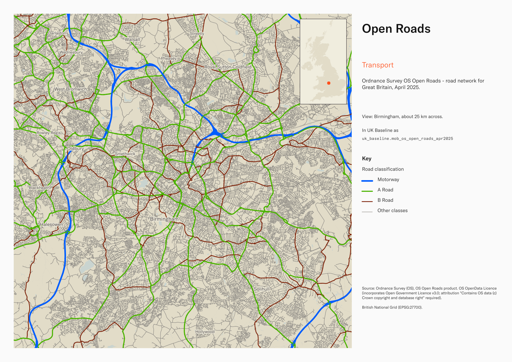
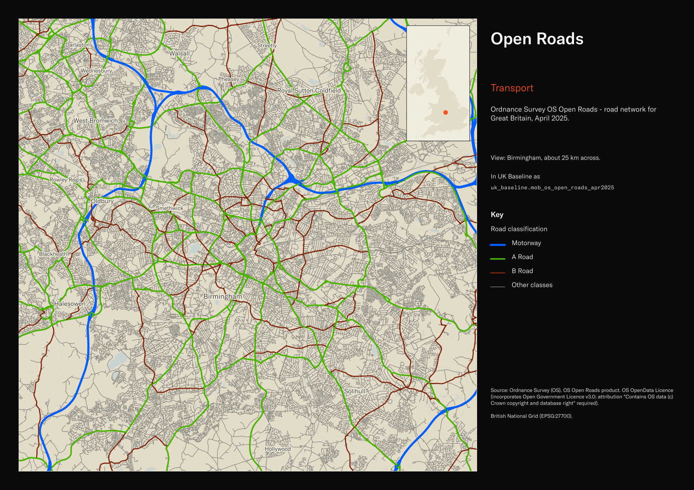

# Ordnance Survey OS Open Roads - road network for Great Britain, April 2025

Open Roads

`mob_os_open_roads_apr2025`<button class="md-clipboard md-icon" data-clipboard-text="mob_os_open_roads_apr2025" title="Copy table name" aria-label="Copy table name" data-search-exclude></button>
{: .layer-table }

**SOURCE**
{: .sec-label }

- Ordnance Survey (OS), OS Open Roads product.

**DOCUMENTATION**
{: .sec-label }

- OS Open Roads : https://www.ordnancesurvey.co.uk/products/os-open-roads

**DEFINITIONS**
{: .sec-label }

- "A structured link-and-node network, which represents the central alignment of all classified and unclassified roads in Great Britain." (Ordnance Survey, OS Open Roads)

**SCOPE**
{: .sec-label }

- Great Britain. 4,207,717 rows.

**CRS**
{: .sec-label }

- EPSG:27700 (OSGB 1936 / British National Grid). Geometry type LineString.

**LICENCE**
{: .sec-label }

- OS OpenData Licence (incorporates Open Government Licence v3.0; attribution "Contains OS data (c) Crown copyright and database right" required).

MSOA SPLIT (added 4 July 2026)

- Geometry split to one row per (source feature x MSOA 2021). Each row carries that MSOA's msoa21cd / msoa21nm / msoa21hclnm and best-fit lad22 / lad25. The source feature's original primary key is preserved as `source_fid`; `gid` is a fresh surrogate primary key. Geometry outside every MSOA (offshore or outside England & Wales) is retained as rows with NULL geography columns, so the layer holds the complete source geometry.

**DATA QUALITY CAVEATS**
{: .sec-label }

- The row count counts split pieces, not source features: this layer was split by Middle Layer Super Output Area, so it holds one row per feature per MSOA piece, plus whole and remainder rows to keep 100% of the source geometry. 4,407,998 rows represent 4,208,256 source features, measured 25 August 2026. `source_fid` identifies the originating feature.
- Geography keys are NULL on 492,244 of 4,407,998 rows, measured 25 August 2026: 1,069 fall inside an England or Wales district and could carry one, so their keys are a gap rather than an absence; 429 are residual fragments left by the MSOA split, each under 100 sqm or 10 m; 490,739 are in Scotland or Northern Ireland, outside the England and Wales lookup; 7 fall outside every district — offshore, inter-tidal, or beyond Great Britain.
- County and Spatial Development Strategy columns are England and Wales only; rows elsewhere carry no county or SDS. Wales and the Isles of Scilly carry a county but no SDS. Rows with no Local Authority District code are NULL in all four columns.

**ENRICHMENT**
{: .sec-label }

- `sds_name` / `sds_group` — Spatial Development Strategy area and devolution status, a Prior + Partners categorisation over Ministry of Housing, Communities and Local Government (MHCLG) English devolution policy, joined at load on the row's Local Authority District 2025 code via uk.ref_lad25_ctyua25_sds_lu_jul2026.

## Columns

| Column | Type | Description / unit |
|---|---|---|
| `source_fid` | `bigint` | Primary key of the source feature in the pre-split layer uk.mob_os_open_roads_apr2025__preswap_jul04 (non-unique here: a feature spanning N MSOAs has N rows). |
| `id` | `character varying` | Source field; OS feature identifier. |
| `fictitious` | `boolean` | Source field "fictitious"; flag for fictitious (connector) links. |
| `road_classification` | `character varying` | Source field "road_classification"; road classification. Observed values: "Unclassified", "Unknown", "Not Classified", "Classified Unnumbered", "A Road", "B Road", "Motorway". |
| `road_function` | `character varying` | Source field "road_function"; road function. Observed values: "Local Road", "Restricted Local Access Road", "Minor Road", "A Road", "B Road", "Secondary Access Road", "Local Access Road", "Motorway". |
| `form_of_way` | `character varying` | Source field "form_of_way"; physical form of the road (e.g. single carriageway, dual carriageway, roundabout, slip road). |
| `road_classification_number` | `character varying` | Source field "road_classification_number"; road number (e.g. "M1", "A40"). |
| `name_1` | `character varying` | Source field "name_1"; primary road name. |
| `name_1_lang` | `character varying` | Source field "name_1_lang"; language of name_1. |
| `name_2` | `character varying` | Source field "name_2"; alternative road name. |
| `name_2_lang` | `character varying` | Source field "name_2_lang"; language of name_2. |
| `road_structure` | `character varying` | Source field "road_structure"; structural form (e.g. bridge, tunnel) where applicable. |
| `length` | `double precision` | Source field "length"; road link length as published. |
| `length_uom` | `character varying` | Source field "length_uom"; unit of measure for length (e.g. "m"). |
| `loop` | `boolean` | Source field "loop"; flag for loop links. |
| `primary_route` | `boolean` | Source field "primary_route"; flag for primary routes. |
| `trunk_road` | `boolean` | Source field "trunk_road"; flag for trunk roads. |
| `start_node` | `character varying` | Source field "start_node"; network start node identifier. |
| `end_node` | `character varying` | Source field "end_node"; network end node identifier. |
| `road_number_toid` | `character varying` | Source field "road_number_toid"; OS TOID of the associated road number. |
| `road_name_toid` | `character varying` | Source field "road_name_toid"; OS TOID of the associated road name. |
| `fid_original` | `integer` | ArcGIS source identifier preserved at load. |
| `wd21nm` | `character varying` | Joined at load from ONS Ward 2021 lookup; 2021 Ward name. |
| `wd21cd` | `character varying` | Joined at load from ONS Ward 2021 lookup; 2021 Ward GSS code. |
| `length_m` | `double precision` | Length in metres. |
| `msoa21cd` | `character varying` | Middle Layer Super Output Area (MSOA) 2021 code of this piece. Open Government Licence v3.0. |
| `msoa21nm` | `character varying` | Official ONS MSOA 2021 name of this piece. Open Government Licence v3.0. |
| `msoa21hclnm` | `text` | House of Commons Library readable MSOA name of this piece. Open Parliament Licence. |
| `lad22cd` | `text` | Local Authority District 2022 code (2021 LAD geography, anchored to the MSOA 2021 name scoping), best-fit from this piece's msoa21cd. Open Government Licence v3.0. |
| `lad22nm` | `text` | Local Authority District 2022 name (2021 LAD geography), best-fit from this piece's msoa21cd. Open Government Licence v3.0. |
| `lad25cd` | `text` | Local Authority District 2025 code (current administering authority), best-fit from this piece's msoa21cd. Open Government Licence v3.0. |
| `lad25nm` | `text` | Local Authority District 2025 name (current administering authority), best-fit from this piece's msoa21cd. Open Government Licence v3.0. |
| `geom` | `geometry(MultiLineString,27700)` | LineString in EPSG:27700. Road centreline geometry. |
| `gid` | `bigint` |  |
| `ctyua25cd` | `text` | County or unitary authority code at 1 April 2025. Joined at load via uk.ref_lad25_ctyua25_sds_lu_jul2026 on the row's Local Authority District 2025 code. Open Government Licence v3.0. |
| `ctyua25nm` | `text` | County or unitary authority name at 1 April 2025. Joined at load via uk.ref_lad25_ctyua25_sds_lu_jul2026 on the row's Local Authority District 2025 code. Open Government Licence v3.0. |
| `sds_name` | `text` | Spatial Development Strategy (SDS) area, a Prior + Partners categorisation over Ministry of Housing, Communities and Local Government (MHCLG) English devolution policy. Joined at load via uk.ref_lad25_ctyua25_sds_lu_jul2026 on the row's Local Authority District 2025 code. Open Government Licence v3.0. |
| `sds_group` | `text` | Devolution status of the Spatial Development Strategy area: Existing Devolution Footprints, Devolution Priority Programme, Other Proposed Geographies or Remaining Areas. Joined at load via uk.ref_lad25_ctyua25_sds_lu_jul2026 on the row's Local Authority District 2025 code. Open Government Licence v3.0. |
