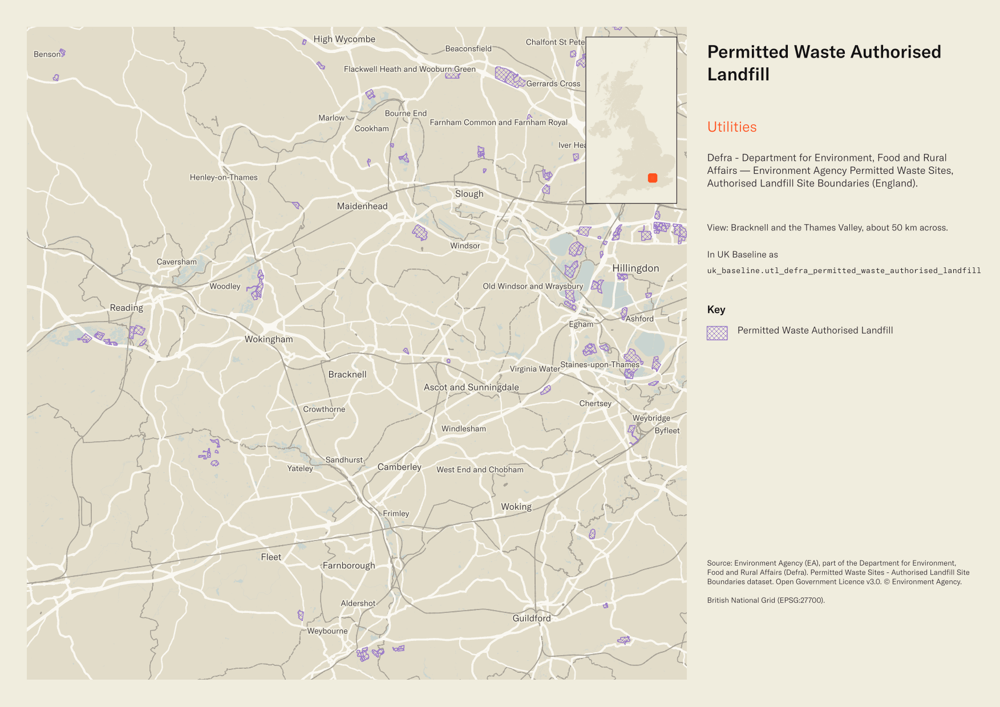

# Defra - Department for Environment, Food and Rural Affairs — Environment Agency Permitted Waste Sites, Authorised Landfill Site Boundaries (England)

Permitted Waste Authorised Landfill

`utl_defra_permitted_waste_authorised_landfill`<button class="md-clipboard md-icon" data-clipboard-text="utl_defra_permitted_waste_authorised_landfill" title="Copy table name" aria-label="Copy table name" data-search-exclude></button>
{: .layer-table }

**SOURCE**
{: .sec-label }

- Environment Agency (EA), part of the Department for Environment, Food and Rural Affairs (Defra). Permitted Waste Sites - Authorised Landfill Site Boundaries dataset.

**DOCUMENTATION**
{: .sec-label }

- EA dataset record : https://environment.data.gov.uk/dataset/692eaecf-d465-11e4-ac2e-f0def148f590

**DEFINITIONS**
{: .sec-label }

- "The Permitted Waste Sites - Authorised Landfill Site Boundaries is a polygon dataset that contains the boundaries of landfill sites that are currently authorised by the Environment Agency under Environmental Permitting Regulations." (Environment Agency)

**SCOPE**
{: .sec-label }

- England. 2,406 rows.

**CRS**
{: .sec-label }

- EPSG:27700 (OSGB 1936 / British National Grid). Geometry type Polygon.

**LICENCE**
{: .sec-label }

- Open Government Licence v3.0. © Environment Agency.

**DATA QUALITY CAVEATS**
{: .sec-label }

- The row count counts split pieces, not source features: this layer was split by Middle Layer Super Output Area, so it holds one row per feature per MSOA piece, plus whole and remainder rows to keep 100% of the source geometry. 2,847 rows represent 2,406 source features, measured 25 August 2026. `source_fid` identifies the originating feature.
- Geography keys are NULL on 14 of 2,847 rows, measured 25 August 2026: 7 fall inside an England or Wales district and could carry one, so their keys are a gap rather than an absence; 7 are residual fragments left by the MSOA split, each under 100 sqm or 10 m.
- County and Spatial Development Strategy columns are England and Wales only; rows elsewhere carry no county or SDS. Wales and the Isles of Scilly carry a county but no SDS. Rows with no Local Authority District code are NULL in all four columns.

**ENRICHMENT**
{: .sec-label }

- `sds_name` / `sds_group` — Spatial Development Strategy area and devolution status, a Prior + Partners categorisation over Ministry of Housing, Communities and Local Government (MHCLG) English devolution policy, joined at load on the row's Local Authority District 2025 code via uk.ref_lad25_ctyua25_sds_lu_jul2026.
- `msoa21hclnm` — House of Commons Library readable MSOA name, assigned at load via the polygon's 2021 MSOA (representative interior point in uk_baseline.adm_ons_msoa_boundary_2021). Open Parliament Licence.

MSOA SPLIT (added 30 June 2026)

- Geometry split to one row per (source feature x MSOA 2021). Each row carries that MSOA's msoa21cd / msoa21nm / msoa21hclnm and best-fit lad22 / lad25. The source feature's original primary key is preserved as `source_fid`; `gid` is a fresh surrogate primary key.
- Features lying within a single MSOA are kept whole (one row, primary-tagged); only features spanning more than one MSOA are split into per-MSOA pieces.
- Keep-everything (3 July 2026): geometry outside every MSOA — offshore, estuarine, or beyond the generalised coastline — is retained as rows with NULL geography columns (source_fid links the parts), so the layer holds the complete source geometry.

## Columns

| Column | Type | Description / unit |
|---|---|---|
| `lic_admin` | `character varying` | Source field "lic_admin"; Environment Agency licensing administration area. |
| `lic_nmbr` | `character varying` | Source field "lic_nmbr"; licence number. |
| `lic_ippcr` | `character varying` | Source field "lic_ippcr"; Integrated Pollution Prevention and Control (IPPC) reference. |
| `lic_wml` | `double precision` | Source field "lic_wml"; Waste Management Licence number. |
| `cust_nmbr` | `character varying` | Source field "cust_nmbr"; customer number. |
| `status` | `character varying` | Source field "status"; permit status. Observed values: "Closure", "Issued", "Effective", "Expired", "Part Suspended". |
| `lic_ltype` | `character varying` | Source field "lic_ltype"; licence type code (e.g. "A05", "L05", "5.2 A(1) a)"). |
| `lic_name` | `character varying` | Source field "lic_name"; licence holder name. |
| `lic_site` | `character varying` | Source field "lic_site"; licensed site reference (name truncated from the source shapefile). |
| `site_name` | `character varying` | Source field "site_name"; site name. |
| `site_build` | `character varying` | Source field "site_build"; site address — building. |
| `site_strt` | `character varying` | Source field "site_strt"; site address — street. |
| `site_area` | `character varying` | Source field "site_area"; site address — area / locality. |
| `site_town` | `character varying` | Source field "site_town"; site address — town. |
| `site_cnty` | `character varying` | Source field "site_cnty"; site address — county. |
| `site_pcode` | `character varying` | Source field "site_pcode"; site postcode. |
| `type_desc` | `character varying` | Source field "type_desc"; permit type description (e.g. "A04: Household, Commercial & Industrial Waste Landfill"). |
| `ngr` | `character varying` | Source field "ngr"; National Grid Reference. |
| `ctroid_x` | `integer` | Source field "ctroid_x"; centroid easting. Unit: metres (EPSG:27700). |
| `ctroid_y` | `integer` | Source field "ctroid_y"; centroid northing. Unit: metres (EPSG:27700). |
| `area` | `character varying` | Source field "area"; site area as published. |
| `date_issue` | `timestamp without time zone` | Source field "date_issue"; permit issue date. |
| `lic_epr` | `character varying` | Source field "lic_epr"; Environmental Permitting Regulations (EPR) permit reference. |
| `gdb_geomattr_data` | `character varying` | Source field "gdb_geomattr_data"; ArcGIS geodatabase legacy geometry-attribute storage. |
| `id_original` | `character varying` | Original feature id preserved at load. |
| `wd21nm` | `character varying` | Joined at load from ONS Ward 2021 lookup; 2021 Ward name. |
| `wd21cd` | `character varying` | Joined at load from ONS Ward 2021 lookup; 2021 Ward GSS code. |
| `area_ha` | `double precision` | Area in hectares of this row's own geometry, computed at load from the EPSG:27700 geometry. On layers split by Middle Layer Super Output Area this is the area of the piece inside its MSOA, not the area of the whole source feature. |
| `fid` | `bigint` |  |
| `msoa21cd` | `text` | Middle Layer Super Output Area (MSOA) 2021 code of this piece. Open Government Licence v3.0. |
| `msoa21nm` | `text` | Official ONS MSOA 2021 name of this piece. Open Government Licence v3.0. |
| `msoa21hclnm` | `text` | House of Commons Library readable MSOA name of this piece. Open Parliament Licence. |
| `lad22cd` | `character varying` | Local Authority District 2022 code (2021 LAD geography, anchored to the MSOA 2021 name scoping), best-fit from this piece's msoa21cd. Open Government Licence v3.0. |
| `lad22nm` | `character varying` | Local Authority District 2022 name (2021 LAD geography), best-fit from this piece's msoa21cd. Open Government Licence v3.0. |
| `lad25cd` | `text` | Local Authority District 2025 code (current administering authority), best-fit from this piece's msoa21cd. Open Government Licence v3.0. |
| `lad25nm` | `text` | Local Authority District 2025 name (current administering authority), best-fit from this piece's msoa21cd. Open Government Licence v3.0. |
| `geom` | `geometry(MultiPolygon,27700)` | Polygon in EPSG:27700. Authorised landfill site boundary. |
| `source_fid` | `bigint` | Primary key of the source feature in the pre-split layer uk.utl_defra_permitted_waste_authorised_landfill__preswap_jun30 (non-unique here: a feature spanning N MSOAs has N rows). |
| `gid` | `bigint` |  |
| `ctyua25cd` | `text` | County or unitary authority code at 1 April 2025. Joined at load via uk.ref_lad25_ctyua25_sds_lu_jul2026 on the row's Local Authority District 2025 code. Open Government Licence v3.0. |
| `ctyua25nm` | `text` | County or unitary authority name at 1 April 2025. Joined at load via uk.ref_lad25_ctyua25_sds_lu_jul2026 on the row's Local Authority District 2025 code. Open Government Licence v3.0. |
| `sds_name` | `text` | Spatial Development Strategy (SDS) area, a Prior + Partners categorisation over Ministry of Housing, Communities and Local Government (MHCLG) English devolution policy. Joined at load via uk.ref_lad25_ctyua25_sds_lu_jul2026 on the row's Local Authority District 2025 code. Open Government Licence v3.0. |
| `sds_group` | `text` | Devolution status of the Spatial Development Strategy area: Existing Devolution Footprints, Devolution Priority Programme, Other Proposed Geographies or Remaining Areas. Joined at load via uk.ref_lad25_ctyua25_sds_lu_jul2026 on the row's Local Authority District 2025 code. Open Government Licence v3.0. |
| `msoa_area_ha` | `double precision` | Area in hectares of the Middle Layer Super Output Area this row falls in, computed from uk_baseline.adm_ons_msoa_boundary_2021 — the same boundary the layer was split against. Provided as the denominator for MSOA coverage shares. NULL wherever msoa21cd is NULL. Open Government Licence v3.0. |
