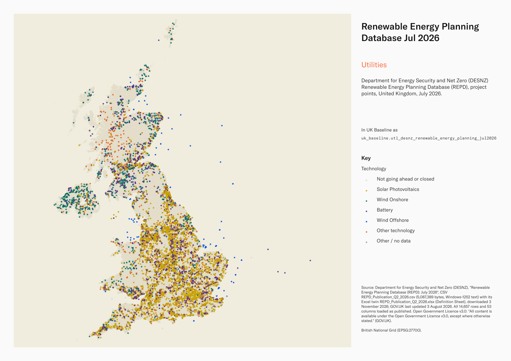
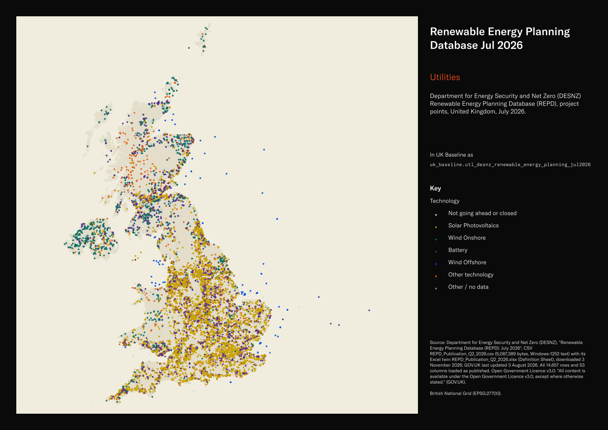

# Department for Energy Security and Net Zero (DESNZ) Renewable Energy Planning Database (REPD), project points, United Kingdom, July 2026

Renewable Energy Planning Database Jul 2026

`utl_desnz_renewable_energy_planning_jul2026`<button class="md-clipboard md-icon" data-clipboard-text="utl_desnz_renewable_energy_planning_jul2026" title="Copy table name" aria-label="Copy table name" data-search-exclude></button>
{: .layer-table }

**SOURCE**
{: .sec-label }

- Department for Energy Security and Net Zero (DESNZ), "Renewable Energy Planning Database (REPD): July 2026", CSV REPD_Publication_Q2_2026.csv (5,087,389 bytes, Windows-1252 text) with its Excel twin REPD_Publication_Q2_2026.xlsx (Definition Sheet), downloaded 3 November 2026; GOV.UK last updated 3 August 2026. All 14,657 rows and 53 columns loaded as published.
- Downloaded from https://www.gov.uk/government/publications/renewable-energy-planning-database-quarterly-extract

**DOCUMENTATION**
{: .sec-label }

- Publication page : https://www.gov.uk/government/publications/renewable-energy-planning-database-quarterly-extract
- Collection : https://www.gov.uk/government/collections/renewable-energy-planning-data
- Definition Sheet : sheet "Definition Sheet" of REPD_Publication_Q2_2026.xlsx on the publication page

**DEFINITIONS**
{: .sec-label }

- "The Renewable Energy Planning Database ('REPD') is managed by Barbour ABI on behalf of the Department of Business, Energy & Industrial Strategy ('BEIS'). The databases track the progress of renewable electricity projects (including those that could also be used for CHP), and electricity storage projects from inception, through planning, construction, operation and decommissioning." (REPD Definition Sheet, July 2026)
- "The REPD is updated on a quarterly basis, and contains information on all Renewable Electricity and CHP projects up to the end of the previous calendar month." (REPD Definition Sheet, July 2026)
- Development Status (short): "This is a description of the current status of the development in a more succinct form. For example, where a facility has obtained planning permission either directly from the Local Planning Authority, through an appeal, or from the Secretary of State, it is classified here as 'Awaiting Construction'. Where a development has been refused planning permission, either directly from the LPA, following an appeal, or from the Secretary of State, it is classified here as 'Application Refused'." (REPD Definition Sheet, July 2026)

**SCOPE**
{: .sec-label }

- United Kingdom, project records by Country: England 10,564, Scotland 2,715, Wales 844, Northern Ireland 533, Country blank 1 (Country as published; two values carry a trailing space). 14,657 project records; the publication page covers "UK renewable electricity projects over 150kW" and notes: "the minimum threshold for installed capacity was 1MW until 2021, at which point it was lowered to 150kW." Projects below 1 MW that passed through planning before 2021 may be absent.
- 14,621 records have a point; 36 records have no coordinates and no point. 14,484 points fall inside a Local Authority District (May 2025); the other 137 are mainly offshore wind (89), tidal stream (23), battery (11) and shoreline wave (7) projects.

**CRS**
{: .sec-label }

- EPSG:27700 (British National Grid): "X & Y coordinates for development site in British National Grid" (REPD Definition Sheet, July 2026), Northern Ireland included. Points built from X-coordinate and Y-coordinate; no reprojection.

**LICENCE**
{: .sec-label }

- Open Government Licence v3.0: "All content is available under the Open Government Licence v3.0, except where otherwise stated." (GOV.UK)

**DATA QUALITY CAVEATS**
{: .sec-label }

- County and Spatial Development Strategy columns are England and Wales only; rows elsewhere carry no county or SDS. Wales and the Isles of Scilly carry a county but no SDS. Rows with no Local Authority District code are NULL in all four columns.
- Dates are text in DD/MM/YYYY form, as published.
- Some column names in the Definition Sheet differ from the CSV headers (for example District for County, Local Planning Authority for Planning Authority); each column note quotes the CSV header.
- Ref ID 21008 is labelled Northern Ireland but has the postcode LL13 7UG and a point in the Wrexham area; loaded as published.
- 836 records have both source coordinates as whole hundreds of metres. This suggests coordinate rounding but does not establish positional accuracy.
- A new edition is published "during the month following the end of each quarter" (GOV.UK).

**ENRICHMENT**
{: .sec-label }

- `sds_name` / `sds_group` — Spatial Development Strategy area and devolution status, a Prior + Partners categorisation over Ministry of Housing, Communities and Local Government (MHCLG) English devolution policy, joined at load on the row's Local Authority District 2025 code via uk.ref_lad25_ctyua25_sds_lu_jul2026.
- `msoa21hclnm` — House of Commons Library readable MSOA name, assigned at load from the feature's representative point in its 2021 MSOA (uk_baseline.adm_ons_msoa_boundary_2021). Open Parliament Licence.

**LOADED INTO uk_baseline**
{: .sec-label }

- Loaded by PNC, 4 November 2026.

## Columns

| Column | Type | Description / unit |
|---|---|---|
| `gid` | `bigint` |  |
| `old_ref_id` | `text` | Source field `Old Ref ID`; "The old reference ID associated with a project in a previous version of the database" (REPD Definition Sheet, July 2026). |
| `ref_id` | `integer` | Source field `Ref ID`; "Project reference ID number in REPD database" (REPD Definition Sheet, July 2026). |
| `record_last_updated` | `text` | Source field `Record Last Updated (dd/mm/yyyy)`; "Date a project record was last updated or checked" (REPD Definition Sheet, July 2026). Date as text, DD/MM/YYYY, as published. |
| `operator_or_applicant` | `text` | Source field `Operator (or Applicant)`; "Name of operator or applicant" (REPD Definition Sheet, July 2026). |
| `site_name` | `text` | Source field `Site Name`; "Name of development site" (REPD Definition Sheet, July 2026). |
| `technology_type` | `text` | Source field `Technology Type`; "Type of technology (e.g. solar photovoltaics, offshore wind etc.)" (REPD Definition Sheet, July 2026). |
| `storage_type` | `text` | Source field `Storage Type`; [UNDOCUMENTED] in the Definition Sheet; interpretation from the header. |
| `storage_colocation_repd_ref_id` | `text` | Source field `Storage Co-location REPD Ref ID`; [UNDOCUMENTED] in the Definition Sheet; interpretation from the header. |
| `installed_capacity_mwelec` | `double precision` | Source field `Installed Capacity (MWelec)`; "Installed electrical capacity in megawatts (MW)" (REPD Definition Sheet, July 2026). Unit: "MWelec" (header). |
| `share_community_scheme` | `text` | Source field `Share Community Scheme`; [UNDOCUMENTED] in the Definition Sheet; interpretation from the header. |
| `chp_enabled` | `text` | Source field `CHP Enabled`; "Is the project capable of combined heat and power output" (REPD Definition Sheet, July 2026). |
| `cfd_allocation_round` | `text` | Source field `CfD Allocation Round`; "The round of CFD funding the agreement was made" (REPD Definition Sheet, July 2026). |
| `ro_banding_roc_mwh` | `double precision` | Source field `RO Banding (ROC/MWh)`; [UNDOCUMENTED] in the Definition Sheet; interpretation from the header. Unit: "ROC/MWh" (header). |
| `fit_tariff_p_kwh` | `double precision` | Source field `FiT Tariff (p/kWh)`; [UNDOCUMENTED] in the Definition Sheet; interpretation from the header. Unit: "p/kWh" (header). |
| `cfd_capacity_mw` | `double precision` | Source field `CfD Capacity (MW)`; "The agreed Contracts for Difference investment capacity" (REPD Definition Sheet, July 2026). Unit: "MW" (header). |
| `turbine_capacity_mw` | `double precision` | Source field `Turbine Capacity (MW)`; "For windfarms, the individual capacity of each wind turbine in megawatts (MW)" (REPD Definition Sheet, July 2026, heading "Wind Turbine Capacity (MW)"). Unit: "MW" (header). |
| `no_of_turbines` | `integer` | Source field `No. of Turbines`; "For windfarms, the number of wind turbines to be located on the development site" (REPD Definition Sheet, July 2026, heading "No. of Wind Turbines"). |
| `height_of_turbines_m` | `double precision` | Source field `Height of Turbines (m)`; "For windfarms, the height of the wind turbines in metres (m)" (REPD Definition Sheet, July 2026). Unit: "m" (header). |
| `mounting_type_for_solar` | `text` | Source field `Mounting Type for Solar`; [UNDOCUMENTED] in the Definition Sheet; interpretation from the header. |
| `development_status` | `text` | Source field `Development Status`; the current planning or development stage; values are defined in the Definition Sheet, for example "Planning Application Submitted - Planning application validated by planning authority" (REPD Definition Sheet, July 2026). |
| `development_status_short` | `text` | Source field `Development Status (short)`; "This is a description of the current status of the development in a more succinct form." (REPD Definition Sheet, July 2026). |
| `reapplying_new_repd_ref` | `text` | Source field `Are they re-applying (New REPD Ref)`; "Reference ID for the revised planning application for the same project" (REPD Definition Sheet, July 2026). |
| `reapplying_old_repd_ref` | `text` | Source field `Are they re-applying (Old REPD Ref) ` (header includes a trailing space); "Reference ID for the previous planning application before project was revised." (REPD Definition Sheet, July 2026). |
| `address` | `text` | Source field `Address`; "Site address of the development" (REPD Definition Sheet, July 2026). |
| `county` | `text` | Source field `County`; "District the development site is located within" (REPD Definition Sheet, July 2026, heading "District"). |
| `region` | `text` | Source field `Region`; "Region the development site is located within" (REPD Definition Sheet, July 2026). |
| `country` | `text` | Source field `Country`; "Country the development site is located within" (REPD Definition Sheet, July 2026). |
| `post_code` | `text` | Source field `Post Code`; "Post code of the development site" (REPD Definition Sheet, July 2026). |
| `x_coordinate` | `double precision` | Source field `X-coordinate`; "X & Y coordinates for development site in British National Grid" (REPD Definition Sheet, July 2026). Unit: metres. The point geometry is built from X-coordinate and Y-coordinate. |
| `y_coordinate` | `double precision` | Source field `Y-coordinate`; "X & Y coordinates for development site in British National Grid" (REPD Definition Sheet, July 2026). Unit: metres. The point geometry is built from X-coordinate and Y-coordinate. |
| `planning_authority` | `text` | Source field `Planning Authority`; "The relevant local planning authority for the project" (REPD Definition Sheet, July 2026, heading "Local Planning Authority"). |
| `planning_application_reference` | `text` | Source field `Planning Application Reference`; "The reference number associated with the planning application" (REPD Definition Sheet, July 2026). |
| `appeal_reference` | `text` | Source field `Appeal Reference`; "The reference number associated with an appeal" (REPD Definition Sheet, July 2026). |
| `secretary_of_state_reference` | `text` | Source field `Secretary of State Reference`; "The reference number associated with a Secretary of State Intervention" (REPD Definition Sheet, July 2026). |
| `type_of_sos_intervention` | `text` | Source field `Type of Secretary of State Intervention`; "The type of Secretary of State of Intervention. This can be one of three types: recovery, call-in, or holding direction" (REPD Definition Sheet, July 2026). |
| `judicial_review` | `text` | Source field `Judicial Review`; "The latest date of when a legal challenge has been launched to review the lawfulness of a planning application and/or appeal decision" (REPD Definition Sheet, July 2026). Date as text, DD/MM/YYYY, as published. |
| `offshore_wind_round` | `text` | Source field `Offshore Wind Round`; "Leasing round in which an offshore wind project was established" (REPD Definition Sheet, July 2026). |
| `planning_application_submitted` | `text` | Source field `Planning Application Submitted`; "Date planning application was validated" (REPD Definition Sheet, July 2026). Date as text, DD/MM/YYYY, as published. |
| `planning_application_withdrawn` | `text` | Source field `Planning Application Withdrawn`; "Date planning application was withdrawn" (REPD Definition Sheet, July 2026). Date as text, DD/MM/YYYY, as published. |
| `planning_permission_refused` | `text` | Source field `Planning Permission Refused`; "Date planning permission was refused" (REPD Definition Sheet, July 2026). Date as text, DD/MM/YYYY, as published. |
| `appeal_lodged` | `text` | Source field `Appeal Lodged`; "Date an appeal was lodged" (REPD Definition Sheet, July 2026). Date as text, DD/MM/YYYY, as published. |
| `appeal_withdrawn` | `text` | Source field `Appeal Withdrawn`; "Date an appeal was withdrawn" (REPD Definition Sheet, July 2026). Date as text, DD/MM/YYYY, as published. |
| `appeal_refused` | `text` | Source field `Appeal Refused`; "Date an appeal was refused (dismissed)" (REPD Definition Sheet, July 2026). Date as text, DD/MM/YYYY, as published. |
| `appeal_granted` | `text` | Source field `Appeal Granted`; "Date an appeal was granted (upheld)" (REPD Definition Sheet, July 2026). Date as text, DD/MM/YYYY, as published. |
| `planning_permission_granted` | `text` | Source field `Planning Permission  Granted`; "Date planning permission was granted by the planning authority" (REPD Definition Sheet, July 2026). Date as text, DD/MM/YYYY, as published. |
| `sos_intervened` | `text` | Source field `Secretary of State - Intervened`; "Date of a project that is 'Called In' by the Secretary of State" (REPD Definition Sheet, July 2026). Date as text, DD/MM/YYYY, as published. |
| `sos_refusal` | `text` | Source field `Secretary of State - Refusal`; "Date planning permission was refused by the Secretary of State" (REPD Definition Sheet, July 2026). Date as text, DD/MM/YYYY, as published. |
| `sos_granted` | `text` | Source field `Secretary of State - Granted`; "Date planning permission was granted by the Secretary of State" (REPD Definition Sheet, July 2026). Date as text, DD/MM/YYYY, as published. |
| `planning_permission_expired` | `text` | Source field `Planning Permission Expired`; "Date a planning permission expires (as per the planning decision)" (REPD Definition Sheet, July 2026, heading "Permission Expiration Date"). Date as text, DD/MM/YYYY, as published. |
| `under_construction` | `text` | Source field `Under Construction`; "Date construction on site has begun" (REPD Definition Sheet, July 2026). Date as text, DD/MM/YYYY, as published. |
| `operational` | `text` | Source field `Operational`; "Date a project become operational" (REPD Definition Sheet, July 2026). Date as text, DD/MM/YYYY, as published. |
| `heat_network_ref` | `text` | Source field `Heat Network Ref`; "Reference ID for same project in HNPD" (REPD Definition Sheet, July 2026). |
| `solar_site_area_sqm` | `double precision` | Source field `Solar Site Area (sqm)`; [UNDOCUMENTED] in the Definition Sheet; interpretation from the header. Unit: "sqm" (header). |
| `geom` | `geometry(Point,27700)` | Point geometry built from source fields `X-coordinate` and `Y-coordinate`; EPSG:27700, coordinate units metres; no reprojection. No point for the 36 records without coordinates. |
| `msoa21cd` | `text` | Middle Layer Super Output Area (MSOA) 2021 code. Assigned at load from the feature's representative point located in uk_baseline.adm_ons_msoa_boundary_2021. Open Government Licence v3.0. |
| `msoa21nm` | `text` | Official Office for National Statistics MSOA 2021 name. Assigned at load from the feature's representative point located in uk_baseline.adm_ons_msoa_boundary_2021. Open Government Licence v3.0. |
| `msoa21hclnm` | `text` | House of Commons Library readable MSOA name. Assigned at load from the feature's representative point located in its 2021 MSOA (uk_baseline.adm_ons_msoa_boundary_2021, which carries the House of Commons Library name). Open Parliament Licence. |
| `lad22cd` | `text` | Local Authority District 2022 code (2021 LAD geography). Assigned at load from the feature's representative point located in uk_baseline.adm_ons_lad_boundary_may2022. Open Government Licence v3.0. |
| `lad22nm` | `text` | Local Authority District 2022 name (2021 LAD geography). Assigned at load from the feature's representative point located in uk_baseline.adm_ons_lad_boundary_may2022. Open Government Licence v3.0. |
| `lad25cd` | `text` | Local Authority District 2025 code (current administering authority). Assigned at load from the feature's representative point located in uk_baseline.adm_ons_lad_boundary_may2025. Open Government Licence v3.0. |
| `lad25nm` | `text` | Local Authority District 2025 name (current administering authority). Assigned at load from the feature's representative point located in uk_baseline.adm_ons_lad_boundary_may2025. Open Government Licence v3.0. |
| `ctyua25cd` | `text` | County or unitary authority code at 1 April 2025. Joined at load via uk.ref_lad25_ctyua25_sds_lu_jul2026 on the row's Local Authority District 2025 code. Open Government Licence v3.0. |
| `ctyua25nm` | `text` | County or unitary authority name at 1 April 2025. Joined at load via uk.ref_lad25_ctyua25_sds_lu_jul2026 on the row's Local Authority District 2025 code. Open Government Licence v3.0. |
| `sds_name` | `text` | Spatial Development Strategy (SDS) area, a Prior + Partners categorisation over Ministry of Housing, Communities and Local Government (MHCLG) English devolution policy. Joined at load via uk.ref_lad25_ctyua25_sds_lu_jul2026 on the row's Local Authority District 2025 code. Open Government Licence v3.0. |
| `sds_group` | `text` | Devolution status of the Spatial Development Strategy area: Existing Devolution Footprints, Devolution Priority Programme, Other Proposed Geographies or Remaining Areas. Joined at load via uk.ref_lad25_ctyua25_sds_lu_jul2026 on the row's Local Authority District 2025 code. Open Government Licence v3.0. |
