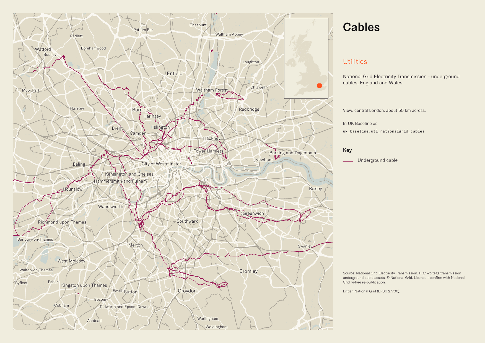
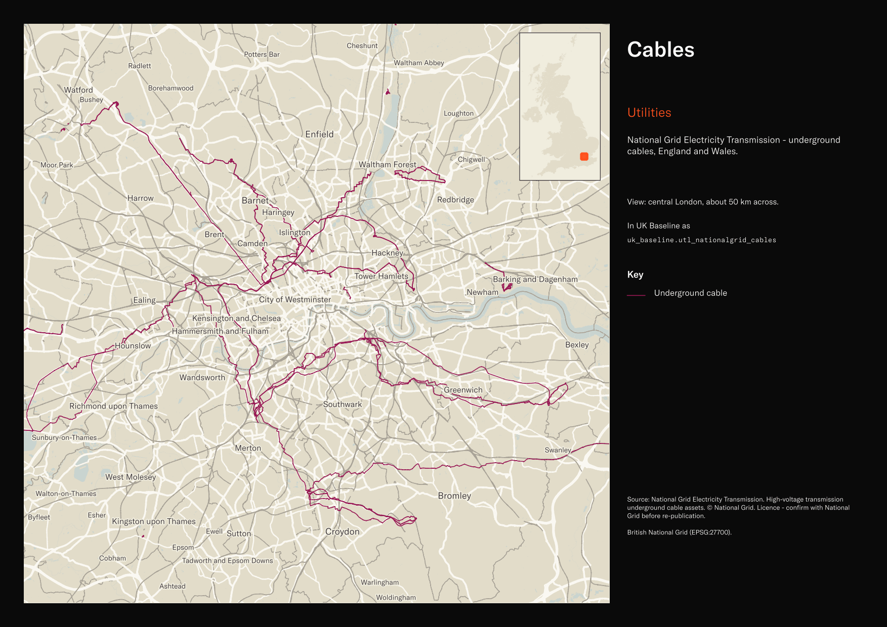

# National Grid Electricity Transmission underground cables, England and Wales

National Grid Underground Cables

`utl_nationalgrid_cables`<button class="md-clipboard md-icon" data-clipboard-text="utl_nationalgrid_cables" title="Copy table name" aria-label="Copy table name" data-search-exclude></button>
{: .layer-table }

**SOURCE**
{: .sec-label }

- National Grid Electricity Transmission. High-voltage transmission underground cable assets.

**DOCUMENTATION**
{: .sec-label }

- Transmission network downloads : https://www.nationalgrid.com/electricity-transmission/network-and-infrastructure/network-route-maps

**DEFINITIONS**
{: .sec-label }

- Underground cable assets in National Grid Electricity Transmission's high-voltage electricity network in England and Wales. (National Grid)

**SCOPE**
{: .sec-label }

- England and Wales. 4,580 rows.

**CRS**
{: .sec-label }

- EPSG:27700 (OSGB 1936 / British National Grid). Geometry type MultiLineString.

**LICENCE**
{: .sec-label }

- Emergency and land use planning only; commercial use prohibited. Attribution: © National Grid UK.

MSOA SPLIT (added 4 July 2026)

- Geometry split to one row per (source feature x MSOA 2021). Each row carries that MSOA's msoa21cd / msoa21nm / msoa21hclnm and best-fit lad22 / lad25. The source feature's original primary key is preserved as `source_fid`; `gid` is a fresh surrogate primary key. Geometry outside every MSOA (offshore or outside England & Wales) is retained as rows with NULL geography columns, so the layer holds the complete source geometry.

**DATA QUALITY CAVEATS**
{: .sec-label }

- Locations are indicative only.
- The row count counts split pieces, not source features: this layer was split by Middle Layer Super Output Area, so it holds one row per feature per MSOA piece, plus whole and remainder rows to keep 100% of the source geometry. 5,825 rows represent 4,580 source features, measured 25 August 2026. `source_fid` identifies the originating feature.
- Geography keys are NULL on 125 of 5,825 rows, measured 25 August 2026: 119 fall inside an England or Wales district and could carry one, so their keys are a gap rather than an absence; 2 are residual fragments left by the MSOA split, each under 100 sqm or 10 m; 4 fall outside every district — offshore, inter-tidal, or beyond Great Britain.
- County and Spatial Development Strategy columns are England and Wales only; rows elsewhere carry no county or SDS. Wales and the Isles of Scilly carry a county but no SDS. Rows with no Local Authority District code are NULL in all four columns.

**ENRICHMENT**
{: .sec-label }

- `sds_name` / `sds_group` — Spatial Development Strategy area and devolution status, a Prior + Partners categorisation over Ministry of Housing, Communities and Local Government (MHCLG) English devolution policy, joined at load on the row's Local Authority District 2025 code via uk.ref_lad25_ctyua25_sds_lu_jul2026.

## Columns

| Column | Type | Description / unit |
|---|---|---|
| `source_fid` | `bigint` | Primary key of the source feature in the pre-split layer uk.utl_nationalgrid_cables__preswap_jul04 (non-unique here: a feature spanning N MSOAs has N rows). |
| `gdo_gid` | `numeric` | Source field `gdo_gid`; source feature identifier. |
| `operating_` | `bigint` | Source field `operating_`; operating voltage (source field name truncated). |
| `action_dtt` | `date` | Source field `action_dtt`; action date (source field name truncated). |
| `status` | `character varying(1)` | Source field `status`; source status code. Observed values: "C", "E", "P". |
| `cable_type` | `character varying(14)` | Source field `cable_type`; cable type. Observed values: "A/C" (alternating current), "D/C" (direct current), "DECOMMISSIONED", "CBL_UNKNOWN". |
| `comments` | `character varying(254)` | Source field `comments`; free-text comments. |
| `tunnel` | `character varying(1)` | Source field `tunnel`; tunnel indicator. |
| `owned` | `character varying(1)` | Source field `owned`; ownership flag. |
| `cable_set` | `character varying(200)` | Source field `cable_set`; cable set identifier. |
| `cable_rout` | `character varying(200)` | Source field `cable_rout`; cable route (source field name truncated). |
| `cable_make` | `character varying(40)` | Source field `cable_make`; cable make (source field name truncated). |
| `year_of_in` | `integer` | Source field `year_of_in`; installation year (source field name truncated). |
| `id_original` | `integer` | Original feature id preserved at load. |
| `wd21nm` | `character varying` | Joined at load from ONS Ward 2021 lookup; 2021 Ward name. |
| `wd21cd` | `character varying` | Joined at load from ONS Ward 2021 lookup; 2021 Ward GSS code. |
| `length_m` | `double precision` | Length in metres. |
| `msoa21cd` | `character varying` | Middle Layer Super Output Area (MSOA) 2021 code of this piece. Open Government Licence v3.0. |
| `msoa21nm` | `character varying` | Official ONS MSOA 2021 name of this piece. Open Government Licence v3.0. |
| `msoa21hclnm` | `text` | House of Commons Library readable MSOA name of this piece. Open Parliament Licence. |
| `lad22cd` | `text` | Local Authority District 2022 code (2021 LAD geography, anchored to the MSOA 2021 name scoping), best-fit from this piece's msoa21cd. Open Government Licence v3.0. |
| `lad22nm` | `text` | Local Authority District 2022 name (2021 LAD geography), best-fit from this piece's msoa21cd. Open Government Licence v3.0. |
| `lad25cd` | `text` | Local Authority District 2025 code (current administering authority), best-fit from this piece's msoa21cd. Open Government Licence v3.0. |
| `lad25nm` | `text` | Local Authority District 2025 name (current administering authority), best-fit from this piece's msoa21cd. Open Government Licence v3.0. |
| `geom` | `geometry(MultiLineString,27700)` | MultiLineString in EPSG:27700. Underground cable route. |
| `gid` | `bigint` |  |
| `ctyua25cd` | `text` | County or unitary authority code at 1 April 2025. Joined at load via uk.ref_lad25_ctyua25_sds_lu_jul2026 on the row's Local Authority District 2025 code. Open Government Licence v3.0. |
| `ctyua25nm` | `text` | County or unitary authority name at 1 April 2025. Joined at load via uk.ref_lad25_ctyua25_sds_lu_jul2026 on the row's Local Authority District 2025 code. Open Government Licence v3.0. |
| `sds_name` | `text` | Spatial Development Strategy (SDS) area, a Prior + Partners categorisation over Ministry of Housing, Communities and Local Government (MHCLG) English devolution policy. Joined at load via uk.ref_lad25_ctyua25_sds_lu_jul2026 on the row's Local Authority District 2025 code. Open Government Licence v3.0. |
| `sds_group` | `text` | Devolution status of the Spatial Development Strategy area: Existing Devolution Footprints, Devolution Priority Programme, Other Proposed Geographies or Remaining Areas. Joined at load via uk.ref_lad25_ctyua25_sds_lu_jul2026 on the row's Local Authority District 2025 code. Open Government Licence v3.0. |
